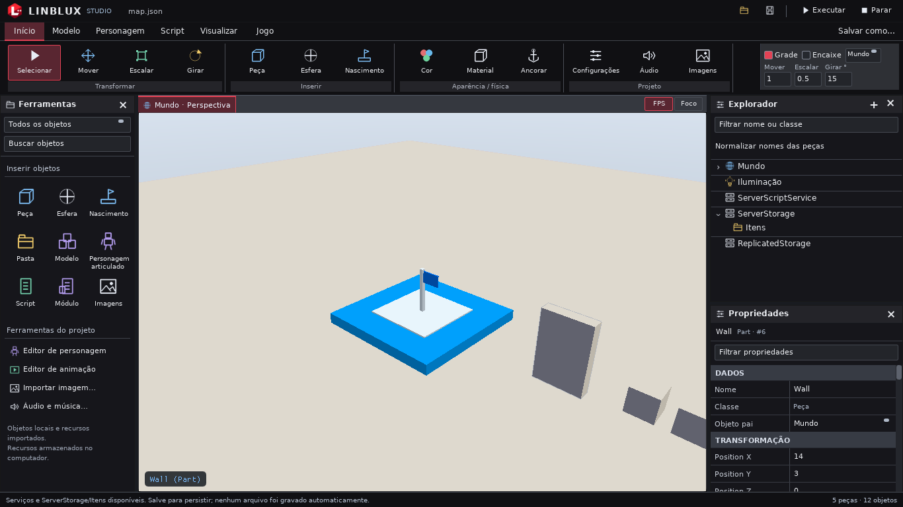
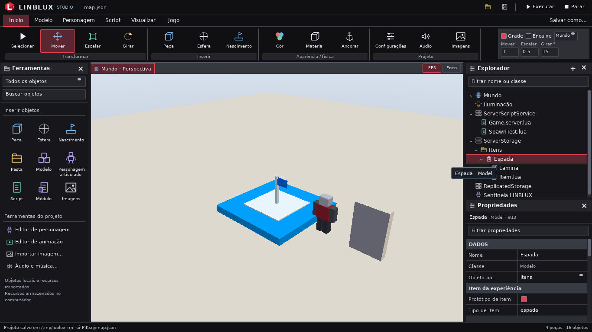
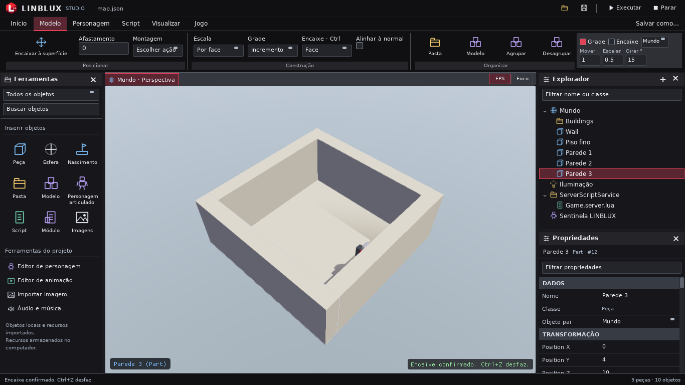

<p align="center"></p>
<h1 align="center">LINBLUX Studio</h1>
<p align="center">Engine experimental de criação 3D para Linux: um Studio para editar
mundos e um Player para executá-los, com física, Lua e interface local.</p>
<p align="center"><strong>Alpha 0.1.0 — projeto experimental de código aberto.</strong>
Manual técnico completo: <a href="LINBLUX.md">LINBLUX.md</a></p>
<p align="center"><a href="#experimentar-no-linux">Compilar e executar</a> ·
<a href="#demonstração">Demonstração</a> · <a href="#estado-da-alpha">Estado da Alpha</a> ·
<a href="#licença-e-créditos">Licença</a></p>

## Assista à demonstração

A demonstração está publicada no YouTube:
**[Assistir à demonstração LINBLUX](https://www.youtube.com/watch?v=jVck4UuYlWQ)**,
no canal [Abismroot](https://www.youtube.com/@Abismroot). Vídeos grandes são
publicados em serviços externos, sem aumentar o tamanho do clone.

A galeria abaixo é gerada a partir dos arquivos de `docs/prints/` e
`docs/videos/`: execute `python3 tools/update_readme_media.py`. O script lê
apenas metadados (tamanho/nome), não transcodifica e não adiciona arquivos ao
Git.

<!-- LINBLUX:MEDIA:START -->

### Capturas

<a href="docs/prints/explorador-servicos-automaticos.png"></a>
<p>Serviços de armazenamento organizados</p>

<a href="docs/prints/explorador-servicos.png"></a>
<p>Explorador e serviços</p>

<a href="docs/prints/studio-construcao.png"></a>
<p>LINBLUX Studio — Construção 3D</p>

### Vídeos

Nenhum vídeo público adicionado. As demonstrações disponíveis são as capturas acima.

<!-- LINBLUX:MEDIA:END -->

## O que é o LINBLUX?

LINBLUX reúne um Studio para editar mundos e um Player para executá-los. Você
monta cenas com Parts e Models, organiza objetos pela hierarquia, ajusta
propriedades e programa comportamentos em Lua 5.4. Física com Bullet, imagens,
sons e personagens fazem parte dessa base local. Studio e Player são
executáveis independentes.

É uma engine experimental em desenvolvimento. A Alpha serve para conhecer a
implementação, criar experiências pequenas e ajudar a encontrar problemas.
Ainda há limitações de edição, compatibilidade e distribuição; use cópias dos
seus projetos ao experimentar.

## O que já existe

| Área | Disponível na base Alpha |
| --- | --- |
| Studio | Cena 3D, Explorador com busca, propriedades, seleção, gizmo e scripts |
| Construção | Move e Scale pela face, rotação, incrementos de Snap e encaixe por superfície |
| Objetos | Parts, Models, hierarquia, Attachments e serviços locais de armazenamento |
| Execução | Player separado e Play/Stop sobre uma cópia da cena autoral |
| Lua 5.4 | Objetos, eventos, física, NPCs, inventário, áudio e UI no escopo da API atual |
| Recursos | PNG/JPEG, Decals, texturas com repetição, sons locais e música |
| Experiências | Salvar/reabrir, biblioteca local e importação/exportação `.lo` |
| Protótipos | Modelos em ServerStorage/Itens, fora da renderização e física; spawn pelo inventário |
| Personagens | Rig de seis corpos, animações compatíveis e NPCs |

Snap e precisão por incremento continuam disponíveis; a superfície quadriculada
de construção (grade visual) e o HUD de vida em barra estão em desenvolvimento
e podem mudar antes do próximo commit (ver §21 do manual).

## Experimentar no Linux

<a id="experimentar-no-linux"></a>

**O pacote binário público ainda está bloqueado.** A revisão de redistribuição
precisa ser concluída (a build atual declara `GPL version 2 or later` ao
ligar o FFmpeg e faltam avisos de componentes embutidos). Não há download
aprovado, tag ou Release de binário anunciada neste README; veja o §21 do
manual. O código-fonte pode ser compilado no Linux.

### Compilar

O build oficial de desenvolvimento é `build-linblux/`. Requisitos:
Linux x86_64, C++17, raylib 6.2, Bullet 3.24, Lua 5.4 e CMake; a primeira
configuração do RmlUi exige rede ou um checkout/cache da dependência. Isso não
comprova suporte a todas as distribuições (detalhes no §4 do manual).

```sh
git clone https://github.com/danielvtroot/LINBLUX.git
cd LINBLUX
cmake -S . -B build-linblux -DCMAKE_BUILD_TYPE=Release
cmake --build build-linblux -j2
./build-linblux/linblux
```

Depois de compilar, abra o Studio, crie uma experiência e use **F5** para
executar; **Shift+F5** encerra e volta ao Studio. No editor, botão direito +
WASD move a câmera, Q/E desce/sobe e F enquadra a seleção. No Player, WASD
move, espaço pula e **Esc** abre o menu sem interromper a simulação.

## Demonstração

[RifleDemo](LINBLUX.md#53-exemplo-rifledemo) é um exemplo local completo de
Lua, itens, NPCs e interação no Player:

No Studio, abra o mesmo `world.loblox.json` e clique Executar (F5). Teclas da
demo: **E** (coletar, 0,6 s), **1** (equipar), **clique** (disparar),
**R** (recarregar), **Delete** (soltar) e **Esc** (menu protegido). A API Lua
usada está descrita em §10–§12 do manual.

## Arquitetura

C++17 e CMake compõem a base. raylib/OpenGL desenha as cenas, Bullet simula a
física 3D e Lua 5.4 executa scripts. O Studio combina RmlUi nos painéis
principais e ImGui em editores especializados; o Player não depende das
interfaces do Studio. `Scene` mantém objetos e IDs persistentes, `ProjectIO`
salva cenas de forma transacional e `RuntimeSession` executa uma cópia da
cena, separada da autoria. Detalhes e invariantes em §2 do manual.

## ATLAS e TURBO

Ferramentas locais de manutenção, sem serviço externo:

- **ATLAS** indexa a estrutura do repositório, localiza arquivos, símbolos e
  possíveis causas de defeitos, sugere hipóteses com evidências e ajuda a
  analisar impacto. Suas relações são textuais: auxiliam a investigação, sem
  provar a causa de um bug nem corrigi-lo automaticamente.
- **TURBO** identifica as verificações relevantes para uma alteração e as
  executa com timeout individual, orçamento global, encerramento de processos
  e logs. Aprovação parcial nunca equivale a validação completa.
- O modo **HDD-Safe** reduz gravações e reindexações em discos mecânicos; o
  modo HDD-Critical permite apenas consultas.

```sh
ATLAS_IO_MODE=hdd-safe python3 tools/atlas/atlas.py diagnose "problema" --brief
python3 tools/atlas/atlas.py tests-for src/editor/EditorUI.cpp
python3 tools/turbo/turbo.py test --mode fast --changed --plan
```

Manual: §16 (ATLAS) e §17 (TURBO e testes) do [LINBLUX.md](LINBLUX.md).

## Estado da Alpha

| Estado | Escopo |
| --- | --- |
| Implementado | Edição local, Player, persistência, física, Lua, objetos e recursos descritos acima |
| Experimental | Construção por superfície, personagens/NPCs, materiais, UI Lua e integração entre ferramentas |
| Limitado | Rig de seis corpos, encaixe em caixas, áudio sem mixagem/atenuação 3D e compatibilidade Linux ainda restrita ao ambiente validado |
| Futuro | Malhas arbitrárias, terreno, multiplayer, contas e publicação online |

O código-fonte e a documentação estão publicados em `main`. A **distribuição
binária pública permanece bloqueada** por pendências de redistribuição do
FFmpeg vinculado e pela conclusão dos avisos dos componentes embutidos. Áudio
audível em hardware real e desempenho em GPU física exigem validação
adicional. Scripts Lua podem usar as capacidades locais da API: execute
somente experiências de origem confiável. Limitações conhecidas em §21 do
manual.

## Próximos passos

Consolidar o Studio e a engine, melhorar estabilidade, renderização e
desempenho, tornar as ferramentas de construção 3D mais intuitivas, ampliar
personagens, Lua, terreno e importação de malhas. Depois, evoluir o
empacotamento Linux e explorar experiências online — multiplayer, contas,
descoberta e colaboração com servidor autoritativo. Nenhum desses recursos
está disponível nesta Alpha (§22 do manual enumera o roadmap completo).

## Contribuição e suporte

- **Bug report**: abra uma issue com versão/commit, distribuição Linux,
  GPU/driver, passos para reproduzir e uma experiência mínima sem dados
  privados.
- **Segurança**: vulnerabilidades seguem o canal privado do GitHub —
  veja §20.4 do manual antes de publicar qualquer detalhe.
- **Colaboração**: leia as convenções e o fluxo de teste em §17–§18 do manual,
  mantenha as mudanças pequenas e preserve dados e WIPs de outros autores.
- Agente de IA? Regras obrigatórias em §19 (preservação de trabalho, proibições
  destrutivas, HDD-Safe e validação honesta).

## Licença e créditos

Código próprio sob [MIT](LICENSE). LINBLUX utiliza raylib, Bullet, Lua 5.4,
RmlUi, Dear ImGui, rlImGui, stb e nlohmann/json; seus avisos e direitos
permanecem preservados. FFmpeg é opcional e sua licença depende da build
vinculada (a build atual declara `GPL version 2 or later`). Ícones Lucide
(ISC) são gerados por `tools/icons/generate_icons.py` para `assets/ui/icons/`.
Créditos e obrigações de distribuição completos em §24 do manual.
