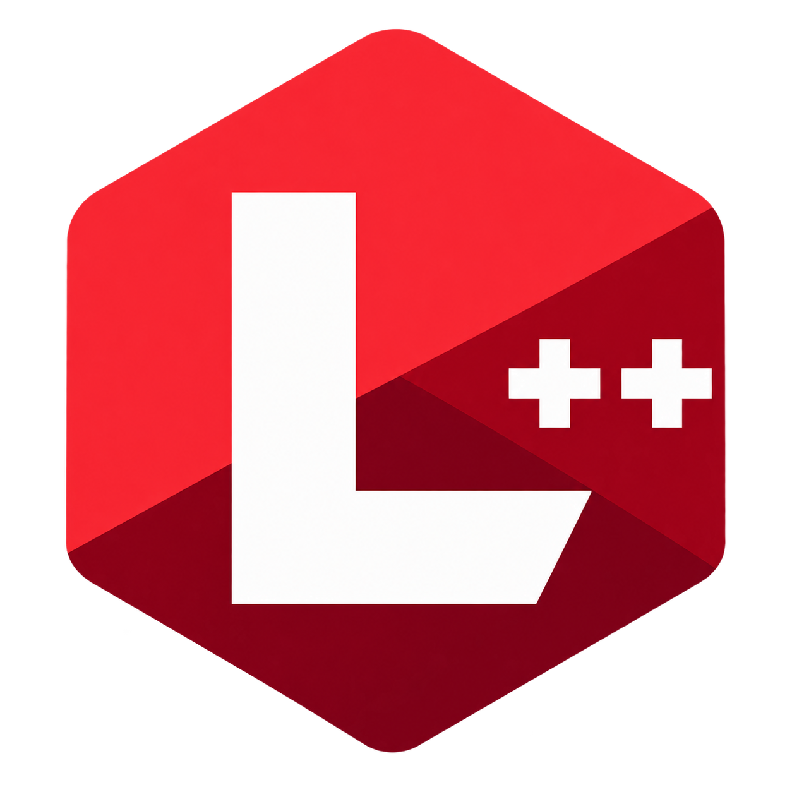
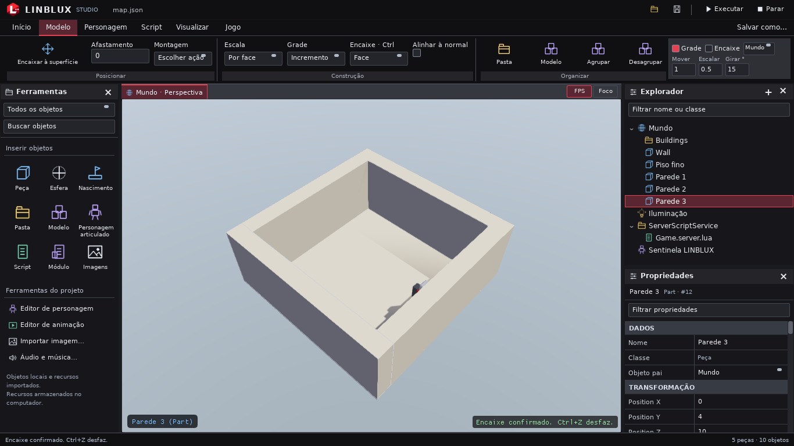
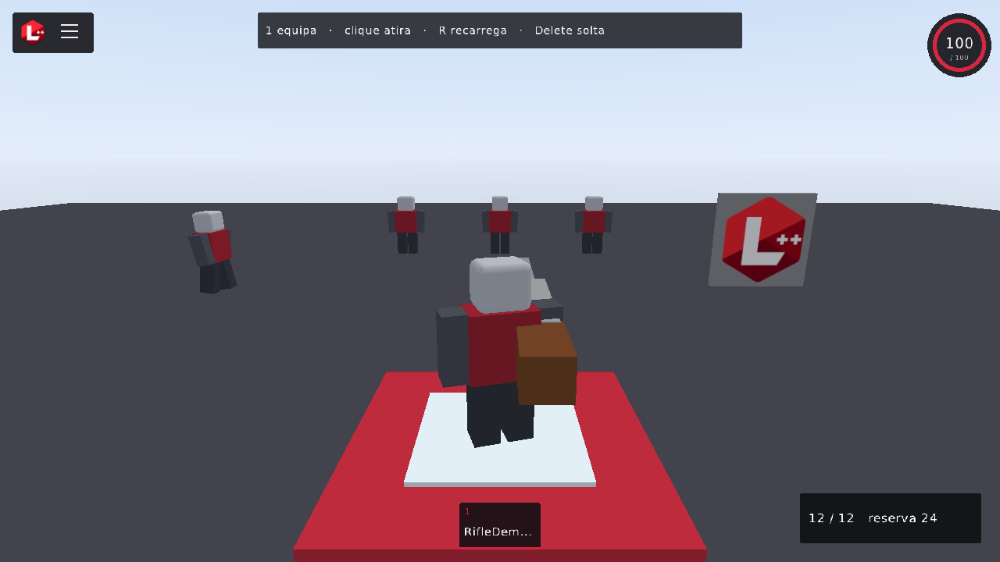

<p align="center"></p>
<h1 align="center">LINBLUX Studio</h1>
<p align="center">Um ambiente experimental de criação 3D para Linux.</p>
<p align="center"><strong>Alpha 0.1.0 · criação e experiências locais · interface em português brasileiro</strong></p>
<p align="center"><a href="README.en.md">English</a> · <a href="docs/ALPHA_0_1_0.md">Download e execução</a> · <a href="docs/README.md">Documentação</a> · <a href="docs/MIDIA.md">Demonstrações</a> · <a href="CONTRIBUTING.md">Contribuir</a></p>

<!-- A captura principal é escolhida manualmente após revisão de conteúdo. -->
<p align="center"></p>

## O que é o LINBLUX?

LINBLUX reúne um Studio para editar mundos e um Player para executá-los.
Você monta cenas com Parts e Models, organiza objetos pela hierarquia, ajusta
propriedades e programa comportamentos em Lua. Física, imagens, sons e personagens
fazem parte dessa base local. Studio e Player são executáveis independentes.

É uma engine experimental em desenvolvimento. A Alpha serve para conhecer a
implementação, criar experiências pequenas e ajudar a encontrar problemas.
Ainda há limitações de edição, compatibilidade e distribuição; use cópias dos
seus projetos ao experimentar.

## Por que existe?

A proposta é construir progressivamente uma plataforma de criação de experiências
3D que possa ser compreendida, modificada e expandida. O protótipo nasceu em um
ciclo curto de desenvolvimento, com hardware limitado e desafios de integração
entre renderização, interface, física e scripting. O primeiro passo é oferecer
uma base local concreta e evoluir a partir do que funciona.

## O que já existe

| Área | Disponível na base Alpha |
| --- | --- |
| Studio | Cena 3D, Explorador com busca, propriedades, seleção e scripts |
| Construção | Move e Scale pela face, Rotate, incrementos de Snap e encaixe por superfície |
| Objetos | Parts, Models, hierarquia, Attachments e serviços locais de armazenamento |
| Execução | Player separado e Play/Stop sobre uma cópia da cena autoral |
| Lua 5.4 | Objetos, eventos, física, NPCs, inventário, áudio e UI no escopo da API atual |
| Recursos | PNG/JPEG, Decals, texturas com repetição, sons locais e música |
| Experiências | Salvar/reabrir, biblioteca local e importação/exportação `.lo` |
| Protótipos | Modelos em ServerStorage/Itens, fora da renderização e física; spawn pelo inventário |
| Personagens | Rig atual de seis corpos, animações compatíveis e NPCs |

Os controles por face preservam o tamanho ao mover e mantêm a face oposta ao
escalar. A grade visual foi removida para simplificar o Studio; Snap e precisão
por incremento continuam disponíveis.

## Demonstração

<p align="center"></p>

[RifleDemo](assets/examples/rifledemo/README.md) é um exemplo local de Lua,
itens, NPCs e interação no Player. A captura acima registra o Player de um
candidato anterior; o resultado de validação atual está nas
[notas da Alpha](docs/ALPHA_0_1_0.md).

Veja a [galeria de capturas e vídeos](docs/MIDIA.md). Para atualizar a galeria
com mídia pública revisada, execute `python3 tools/update_readme_media.py`.
Vídeos grandes ficam em Releases ou em um serviço de vídeo, sem aumentar o clone.

## Experimentar no Linux

**O pacote binário público ainda está bloqueado.** A revisão de redistribuição
das dependências precisa ser concluída. Consulte o [estado da Alpha e do
candidato interno](docs/ALPHA_0_1_0.md); não há download binário aprovado anunciado
neste README. O código-fonte pode ser compilado no Linux.

Depois de compilar, abra o Studio, crie uma experiência e use **F5** para executar.
**Shift+F5** encerra a execução. No editor, botão direito + WASD move a câmera;
Q/E desce/sobe e F enquadra a seleção. No Player, WASD move, espaço pula e Esc
abre o menu sem interromper a simulação.

### Compilar

O build oficial de desenvolvimento é `build-linblux/`. Requisitos e dependências
por distribuição estão no [guia de build](docs/BUILD.md). A validação desta base
usa Linux x86_64, C++17, raylib 6.2.0, Bullet 3.24 e Lua 5.4; isso não comprova
suporte a todas as distribuições. A primeira configuração do RmlUi exige rede
ou um checkout/cache da dependência.

```sh
git clone https://github.com/danielvtroot/LINBLUX.git
cd LINBLUX
cmake -S . -B build-linblux -DCMAKE_BUILD_TYPE=Release
cmake --build build-linblux -j2
./build-linblux/linblux
```

Para executar a demo diretamente:

```sh
./build-linblux/linblux_player --project assets/examples/rifledemo/world.loblox.json
```

[Guia Studio](docs/GUIA_STUDIO.md) · [Guia Player](docs/PLAYER.md) ·
[Experiências e `.lo`](docs/EXPERIENCES.md)

## Arquitetura

C++17 e CMake compõem a base. raylib/OpenGL desenha as cenas, Bullet simula a
física e Lua 5.4 executa scripts. O Studio combina RmlUi nos painéis principais
e ImGui em editores especializados. O Player não depende das interfaces do Studio.

`Scene` mantém objetos e IDs persistentes; `ProjectIO` valida e salva cenas de
forma transacional. `RuntimeSession` executa uma cópia da cena, separada da
autoria. O gerenciador de experiências organiza manifestos e recursos locais.
Veja os targets e limites de acoplamento em [Arquitetura](docs/ARCHITECTURE.md).

## LINBLUX ATLAS + TURBO

O projeto inclui ferramentas de manutenção locais, utilizáveis por desenvolvedores
e agentes com acesso ao terminal, sem depender de um serviço externo.

**ATLAS** indexa a estrutura do repositório, localiza código e símbolos, sugere
hipóteses com evidências e ajuda a analisar impacto. Suas relações são textuais:
auxiliam a investigação, sem provar a causa de um defeito ou corrigi-lo automaticamente.

**ATLAS TURBO** seleciona verificações e supervisiona testes com timeout individual,
orçamento global, encerramento dos processos e logs. Pode reduzir trabalho
repetido; tempo e cobertura dependem das alterações e do ambiente. Aprovação
parcial nunca equivale a validação completa.

```sh
ATLAS_IO_MODE=hdd-safe python3 tools/atlas/atlas.py diagnose "problema" --brief
python3 tools/atlas/atlas.py tests-for src/editor/EditorUI.cpp
python3 tools/turbo/turbo.py test --mode fast --changed --plan
```

O modo HDD-Safe reduz gravações; HDD-Critical permite consultas sem reindexar.
[Manual ATLAS](docs/atlas/README.md) · [Manual TURBO](docs/turbo/README.md) ·
[Como testar](docs/TESTING.md)

## Estado da Alpha

| Estado | Escopo |
| --- | --- |
| Implementado | Edição local, Player, persistência, física, Lua, objetos e recursos descritos acima |
| Experimental | Construção por superfície, personagens/NPCs, materiais, UI Lua e integração entre ferramentas |
| Limitado | Rig de seis corpos, encaixe em caixas, áudio sem mixagem/atenuação 3D e compatibilidade Linux ainda restrita ao ambiente validado |
| Futuro | Malhas arbitrárias, terreno, multiplayer, contas e publicação online |

Áudio audível em hardware real e desempenho de GPU física exigem validação
adicional. Scripts Lua podem usar as capacidades locais da API: execute somente
experiências de origem confiável. Leia os [limites da Alpha](docs/ALPHA_0_1_0.md)
e a [compatibilidade](docs/COMPATIBILIDADE.md) antes de distribuir um projeto.

## Próximos passos

Consolidar o Studio e a engine, melhorar renderização e desempenho, tornar as
ferramentas de criação mais intuitivas, ampliar personagens, importação 3D,
terreno e API Lua. Depois, evoluir empacotamento Linux e explorar experiências
compartilhadas com servidor autoritativo, identidade, replicação, descoberta,
colaboração e extensões. São objetivos futuros, sem datas prometidas.
[Roadmap completo](docs/ROADMAP.md).

## Documentação e colaboração

O [índice de documentação](docs/README.md) reúne os guias de uso, API Lua,
arquitetura e manutenção. Para relatar um bug, inclua versão/commit, distribuição,
passos para reproduzir e uma experiência mínima sem dados privados.

Leia [CONTRIBUTING](CONTRIBUTING.md), revise os testes afetados e envie mudanças
pequenas. Problemas sensíveis seguem a [política de segurança](SECURITY.md).
[Changelog](docs/CHANGELOG.md) · [Relatório do lançamento](docs/releases/ALPHA_0_1_0_LANCAMENTO.md)

## Licença e créditos

Código próprio sob [MIT](LICENSE). LINBLUX utiliza raylib, Bullet, Lua, RmlUi,
Dear ImGui, rlImGui, stb e nlohmann/json; seus avisos e direitos permanecem
preservados. FFmpeg é opcional e sua licença depende da build vinculada.
[Recursos, créditos e obrigações de distribuição](docs/ASSETS_E_LICENCAS.md).
