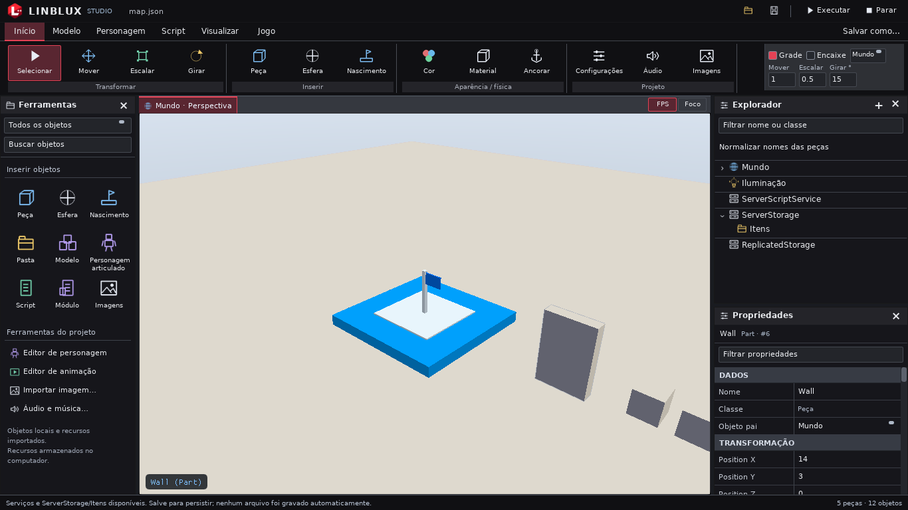
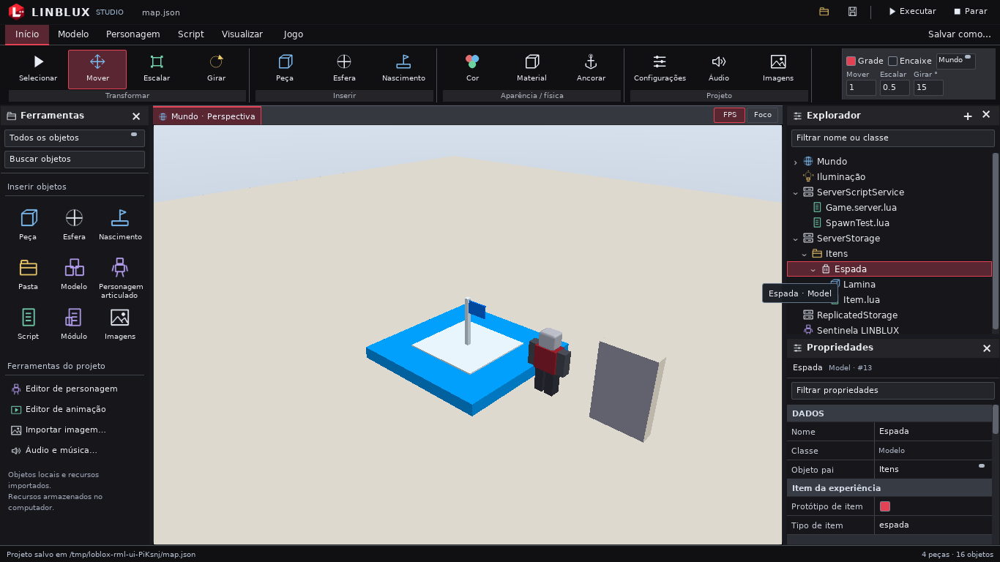

# LINBLUX em imagens

Capturas reais do Studio. A interface oficial atual é em português brasileiro.
As capturas usam renderização por software; não representam desempenho em GPU física.

<!-- LINBLUX:MEDIA:START -->

### Capturas

Serviços de armazenamento organizados

Explorador e serviços

LINBLUX Studio — Construção 3D

### Vídeos

O vídeo de demonstração está publicado no YouTube: [Assistir à demonstração LINBLUX](https://www.youtube.com/watch?v=jVck4UuYlWQ). O GitHub não reproduz MP4 do repositório dentro do README. O arquivo local excede o limite de 20 MiB da galeria e não entra no Git.

<!-- LINBLUX:MEDIA:END -->

## Demonstração em vídeo

O vídeo está publicado no YouTube: **[Assistir à demonstração LINBLUX](https://www.youtube.com/watch?v=jVck4UuYlWQ)**,
no canal [Abismroot](https://www.youtube.com/@Abismroot). Ele foi gravado neste
ambiente e é a fonte da gravação local `docs/videos/linblux.mp4` (1920×1080, cerca
de 8 minutos, **126 MiB**), que permanece fora do Git: excede o limite de 20 MiB
desta galeria e o limite de 100 MiB por arquivo do GitHub.

O GitHub não reproduz MP4 guardado no repositório dentro do README, por isso o
player abre em outra aba. Nada foi transcodificado nem duplicado. O arquivo local
permanece intacto; nada foi transcodificado ou duplicado.

## Atualizar a galeria

1. Confira se a captura mostra somente LINBLUX, sem dados pessoais ou conteúdo sem autorização.
2. Coloque PNG/JPEG/WebP em `docs/prints/`, ou MP4/WebM em `docs/videos/`.
3. Execute na raiz: `python3 tools/update_readme_media.py`.
4. Revise `git diff -- docs/MIDIA.md` e adicione somente os arquivos públicos escolhidos.

O README aponta para esta página. O script altera somente o bloco entre marcadores,
não abre o conteúdo dos vídeos, não transcodifica e não adiciona arquivos ao Git.
Nomes ocultos, temporários, symlinks, arquivos vazios e formatos não aceitos são ignorados.
Imagens acima de 8 MiB e vídeos acima de 20 MiB são omitidos com aviso.
Esses limites editoriais evitam aumentar o custo de clonar o código.

Uma imagem com o mesmo nome-base do vídeo vira sua capa (por exemplo,
`prints/construcao.png` e `videos/construcao.webm`). Sem capa, haverá um link textual.
O GitHub pode abrir ou baixar o arquivo; não se promete reprodução embutida no README.

Vídeos maiores devem ser publicados como assets de uma GitHub Release ou em um
serviço de vídeo apropriado, com direitos confirmados. Adicione o link manualmente
fora do bloco gerado. Os títulos públicos das capturas revisadas ficam em `TITLES`,
no gerador; nomes sem título revisado usam o nome do arquivo legível. Não mova mídia pessoal para estas pastas só para aparecer na galeria.
`midia/careditfullhd.mp4` não é coletado nem incluído automaticamente.
