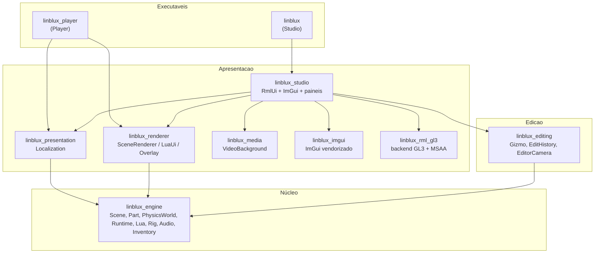

# AUDITORIA COMPLETA DO MOTOR 3D — LINBLUX

> **Documento de investigação. Nenhum código do motor foi alterado.**
> Este arquivo é autossuficiente: descreve a arquitetura real, aponta caminhos,
> classes e funções verificáveis, separa **fatos comprovados** de **hipóteses** e
> propõe um plano de modernização por fases. Foi produzido para ser entregue a
> outro engenheiro sem acesso ao repositório.

| Campo | Valor |
| --- | --- |
| Projeto | LINBLUX (engine 3D para Linux, Studio + Player) |
| Commit auditado | `2aebae4794c1749015082f062e5c2b411db1ecb1` (`2aebae4`) |
| Mensagem do commit | `docs: record ferramenta de terminal session results — menu, snap, rendering, explorer, player audio` |
| Data do commit | 2026-10-27 20:06:44 -0300 |
| Branch | `main` |
| Data da auditoria | 2026-10-27 |
| `git describe` | `2aebae4-dirty` |
| Estado da árvore | **suja**: 2 arquivos modificados não publicados (`assets/ui/documents/studio.rml`, `assets/ui/styles/studio.rcss`) |
| Versão declarada no CMake | `project(LINBLUX VERSION 0.3.0)` (`CMakeLists.txt:2`) |
| Documentação de release | `docs/ALPHA_0_1_0.md` fala em "Alpha 0.1.0"; não há tag nem Release |
| Host | Loc-OS GNU/Linux 24 "chill", kernel `6.12.113+deb13-amd64` |
| Compilador | `c++ (Debian 14.2.0-19) 14.2.0`, C++17 |
| CMake | 3.31.6 |
| Build principal | `build-linblux/` (árvores antigas: `build/`, `build-no-video/`) |
| Nº de arquivos em `src/` | 113 (`.cpp`/`.h`) |
| Linhas em `src/` | 26.502 |
| Nº de testes registrados | 57 (`ctest -N` em `build-linblux/`) |
| Índice ATLAS | 402 arquivos, 4.054 símbolos, 1.226 relações, 42 alvos CMake, 14 dependências externas |

## Como este documento foi produzido

1. `AGENTS.md`, `docs/ARCHITECTURE.md`, `docs/relatorios/CONCLUSAO_ENGINE.md`,
   `docs/EDITOR_PRECISAO.md` e relatórios 35–39 foram lidos integralmente.
2. `python3 tools/atlas/atlas.py update` e `status` foram executados
   (índice reconstruído: 402 arquivos, 3 alterados, 0 removidos).
3. `python3 tools/turbo/turbo.py test --plan` e `status` foram executados
   (nenhum teste foi disparado; o plano apenas informa a seleção).
4. `ctest -N` foi executado em `build-linblux/` apenas para **listar** testes.
5. O código-fonte real foi lido: renderizador, física, cena, objetos, gizmos,
   matemática, runtime, NPCs, navegação, rigs, Lua, serialização, UI.
6. Nenhum comando de escrita, build, teste, `git add`, `commit`, `reset`,
   `clean` ou instalação de dependência foi executado. A única escrita foi este
   arquivo.

### Limitações explícitas desta auditoria

- **Sem `clangd`, `rg` ou `ctags`** neste ambiente. O ATLAS usa extração textual
  (marcada como `medium`); toda referência cruzada foi confirmada lendo o
  arquivo real, mas “usado por” não é prova semântica de chamada.
- **Nenhuma medição de GPU foi feita.** Não há números de FPS, draw calls reais
  ou tempo de frame nesta auditoria. Onde há número, ele é **calculado a partir
  de constantes do código** e está marcado como cálculo.
- **Nenhum teste foi executado** (ver §17). Os estados de teste citados vêm dos
  relatórios 35–39 e do `CONCLUSAO_ENGINE.md`, e estão identificados como
  *históricos*.
- **Não há dispositivo de áudio físico** garantido neste host; nada foi ouvido.
- A árvore de trabalho está **suja**: os dois arquivos de UI citados acima
  contêm alterações locais não publicadas (layout do ribbon e do grupo de snap).
  Todas as referências a `studio.rml`/`studio.rcss` neste relatório descrevem a
  **árvore de trabalho**, não o commit. Onde isso importa, está anotado.
- Comparações com Godot/Unity/Unreal/Blender são baseadas em documentação
  pública (§18); não houve inspeção do código dessas engines.
- Versões de bibliotecas de terceiros foram confirmadas por `pkg-config`/`dpkg`
  no host; bibliotecas apenas *candidatas* (§19) não foram baixadas nem testadas.

### Escopo protegido

Esta execução **não** alterou renderização, física, Lua, áudio, rigs, frontend,
testes, CMake, assets, builds ou dependências. O arquivo criado é
`docs/relatorios/AUDITORIA_COMPLETA_MOTOR_3D_LINBLUX.md`.

---

# 1. Resumo executivo

## 1.1 O que o LINBLUX é, tecnicamente

O LINBLUX **não é** uma engine de cena genérica com grafo de cena e render graph.
É um **runtime de blocos** (estilo sandbox) com um editor de autoria embutido,
construído sobre **raylib + OpenGL 3.3 + Bullet + Lua 5.4 + RmlUi + ImGui**:

- **Modelo de objeto:** `Instance` → `Part` (`Block` ou `Sphere`), `Model`,
  `Folder`, `Script`, `Decal`, `Texture`, `Attachment`, mais serviços
  (`Workspace`, `Lighting`, `ServerScriptService`, `ServerStorage`,
  `ReplicatedStorage`).
- **Transformação:** cada `Part` guarda posição/rotação/tamanho **em espaço de
  mundo**. Pai é **organizacional**, não transformacional (exceto `Model`, que
  “assa” transformações nos filhos via `Scene::transformModel`).
- **Renderização:** desenho imediato por CPU. Cada caixa é emitida como 12
  triângulos com **cor por face** calculada por Lambert + hemisférica em C++; não
  existe malha, VBO, material de GPU, textura por material, sombra ou
  pós-processamento 3D. O único shader 3D é o **céu procedural**.
- **Física:** um corpo Bullet por `Part`, passo fixo 1/60, gravidade −98,1
  unidades/s², solver 16 iterações, contatos por manifold.
- **Jogador:** cápsula Bullet dedicada + controlador cinemático próprio
  (`RuntimeSession::step`) + rig R6 de 6 corpos desenhado por cima.
- **Autoria vs execução:** o Play cria um `Scene` **novo** por serialização
  (`projectio::toJson` → `fromJson`), dono de sua própria física e VM Lua. O
  documento autoral nunca é tocado durante o Play.

## 1.2 Os doze achados de maior impacto

| # | Achado | Evidência | Severidade |
| --- | --- | --- | --- |
| A1 | As **linhas escuras tracejadas** são um passe de contorno do Editor ligado por padrão para **todas** as Parts, com depth test ativo, sem depth write e **sem depth bias**, desenhando arestas **coincidentes** com os triângulos das faces | `SceneRenderer::drawEditorGuides` (`src/rendering/SceneRenderer.cpp:971`); `EditorGeometryView{edges=true}` (`SceneRenderer.h:22`); `EditorUI::editorGeometry_` (`EditorUI.h:191`); chamada em `EditorUI.cpp:1971` | **Alta** (é a queixa visual nº 1) |
| A2 | O snap de grade arredonda o **delta do arraste**, não a posição absoluta — nunca alinha ao grid do mundo; cada arraste re-ancora | `gizmomath::SnapDelta` + `MoveAxis`/`MovePlane` (`src/editor/GizmoMath.cpp`), uso em `Gizmo::update` (`Gizmo.cpp:181,226`) | **Alta** |
| A3 | O encaixe de face só vale para **Mover**, só para caixas (esferas viram caixa circunscrita), só dentro de **0,02–2 unidades**, e **rejeita silenciosamente** a correção se qualquer peça do conjunto penetrar qualquer obstáculo | `Gizmo::snapPosition` (`Gizmo.cpp:109`); `SnapSurfaces`/`BoxSeparation` (`GizmoMath.cpp`); tolerância em `EditorUI.cpp:1833-1841` | **Alta** |
| A4 | O gizmo é **overlay 2D em espaço de tela**, não geometria 3D: direções de eixo são projetadas e, quando degeneradas, substituídas por direções fixas de fallback | `gizmolayout::Layout`, `AxisDirectionOnScreen` com `fallbacks = {{0.94,0.34},{0,-1},{-0.94,0.34}}` (`GizmoLayout.cpp`); `Gizmo::drawOverlay` usa `DrawLineEx`/`DrawCircleV` | **Média-alta** (explica “gizmos confusos”) |
| A5 | Todas as Parts nascem com a **mesma cor e o mesmo material** (`163,162,165`, `SmoothPlastic`); não há textura por material, sombra, AO nem contato escurecido | `Part.h` (`color_{163,162,165,255}`, `material_ = SmoothPlastic`); `LitSurface` (`SceneRenderer.cpp`) | **Alta** (contraste) |
| A6 | O passe de contorno é o **único** elemento que separa superfícies; ao contrário do que se supõe, o modelo de luz **já produz** contraste mensurável (teto 0,58 / parede +Z 0,68 / piso 1,09 de albedo) | cálculo a partir de `LitSurface` + `Lighting` (§6.4) | **Alta** (corrige hipótese errada) |
| A7 | O rig R6 padrão é desenhado **no Editor** em `root{8,3,0}` mesmo sem NPC, porque `drawScene(..., authoredRigs=true)` desenha todos os rigs de `gameAssets` | `SceneRenderer::drawScene` (`for (const auto& asset : scene.gameAssets().rigs)`); `EditorUI.cpp:1959-1976` | Média |
| A8 | `ServerStorage`/`ReplicatedStorage` **não podem conter Parts**: `Scene::accepts` exige ancestralidade no `Workspace` para qualquer Part, e `canParent` recusa reparentar subárvores com Parts para fora do Workspace | `Scene::accepts`, `Scene::canParent` (`src/scene/Scene.cpp`) | **Alta** (bloqueia templates/rigs/itens iniciais “reais”) |
| A9 | O estado de queda é `Freefall` já durante a descida de um pulo normal; o clipe de queda só troca após `vy < −8`, `tempo no ar > 0,3 s` e `queda > 4,5 unidades` — um pulo padrão (7 unidades, ~0,76 s) **não** satisfaz | `RuntimeSession::step`/`animate` (`src/game/Runtime.cpp`) | Média (o “bug do pulo” tem causa mais estreita que o relatado) |
| A10 | A documentação do encaixe (`EDITOR_PRECISAO.md`) está **desatualizada** em relação ao código: diz que esferas não participam, mas `effa896` as inclui como caixa circunscrita | `EditorUI.cpp:1833-1841` vs `docs/EDITOR_PRECISAO.md` | Baixa (documentação), **mas induz diagnóstico errado** |
| A11 | O `Part::bounds()` de esfera usa `{r,r,r}`, mas o diagnóstico de AABB em `drawEditorGuides` usa `halfExtents()` (size/2) — a caixa de depuração de uma esfera não é a esfera desenhada | `Part::bounds` (`Part.h`), `drawEditorGuides` (`SceneRenderer.cpp`) | Média (diagnóstico enganoso) |
| A12 | Não há **nenhum** polygon offset, line width ou bias no projeto (`grep` por `PolygonOffset|rlSetLineWidth|glPolygonOffset` em `src/`: 0 resultados) | busca textual em `src/` | — (é evidência para A1) |

## 1.3 Respostas curtas às perguntas do briefing

- **Por que linhas tracejadas?** Passe de arestas do Editor (`edges=true`
  default) desenhado **coincidente com as faces**, com depth test e **sem bias**;
  empates de profundidade por pixel + linhas de 1 px + FXAA produzem o tracejado.
  Não aparece no Player (o Player nunca chama `drawEditorGuides`) e **desaparece
  na peça selecionada**, porque o passe exclui a seleção. Ver §6.
- **Como o renderizador funciona?** Desenho imediato CPU→rlgl, um `drawScene`
  único compartilhado por Editor e Player, câmera `Camera3D`, sem malhas
  persistidas, sem culling, com blending pré-multiplicado para decals. Ver §5.
- **Por que paredes parecem iguais ao piso?** Não é o modelo de luz (ele tem
  contraste calculável); é a **uniformidade de albedo/material**, a ausência de
  sombra/AO/contato e a presença das arestas escuras que “achatam” a leitura.
  Ver §6.5 e §7.
- **Causa das dificuldades de snap?** Snap relativo ao delta, encaixe só em
  Mover, tolerância ≤2 unidades, rejeição silenciosa por penetração, ausência de
  snap de aresta/vértice, e nenhuma correção automática de sobreposição. Ver §9.
- **Como corrigir os gizmos matematicamente?** Proposta concreta com snap
  absoluto, encaixe por face com histerese, seleção de plano por dominância,
  escala com pivô e snap de rotação por arco — §9.9.
- **Texturas e iluminação?** Mipmaps + trilinear + anisotrópico 4x **já
  existem** (`game::AssetTexture`); faltam materiais com parâmetros, sombra
  direcional, AO e contato. Ver §7.
- **Física Bullet?** Um corpo por Part, massa = volume × densidade (mín. 0,1),
  passo fixo 1/60 com até 5 subpassos, corpo “suspenso” durante arraste
  (`setPartEditing`), juntas `btFixedConstraint` com 64 iterações locais. §10.
- **Por que NPCs se arrastam?** Atrito zero enquanto o controlador comanda
  velocidade (por projeto), velocidade reescrita por passo, damping 0,02/0,1,
  sem aceleração, sem snap ao chão, e o visual do rig depende de
  `position.y − size.y/2 + 3`. §11.
- **Bibliotecas novas valem a pena?** Para o problema real (leitura de
  geometria, contraste, contorno, snap), **não** se justifica trocar o
  renderizador. Recomendação: OpenGL moderno pontual + passes próprios, com
  bgfx/Filament/Ogre/Magnum documentados e classificados. §19.
- **Evoluir raylib ou migrar?** Evoluir. O gargalo é **modelo de dados e
  passes de autoria**, não o backend. §19.5 e §23.
- **Quais arquivos precisam mudar?** §21 lista por fase, com arquivos, risco e
  testes.
- **Como modernizar sem quebrar?** Fases A→D, contrato de serialização
  preservado (v1..v6), testes existentes como rede de segurança, e nenhuma
  mudança de formato sem migração. §21, §22.

## 1.4 O que **não** é problema (e foi descartado com evidência)

| Hipótese levantada | Situação | Evidência |
| --- | --- | --- |
| “Z-fighting é a causa das linhas” | **Parcialmente falso.** Z-fighting produz manchas/flicker em superfícies coplanares; aqui as linhas seguem arestas e dependem do passe | §6.2 (teste discriminante) |
| “Texturas não têm mipmap” | **Falso.** `GenTextureMipmaps` + `TRILINEAR` + `ANISOTROPIC_4X` | `ImageAssets.cpp:535-537` |
| “A física não corresponde à geometria das caixas” | **Falso para caixas**: margem é recalculada para que `halfExtentsWithMargin == halfExtents` visual | `PhysicsWorld::updateShape`, `collisionGeometry` |
| “O renderizador não tem correção de gamma / blending” | Parcial: decals usam `BLEND_ALPHA_PREMULTIPLY` com textura pré-multiplicada, coerente | `AssetTexture` + `DrawFaceQuad` |
| “O Player sofre das mesmas linhas” | **Falso**: `drawEditorGuides` nunca é chamado no Player | `src/player/main.cpp` |
| “O pulo curto sempre dispara a animação de queda” | **Falso no caso padrão**: os limiares impedem; há casos de borda reais (§12.8) | `RuntimeSession::animate` |
| “É preciso trocar Bullet para ter física decente” | **Não**: os sintomas descritos são de **controlador** e de propriedades, não do solver | §10.9 |

---

# 2. Estado Git e ambiente

## 2.1 Repositório

```
commit  2aebae4794c1749015082f062e5c2b411db1ecb1
branch  main
describe 2aebae4-dirty
```

Últimos assuntos de commit relevantes (de `git log`, em ordem cronológica):

| Hash | Assunto |
| --- | --- |
| `b6a3a47` | Menu do Player sem pausar simulação |
| `effa896` | Encaixe de face como toggle permanente |
| `d695b0b` | Maior contraste hemisférico (0,58 + 0,20·up; sol 0,38) |
| `8070713` | Explorador: inserção em ServerStorage/ReplicatedStorage |
| `7dab595` | Menu de áudio do Player (volume %, mudo) |
| `2aebae4` | Registro de sessão: menu, snap, renderização, explorador, áudio |

## 2.2 Estado da árvore

`git status --porcelain`:

```
 M assets/ui/documents/studio.rml
 M assets/ui/styles/studio.rcss
```

`git diff --stat`: 2 arquivos, 12 inserções, 8 remoções.

**Natureza da alteração local** (importante para quem for reproduzir o layout
descrito em §16):

- `studio.rml`: o bloco do ribbon passa a ter `<div id="ribbon-spacer"/>` e o
  grupo de snap troca `snap-heading` por `snap-checks` + `snap-row`; rótulos
  encurtados (“Ajuste à grade” → “Grade”, “Encaixe de face” → “Encaixe”).
- `studio.rcss`: `#ribbon` passa de `padding: 4px 8px 0; overflow: auto` para
  `padding: 4px 216px 0 8px; overflow: hidden`; `#snap-group` deixa de ser item
  flex de 170 px e passa a `position: absolute; right: 6px; top: 4px; width:
  210px; z-index: 10`; `#transform-space` cai de 82 px para 54 px; campos de
  snap caem de 50 px para 43 px.

Consequência direta: **o ribbon reserva 216 px fixos à direita** e passou a
`overflow: hidden`, então em janelas estreitas os grupos de ferramentas são
**cortados** em vez de rolar. Isso é parte da queixa “barra superior apertada”
(§16.4).

## 2.3 Build e alvos

Build existente e utilizado: `build-linblux/`. Existem árvores antigas (`build/`,
`build-no-video/`) que **não** devem ser usadas como referência.

Alvos declarados em `CMakeLists.txt`:

| Alvo | Tipo | Conteúdo principal |
| --- | --- | --- |
| `linblux_engine` | STATIC | objetos, cena, física, Lua, rigs, áudio, UI de jogo, persistência, experiências |
| `linblux_editing` | STATIC | `EditHistory`, `GizmoMath`, `GizmoLayout`, `Gizmo`, `TransformMetrics`, `TransformSession`, `ModelTransformSession`, `EditorCamera`, `SceneRendererAdapter` |
| `linblux_core` | INTERFACE | fachada transitória `engine + editing` para testes |
| `linblux_renderer` | STATIC | `SceneRenderer`, `PlayerMenu`, `ExperienceOverlay`, `LuaUiRenderer` |
| `linblux_presentation` | STATIC | `Localization` |
| `linblux_media` | STATIC | `VideoBackground` (FFmpeg opcional) |
| `linblux_imgui` | STATIC | ImGui vendorizado + `rlImGui` |
| `linblux_rml_gl3` | STATIC | backend GL3 do RmlUi com MSAA de camada |
| `linblux_studio` | STATIC | `ExperienceUI`, `NativeFileDialog`, `StudioFrontend`, `EditorActions`, `EditorUI`, `GamePanels`, `StudioPanels` |
| `linblux` | EXECUTÁVEL | Studio (`src/main.cpp` + `src/app/Application.cpp`) |
| `linblux_player` | EXECUTÁVEL | Player (`src/player/main.cpp`), sem link com Studio/ImGui/RmlUi |

`linblux_editor` é **alias** de `linblux_studio`. O namespace C++ legado `loblox`
é preservado.

## 2.4 Dependências reais (confirmadas no host)

| Dependência | Versão confirmada | Origem | Observação |
| --- | --- | --- | --- |
| raylib | `pkg-config` 6.2.0; header instalado reporta `RAYLIB_VERSION "6.5-dev"` | `/usr/local` (`pkg-config --cflags` → `-I/usr/local/include`) | **Divergência entre `.pc` e header**; registrar antes de qualquer decisão de API |
| Lua | 5.4.7 (`lua5.4`) | sistema | VM isolada, sem `io/os` |
| Bullet | 3.24 (`libbullet-dev 3.24+dfsg-2.1+b2`) | sistema | headers em `/usr/include/bullet` |
| OpenGL | sistema (`OpenGL::GL`) | CMake | contexto 3.3 core usado pelo backend RmlUi GL3 |
| FFmpeg | libavformat 61.7.103 | sistema | usado para metadados de áudio e vídeo de fundo |
| RmlUi | commit fixo `ba95ffe8bfb6370efb2cdcca927eaad4710c5413`, SHA-256 `1541ef…2cde8` | `FetchContent` | sem samples, browser, GLFW ou VM Lua |
| zlib | sistema | CMake | — |
| X11 / Xvfb / xdotool | sistema | CMake | usado por testes gráficos supervisionados |
| Dear ImGui + rlImGui | vendorizado, versão fixa | `third_party/` | `NO_FONT_AWESOME` |
| nlohmann/json | vendorizado | `third_party/` | serialização |
| stb_image | vendorizado | `third_party/stb` | com licença instalada |

MSAA do **RmlUi** (não da cena 3D): `LINBLUX_RMLUI_MSAA_SAMPLES=4` por padrão,
aplicado ao *layer framebuffer* da interface (`CMakeLists.txt`, bloco
`linblux_rml_gl3`). O comentário do CMake estima ~80 MiB a 1920×1080 e ~42 MiB a
1366×768 apenas para essa camada.

## 2.5 Compilação e política de testes do projeto

- `cmake -S . -B build-linblux` / `cmake --build build-linblux -j2`.
- Testes **gráficos** (label `graphics`, Xvfb, `LIBGL_ALWAYS_SOFTWARE`) só via
  TURBO, nunca por `ctest` direto (`AGENTS.md`).
- `PASSED_PARTIAL`, `BUDGET_EXHAUSTED`, `UNKNOWN`, `NO_TESTS`, `REUSED`,
  `TIMEOUT` **não** são aprovação plena.
- Nesta auditoria: `turbo.py test --plan` e `status` foram executados; o estado
  retornado foi `STALE` com “último resultado: NÃO EXECUTADO”. Nenhum teste foi
  rodado.

## 2.6 Dados privados e segredos

Não há tokens, credenciais, caminhos pessoais além do caminho do projeto, nem
experiências privadas neste documento. Nomes de usuário do host e caminhos
`/home/...` **não** foram incluídos. Os caminhos citados são todos relativos à
raiz do repositório.

---

# 3. Arquitetura geral

## 3.1 Camadas e dependências



Regras que o código respeita hoje:

1. `linblux_engine` **não** conhece ImGui, RmlUi nem OpenGL como API (usa raylib
   para imagens e tipos `Vector3`/`Color`, o que é um acoplamento remanescente
   reconhecido em `docs/ARCHITECTURE.md`).
2. `linblux_renderer` recebe `Camera3D`; a câmera do editor (`EditorCamera`) é
   convertida por `SceneRendererAdapter.cpp`, que fica em `linblux_editing`.
3. `linblux_player` **não** linka Studio, ImGui ou RmlUi.
4. `Scene` não conhece Bullet: a física se registra como *listener* de remoção
   (`Scene::addRemovalListener`).

## 3.2 Os dois mundos: autoria e execução

```mermaid
sequenceDiagram
  participant U as Usuário
  participant E as EditorUI / StudioFrontend
  participant AS as Scene (autoral)
  participant AP as PhysicsWorld (autoral)
  participant RT as RuntimeSession
  participant RS as Scene (runtime)
  participant RP as PhysicsWorld (runtime)
  participant L as LuaRuntime
  U->>E: F5 (play)
  E->>RT: start(authoringScene)
  RT->>RT: authoring.validate()
  RT->>RS: fromJson(toJson(authoring))   %% cópia profunda
  RT->>RP: attach(runtimeScene) + gravity + fixed step
  RT->>RT: respawn() (cápsula)
  RT->>L: start(*this)  %% VM isolada
  loop cada frame
    E->>RT: update(dt, PlayerInput)
    RT->>L: update/fixedUpdate
    RT->>RP: stepSimulation(1/60)
    RT->>RS: syncFromBodies
    E->>E: drawScene(runtimeScene, camera)
  end
  U->>E: Shift+F5
  E->>RT: stop()
  RT->>RS: destroy; AP permanece intocado
```

Fatos relevantes:

- A cópia é feita por **JSON em memória** (`projectio::toJson` → `fromJson`), não
  por clone direto. Isso garante que o Play exercite também o caminho de
  serialização — e significa que **qualquer dado não serializado não existe no
  Play**.
- `RuntimeSession` é dona de `Scene`, `PhysicsWorld`, `Inventory`,
  `InteractionSystem`, `ItemActions`, `NpcSystem`, `AudioSystem`,
  `MusicPlaylist`, `UiModel`, `ProgressStore` e `LuaRuntime` (`Runtime.h`).
- O `PhysicsWorld` autoral continua simulando quando o editor **não** está em
  Play nem em overlay (`Application::run`: `if (!ui_->playing() && !ui_->experienceOverlay()) physics_.simulate(scene_, dt)`). Ou seja, **no Editor as Parts dinâmicas caem**.

## 3.3 Frame do Studio (ordem real)

```mermaid
graph LR
  A["rlImGuiBegin"] --> B["EditorUI::draw<br/>dockspace, painéis ImGui/Rml"]
  B --> C["BeginTextureMode(viewport_)"]
  C --> D["SceneRenderer::drawScene"]
  D --> E["SceneRenderer::drawEditorGuides<br/>(somente Editor)"]
  E --> F["drawCollisionShapes (opcional)"]
  F --> G["Gizmo::drawOverlay (ImGui drawlist 2D)"]
  G --> H["EndTextureMode"]
  H --> I["resolveViewport<br/>(FXAA em RenderTexture)"]
  I --> J["rlImGuiEnd"]
  J --> K["StudioFrontend::render<br/>(RmlUi layer framebuffer)"]
  K --> L["EndDrawing"]
```



O viewport 3D é um `RenderTexture2D` do tamanho do painel; há um segundo
`RenderTexture2D` (`resolvedViewport_`) que recebe o passe FXAA. **Não há MSAA
no render target 3D** — só FXAA (`EditorUI::resizeViewport`/`resolveViewport`).

## 3.4 Onde cada responsabilidade realmente mora

| Responsabilidade | Arquivo real | Observação |
| --- | --- | --- |
| Estado global da aplicação | `src/app/Application.cpp` | janela, ImGui, RmlUi, cena padrão, loop |
| Composição do Studio | `src/ui/StudioFrontend.cpp` (1.315 linhas) | todo o RML, ações, layout, cache de propriedades |
| Viewport 3D, seleção, câmera | `src/editor/EditorUI.cpp` (2.850 linhas) | maior arquivo do projeto |
| Painéis ImGui de jogo/rig/animação/pausa | `src/editor/GamePanels.cpp` (1.097 linhas) | fallback quando RmlUi está ausente |
| Desenho da cena | `src/rendering/SceneRenderer.cpp` (1.167 linhas) | compartilhado Editor/Player |
| Física | `src/physics/PhysicsWorld.cpp` (629 linhas) | um corpo por Part |
| Controlador do jogador + sessão | `src/game/Runtime.cpp` (960 linhas) | cápsula, câmera, animação, progresso |
| API Lua | `src/scripting/LuaRuntime.cpp` (1.890 linhas) | tabela `linblux` inteira |
| Serialização | `src/serialization/ProjectIO.cpp` (1.130 linhas) | JSON v1..v6 |
| Experiências `.lo` | `src/experiences/ExperienceManager.cpp` (878 linhas) | manifesto, mídia, cópias independentes |
| NPCs | `src/game/Npc.cpp` (674 linhas) | controlador + clipes procedurais |
| Navegação | `src/game/Navigation.cpp` (291 linhas) | grade XZ + A* |

---

# 4. Mapa de arquivos, classes e pontos de entrada

Convenção das tabelas: **Arquivo — símbolo principal — entrada — responsabilidade
— dependências — limitação conhecida**.

## 4.1 Núcleo de objetos

| Arquivo | Símbolo | Entrada | Responsabilidade | Depende de | Limitação |
| --- | --- | --- | --- | --- | --- |
| `src/objects/Instance.h` | `Instance`, `InstanceId`, `InstanceClass`, `ModelFrame`, `Attachment`, `Container`, `Script`, `Surface`, `SurfaceProperties` | construtores + `Scene::adopt` | nó de hierarquia sem posse dos filhos; atributos `bool/double/string` | raylib (`Color`) | `Instance` não tem transformação; `ModelFrame.scale` é uniforme |
| `src/objects/Instance.cpp` | `InstanceClassName`, `InstanceClassFromName`, `IsScriptClass`, `IsRootServiceClass` | — | nomes ↔ enums | — | `InstanceClass` tem 15 valores fixos em C++ |
| `src/objects/Part.h/.cpp` | `Part`, `Transform`, `BodyProperties`, `NpcProperties`, `PartDirty`, `PartShape`, `PartMaterial` | `Scene::createPart` | geometria, cor, material, ancoragem, colisão, propriedades de corpo, NPC | `core/Math.h`, `core/Geometry.h` | transform é **mundo**; `Sphere` deriva raio do menor eixo |
| `src/objects/Baseplate.h/.cpp` | `Baseplate` | `Scene::createBaseplate` | Part protegida, 160×1×160 por padrão | `Part` | não deletável |
| `src/objects/SpawnLocation.h/.cpp` | `SpawnLocation` | `Scene::createSpawnLocation` | marcador de nascimento | `Part` | desenha mastro só no Editor |
| `src/objects/Lighting.h/.cpp` | `Lighting` | `Scene` (id 2) | céu, sol, ambiente, névoa, nuvens | `Instance` | só dados; render lê a cada frame |
| `src/objects/Workspace.h/.cpp` | `Workspace` | `Scene` (id 1) | raiz das Parts e `FallenPartsDestroyHeight` | `Instance` | — |
| `src/core/Math.h` | `NearlyEqual`, `V3`, `ClampPartSize`, `kMinPartSize=0.2`, `QuatFromEulerDegrees`, `EulerDegreesFromQuat`, `CanonicalQuaternion`, `UnitQuaternion`, `QuaternionSlerpShortest`, `QuatFromEulerDegreesZYX`, `EulerDegreesZYXFromQuat` | — | utilitários matemáticos | raylib/raymath | **duas convenções de Euler convivem** (§8.3) |
| `src/core/Geometry.h` | `OrientedBox` | — | 8 cantos, `intersect(ray)` | raymath | usado por render, seleção e (indiretamente) física |

## 4.2 Cena e hierarquia

| Arquivo | Símbolo | Entrada | Responsabilidade | Limitação |
| --- | --- | --- | --- | --- |
| `src/scene/Scene.h/.cpp` | `Scene`, `NpcVisual`, `PartPick` | `buildDefaultScene`, `createPart`, `createContainer`, `group`, `duplicateTree`, `remove`, `validate`, `pickPart(s)` | posse de todos os `Instance`, índice `id→Instance`, lista de `Part*`, seleção, `GameAssets`, `npcVisuals` | `Scene` guarda seleção e *listeners* (acoplamento de autoria); `npcVisuals` é estado de apresentação |
| `src/scene/Scene.cpp` | `Scene::validate` | `Play`, `Save`, `checkInvariants` | invariantes fortes: ids, pais, quaternion normalizado, tamanho mínimo, superfícies, juntas | validação O(n²) em alguns laços (juntas, grupos) |
| `src/scene/Scene.cpp` | `Scene::pickParts` | `EditorUI` (clique) | raycast por `Part::intersect` | **AABB/OBB de tamanho cheio**, não a malha desenhada de esferas (ver A11) |
| `src/scene/Scene.cpp` | `Scene::accepts` / `canParent` | criação/reparent | regras de hierarquia | **Part só dentro do Workspace** (A8) |
| `src/scene/Scene.cpp` | `Scene::transformModel` | propriedades, Lua, gizmo de Modelo | aplica posição/rotação/escala uniforme a todos os descendentes | escala **não uniforme não suportada** |

## 4.3 Renderização

| Arquivo | Símbolo | Entrada | Responsabilidade | Limitação |
| --- | --- | --- | --- | --- |
| `src/rendering/SceneRenderer.h/.cpp` | `SceneRenderer`, `RigRenderState`, `EditorGeometryView` | `drawScene`, `drawEditorGuides`, `drawCollisionShapes`, `MaterialColor` | desenha céu, Parts, decals, rigs, NPCs, contornos e colisores | ver §5 |
| `src/rendering/SceneRenderer.cpp` | `DrawShadedBox`, `DrawShadedSphere`, `DrawShadedRoundedBlocky` | `drawScene` | geometria procedural por frame | sem cache de malha; sem normais por vértice |
| `src/rendering/SceneRenderer.cpp` | `LitSurface`, `ApplyFog`, `MaterialGloss` | por face | iluminação em CPU | sem sombra, sem AO, sem especular por pixel |
| `src/rendering/SceneRenderer.cpp` | `ProceduralSky`, `DrawProceduralSky` | `drawScene` | quad full-screen + GLSL 330 | único shader 3D |
| `src/rendering/SceneRenderer.cpp` | `skins::DrawFaceQuad`, `DrawLayer`, `DrawBodyImage` | `DrawPartSkins`, `drawRig` | quads texturados (decal/texture/face) | sem sorting de transparência; offset fixo 0,02 |
| `src/rendering/SceneRenderer.cpp` | `drawSelection` | `drawScene` | wireframe dourado sem depth test | não é *outline* real (sem stencil) |
| `src/rendering/EditorCamera.cpp` | `EditorCamera` | `EditorUI` | órbita/FPS, `rayFromScreen`, `projectChecked`, `worldUnitsPerPixel` | sem colisão de câmera no Editor |
| `src/editor/SceneRendererAdapter.cpp` | overloads | — | `EditorCamera` → `Camera3D` | — |
| `src/rendering/LuaUiRenderer.cpp` | `DrawLuaUi` | Studio Play e Player | UI declarativa por script | sem scroll/listas/campos |
| `src/rendering/PlayerMenu.cpp`, `ExperienceOverlay.cpp` | — | Player | menu e overlay | — |

## 4.4 Edição

| Arquivo | Símbolo | Entrada | Responsabilidade | Limitação |
| --- | --- | --- | --- | --- |
| `src/editor/EditorUI.cpp` | `EditorUI` | `draw()` | viewport, seleção, atalhos, readout numérico, painéis | 2.850 linhas, muitas responsabilidades |
| `src/editor/Gizmo.h/.cpp` | `Gizmo`, `GizmoInput`, `GizmoUpdateResult` | `update`, `drawOverlay` | arraste de mover/escalar/girar + hit test | overlay 2D, sem snap absoluto |
| `src/editor/GizmoMath.h/.cpp` | `SnapSurfaces`, `BoxSeparation`, `MoveAxis`, `MovePlane`, `ScaleFace*`, `Rotate`, `SeparateScreenPoints` | `Gizmo` | matemática pura de transformação | snap relativo; sem encaixe de aresta/vértice |
| `src/editor/GizmoLayout.h/.cpp` | `Build`, `Pick*`, `PixelLength` | `Gizmo` | geometria de tela única para desenho e clique | direções de fallback fixas |
| `src/editor/TransformSession.h/.cpp` | `TransformSession` | `EditorUI::draw` | suspende/retoma corpo físico durante arraste | — |
| `src/editor/ModelTransformSession.h/.cpp` | `ModelTransformSession`, `proxy_` | `EditorUI::draw` | gizmo de Modelo via `Part` fantasma | proxy é AABB no frame do pivô |
| `src/editor/TransformMetrics.h/.cpp` | `transformmetrics::Context/Measurement` | readout | leitura em studs/graus e edição por texto | 2 eixos não são editáveis por texto |
| `src/editor/EditHistory.h/.cpp` | `TransformEdit`, `EditHistory` | Ctrl+Z/Y | undo/redo por arraste | limite 128 entradas |
| `src/editor/InputRouting.h` | `RouteInput`, `InputOwner` | `EditorUI` | prioridade de entrada (Cancel/Transform/Camera/Viewport) | regras implícitas em bools |
| `src/editor/Tool.h` | `ToolMode` | — | `Select/Move/Scale/Rotate` | só 4 ferramentas |

## 4.5 Física e gameplay

| Arquivo | Símbolo | Entrada | Responsabilidade | Limitação |
| --- | --- | --- | --- | --- |
| `src/physics/PhysicsWorld.h/.cpp` | `PhysicsWorld`, `BodyEntry`, `JointEntry`, `CollisionGeometry` | `attach`, `simulate`, `raycast`, `syncJoints` | Bullet, corpos, juntas, consultas | um corpo por Part; sem layers/máscaras |
| `src/game/Runtime.h/.cpp` | `RuntimeSession`, `PlayerCamera`, `PlayerInput`, `HumanoidState`, `PartMotion`, `SpatialQuery` | `start/update/stop` | sessão de Play completa | controlador próprio, não Bullet character |
| `src/game/Npc.h/.cpp` | `NpcSystem`, `Controller`, `NpcClip` | `tick` | conduz corpos, A*, vida, clipes | clipes procedurais, não assets |
| `src/game/Navigation.h/.cpp` | `NavGrid`, `NavPath` | `build`, `findPath` | grade XZ + A* 8-vizinhos | sem navmesh, sem salto, sem ilhas |
| `src/game/Rig.h/.cpp` | `Rig`, `Body`, `Joint`, `AnimationClip`, `Keyframe`, `Animator`, `PlayerSettings`, `GameAssets` | `MakeR6`, `evaluate`, `sample` | rig R6, clipes, assets do projeto | 6 juntas fixas em C++ |
| `src/game/Inventory.h/.cpp` | `Inventory`, `ItemOptions`, `ItemInfo` | `loadAuthored`, `spawn`, `collect`, `equip` | bolsa de sessão | só runtime |
| `src/game/ItemActions.h/.cpp` | `ItemActions`, `ItemConfig` | `configure/activate/tick` | cadência, munição, recarga | efeito é do script |
| `src/game/Interaction.h/.cpp` | `InteractionSystem` | `update` | segurar E com linha de visão | — |
| `src/game/Audio.h/.cpp` | `AudioSystem`, `MusicPlaylist`, `SoundAsset`, `MusicSettings` | `play`, `update` | áudio 2D, playlist | sem 3D/mixer |
| `src/game/Ui.h/.cpp` | `UiModel` | `create/set/on` | UI declarativa | 5 widgets |
| `src/game/ProgressStore.h/.cpp` | `ProgressStore` | `open/get/set/flush` | estado privado por experiência | não exportado |
| `src/game/Spawn.h/.cpp` | `OrderedSpawnPoints` | `respawn` | ordem determinística de spawn | — |
| `src/game/ImageAssets.h/.cpp` | `AssetTexture`, `ResolveImagePath`, `ListImages`, `DescribeImageUsage` | renderer, UI | texturas, manifesto, usos | cache global |
| `src/game/GameAssetsIO.h/.cpp` | — | ProjectIO | sons/rigs/animações no JSON | — |

## 4.6 Scripting, serialização, experiências, UI

| Arquivo | Símbolo | Entrada | Responsabilidade | Limitação |
| --- | --- | --- | --- | --- |
| `src/scripting/LuaRuntime.h/.cpp` | `LuaRuntime`, `ScriptInput`, job/listener internos | `start/update/fixedUpdate` | VM, tabela `linblux`, eventos, tarefas | um `coroutine` por `every` |
| `src/serialization/ProjectIO.h/.cpp` | `toJson`, `fromJson`, `save`, `load`, `kFormatName` | Editor/Play | JSON transacional (tmp+fsync+rename) | versões 1..6 |
| `src/serialization/SceneLua.h/.cpp` | `ExportSceneLua`, `ImportSceneLua` | UI | cena ↔ script Lua | formato próprio v1 |
| `src/experiences/ExperienceManager.h/.cpp` | `ExperienceManager`, manifesto | Home/abrir `.lo` | cópias independentes, import/export | — |
| `src/ui/StudioFrontend.cpp` | `StudioFrontend`, `Impl` | `draw/render/input` | todo o RML do Studio | monolito de 1.315 linhas |
| `src/ui/RmlFrontendSupport.cpp` | `IconImage`, fontes | RmlUi | ícones procedurais, assets | ícones gerados por código |
| `src/ui/ExperienceUI.cpp` | `ExperienceUI` | Home | páginas de experiências | — |
| `src/ui/EditorActions.cpp` | `EditorActions` | frontend | comandos de UI | validações em `throw` |
| `src/ui/NativeFileDialog.cpp` | `ChooseNative` | UI | zenity/yad/kdialog | depende de binário externo |
| `src/ui/Localization.cpp` | `i18n::Text/Label/Markup` | UI | pt-BR/en | catálogo em código |

## 4.7 Testes (visão de arquivos)

31 arquivos C++ de teste em `tests/`, mais 8 scripts Python, mais as suítes
`tests/atlas`, `tests/backup`, `tests/turbo`. Detalhamento e lacunas em §17.

---

