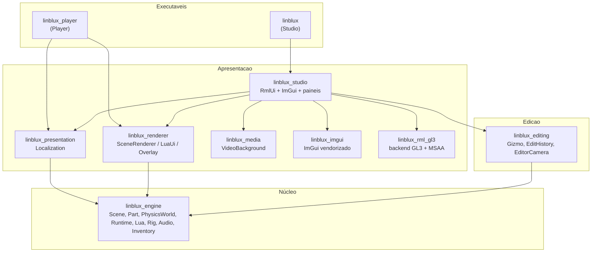
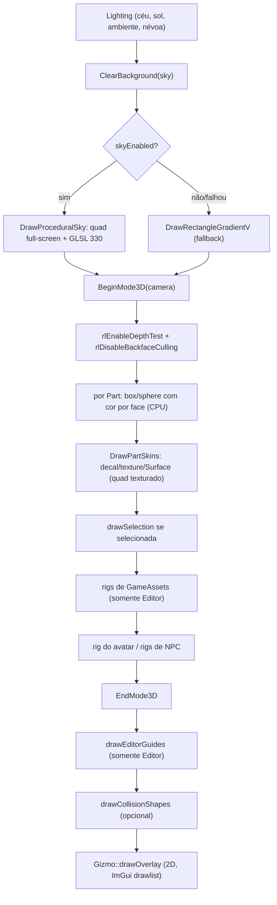
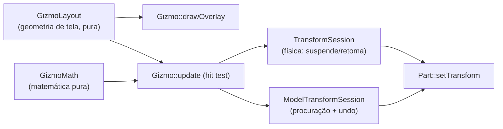
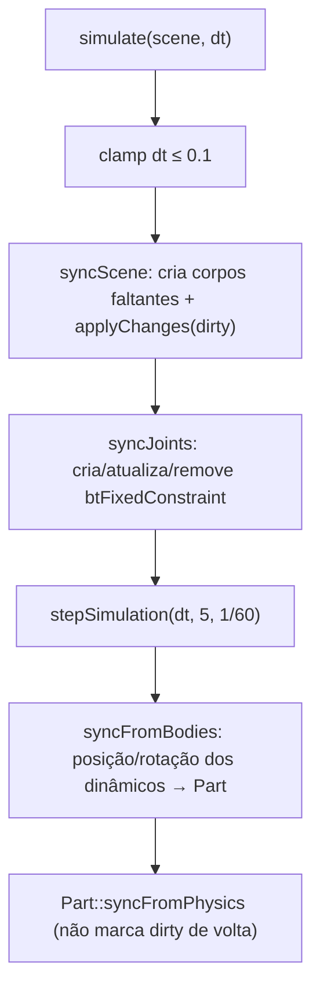

# AUDITORIA COMPLETA DO MOTOR 3D — LINBLUX

> **Documento de investigação. Nenhum código do motor foi alterado.**
> Este arquivo é autossuficiente: descreve a arquitetura real, aponta caminhos,
> classes e funções verificáveis, separa **fatos comprovados** de **hipóteses** e
> propõe um plano de modernização por fases. Foi produzido para ser entregue a
> outro engenheiro sem acesso ao repositório.

| Campo | Valor |
| --- | --- |
| Projeto | LINBLUX (engine 3D para Linux, Studio + Player) |
| Commit auditado | `2aebae4794c1749015082f062e5c2b411db1ecb1` (`2aebae4`) |
| Mensagem do commit | `docs: record ferramenta de terminal session results — menu, snap, rendering, explorer, player audio` |
| Data do commit | 2026-10-27 20:06:44 -0300 |
| Branch | `main` |
| Data da auditoria | 2026-10-27 |
| `git describe` | `2aebae4-dirty` |
| Estado da árvore | **suja**: 2 arquivos modificados não publicados (`assets/ui/documents/studio.rml`, `assets/ui/styles/studio.rcss`) |
| Versão declarada no CMake | `project(LINBLUX VERSION 0.3.0)` (`CMakeLists.txt:2`) |
| Documentação de release | `docs/ALPHA_0_1_0.md` fala em "Alpha 0.1.0"; não há tag nem Release |
| Host | Loc-OS GNU/Linux 24 "chill", kernel `6.12.113+deb13-amd64` |
| Compilador | `c++ (Debian 14.2.0-19) 14.2.0`, C++17 |
| CMake | 3.31.6 |
| Build principal | `build-linblux/` (árvores antigas: `build/`, `build-no-video/`) |
| Nº de arquivos em `src/` | 113 (`.cpp`/`.h`) |
| Linhas em `src/` | 26.502 |
| Nº de testes registrados | 57 (`ctest -N` em `build-linblux/`) |
| Índice ATLAS | 402 arquivos, 4.054 símbolos, 1.226 relações, 42 alvos CMake, 14 dependências externas |

## Como este documento foi produzido

1. `AGENTS.md`, `docs/ARCHITECTURE.md`, `docs/relatorios/CONCLUSAO_ENGINE.md`,
   `docs/EDITOR_PRECISAO.md` e relatórios 35–39 foram lidos integralmente.
2. `python3 tools/atlas/atlas.py update` e `status` foram executados
   (índice reconstruído: 402 arquivos, 3 alterados, 0 removidos).
3. `python3 tools/turbo/turbo.py test --plan` e `status` foram executados
   (nenhum teste foi disparado; o plano apenas informa a seleção).
4. `ctest -N` foi executado em `build-linblux/` apenas para **listar** testes.
5. O código-fonte real foi lido: renderizador, física, cena, objetos, gizmos,
   matemática, runtime, NPCs, navegação, rigs, Lua, serialização, UI.
6. Nenhum comando de escrita, build, teste, `git add`, `commit`, `reset`,
   `clean` ou instalação de dependência foi executado. A única escrita foi este
   arquivo.

### Limitações explícitas desta auditoria

- **Sem `clangd`, `rg` ou `ctags`** neste ambiente. O ATLAS usa extração textual
  (marcada como `medium`); toda referência cruzada foi confirmada lendo o
  arquivo real, mas “usado por” não é prova semântica de chamada.
- **Nenhuma medição de GPU foi feita.** Não há números de FPS, draw calls reais
  ou tempo de frame nesta auditoria. Onde há número, ele é **calculado a partir
  de constantes do código** e está marcado como cálculo.
- **Nenhum teste foi executado** (ver §17). Os estados de teste citados vêm dos
  relatórios 35–39 e do `CONCLUSAO_ENGINE.md`, e estão identificados como
  *históricos*.
- **Não há dispositivo de áudio físico** garantido neste host; nada foi ouvido.
- A árvore de trabalho está **suja**: os dois arquivos de UI citados acima
  contêm alterações locais não publicadas (layout do ribbon e do grupo de snap).
  Todas as referências a `studio.rml`/`studio.rcss` neste relatório descrevem a
  **árvore de trabalho**, não o commit. Onde isso importa, está anotado.
- Comparações com Godot/Unity/Unreal/Blender são baseadas em documentação
  pública (§18); não houve inspeção do código dessas engines.
- Versões de bibliotecas de terceiros foram confirmadas por `pkg-config`/`dpkg`
  no host; bibliotecas apenas *candidatas* (§19) não foram baixadas nem testadas.

### Escopo protegido

Esta execução **não** alterou renderização, física, Lua, áudio, rigs, frontend,
testes, CMake, assets, builds ou dependências. O arquivo criado é
`docs/relatorios/AUDITORIA_COMPLETA_MOTOR_3D_LINBLUX.md`.

---

# 1. Resumo executivo

## 1.1 O que o LINBLUX é, tecnicamente

O LINBLUX **não é** uma engine de cena genérica com grafo de cena e render graph.
É um **runtime de blocos** (estilo sandbox) com um editor de autoria embutido,
construído sobre **raylib + OpenGL 3.3 + Bullet + Lua 5.4 + RmlUi + ImGui**:

- **Modelo de objeto:** `Instance` → `Part` (`Block` ou `Sphere`), `Model`,
  `Folder`, `Script`, `Decal`, `Texture`, `Attachment`, mais serviços
  (`Workspace`, `Lighting`, `ServerScriptService`, `ServerStorage`,
  `ReplicatedStorage`).
- **Transformação:** cada `Part` guarda posição/rotação/tamanho **em espaço de
  mundo**. Pai é **organizacional**, não transformacional (exceto `Model`, que
  “assa” transformações nos filhos via `Scene::transformModel`).
- **Renderização:** desenho imediato por CPU. Cada caixa é emitida como 12
  triângulos com **cor por face** calculada por Lambert + hemisférica em C++; não
  existe malha, VBO, material de GPU, textura por material, sombra ou
  pós-processamento 3D. O único shader 3D é o **céu procedural**.
- **Física:** um corpo Bullet por `Part`, passo fixo 1/60, gravidade −98,1
  unidades/s², solver 16 iterações, contatos por manifold.
- **Jogador:** cápsula Bullet dedicada + controlador cinemático próprio
  (`RuntimeSession::step`) + rig R6 de 6 corpos desenhado por cima.
- **Autoria vs execução:** o Play cria um `Scene` **novo** por serialização
  (`projectio::toJson` → `fromJson`), dono de sua própria física e VM Lua. O
  documento autoral nunca é tocado durante o Play.

## 1.2 Os doze achados de maior impacto

| # | Achado | Evidência | Severidade |
| --- | --- | --- | --- |
| A1 | As **linhas escuras tracejadas** são um passe de contorno do Editor ligado por padrão para **todas** as Parts, com depth test ativo, sem depth write e **sem depth bias**, desenhando arestas **coincidentes** com os triângulos das faces | `SceneRenderer::drawEditorGuides` (`src/rendering/SceneRenderer.cpp:971`); `EditorGeometryView{edges=true}` (`SceneRenderer.h:22`); `EditorUI::editorGeometry_` (`EditorUI.h:191`); chamada em `EditorUI.cpp:1971` | **Alta** (é a queixa visual nº 1) |
| A2 | O snap de grade arredonda o **delta do arraste**, não a posição absoluta — nunca alinha ao grid do mundo; cada arraste re-ancora | `gizmomath::SnapDelta` + `MoveAxis`/`MovePlane` (`src/editor/GizmoMath.cpp`), uso em `Gizmo::update` (`Gizmo.cpp:181,226`) | **Alta** |
| A3 | O encaixe de face só vale para **Mover**, só para caixas (esferas viram caixa circunscrita), só dentro de **0,02–2 unidades**, e **rejeita silenciosamente** a correção se qualquer peça do conjunto penetrar qualquer obstáculo | `Gizmo::snapPosition` (`Gizmo.cpp:109`); `SnapSurfaces`/`BoxSeparation` (`GizmoMath.cpp`); tolerância em `EditorUI.cpp:1833-1841` | **Alta** |
| A4 | O gizmo é **overlay 2D em espaço de tela**, não geometria 3D: direções de eixo são projetadas e, quando degeneradas, substituídas por direções fixas de fallback | `gizmolayout::Layout`, `AxisDirectionOnScreen` com `fallbacks = {{0.94,0.34},{0,-1},{-0.94,0.34}}` (`GizmoLayout.cpp`); `Gizmo::drawOverlay` usa `DrawLineEx`/`DrawCircleV` | **Média-alta** (explica “gizmos confusos”) |
| A5 | Todas as Parts nascem com a **mesma cor e o mesmo material** (`163,162,165`, `SmoothPlastic`); não há textura por material, sombra, AO nem contato escurecido | `Part.h` (`color_{163,162,165,255}`, `material_ = SmoothPlastic`); `LitSurface` (`SceneRenderer.cpp`) | **Alta** (contraste) |
| A6 | O passe de contorno não é o único elemento que separa superfícies: o modelo de luz **já produz** contraste mensurável (teto 0,52 / parede +Z 0,60 / piso 0,99 de albedo) | cálculo a partir de `LitSurface` + `Lighting` (§5.5) | **Alta** (corrige hipótese errada) |
| A7 | O rig R6 padrão é desenhado **no Editor** em `root{8,3,0}` mesmo sem NPC, porque `drawScene(..., authoredRigs=true)` desenha todos os rigs de `gameAssets` | `SceneRenderer::drawScene` (`for (const auto& asset : scene.gameAssets().rigs)`); `EditorUI.cpp:1959-1976` | Média |
| A8 | `ServerStorage`/`ReplicatedStorage` **não podem conter Parts**: `Scene::accepts` exige ancestralidade no `Workspace` para qualquer Part, e `canParent` recusa reparentar subárvores com Parts para fora do Workspace | `Scene::accepts`, `Scene::canParent` (`src/scene/Scene.cpp`) | **Alta** (bloqueia templates/rigs/itens iniciais “reais”) |
| A9 | O estado de queda é `Freefall` já durante a descida de um pulo normal; o clipe de queda só troca após `vy < −8`, `tempo no ar > 0,3 s` e `queda > 4,5 unidades` — um pulo padrão (7 unidades, ~0,76 s) **não** satisfaz | `RuntimeSession::step`/`animate` (`src/game/Runtime.cpp`) | Média (o “bug do pulo” tem causa mais estreita que o relatado) |
| A10 | A documentação do encaixe (`EDITOR_PRECISAO.md`) está **desatualizada** em relação ao código: diz que esferas não participam, mas `effa896` as inclui como caixa circunscrita | `EditorUI.cpp:1833-1841` vs `docs/EDITOR_PRECISAO.md` | Baixa (documentação), **mas induz diagnóstico errado** |
| A11 | O `Part::bounds()` de esfera usa `{r,r,r}`, mas o diagnóstico de AABB em `drawEditorGuides` usa `halfExtents()` (size/2) — a caixa de depuração de uma esfera não é a esfera desenhada | `Part::bounds` (`Part.h`), `drawEditorGuides` (`SceneRenderer.cpp`) | Média (diagnóstico enganoso) |
| A12 | Não há **nenhum** polygon offset, line width ou bias no projeto (`grep` por `PolygonOffset|rlSetLineWidth|glPolygonOffset` em `src/`: 0 resultados) | busca textual em `src/` | — (é evidência para A1) |

## 1.3 Respostas curtas às perguntas do briefing

- **Por que linhas tracejadas?** Passe de arestas do Editor (`edges=true`
  default) desenhado **coincidente com as faces**, com depth test e **sem bias**;
  empates de profundidade por pixel + linhas de 1 px + FXAA produzem o tracejado.
  Não aparece no Player (o Player nunca chama `drawEditorGuides`) e **desaparece
  na peça selecionada**, porque o passe exclui a seleção. Ver §6.
- **Como o renderizador funciona?** Desenho imediato CPU→rlgl, um `drawScene`
  único compartilhado por Editor e Player, câmera `Camera3D`, sem malhas
  persistidas, sem culling, com blending pré-multiplicado para decals. Ver §5.
- **Por que paredes parecem iguais ao piso?** Não é o modelo de luz (ele tem
  contraste calculável); é a **uniformidade de albedo/material**, a ausência de
  sombra/AO/contato e a presença das arestas escuras que “achatam” a leitura.
  Ver §6.5 e §7.
- **Causa das dificuldades de snap?** Snap relativo ao delta, encaixe só em
  Mover, tolerância ≤2 unidades, rejeição silenciosa por penetração, ausência de
  snap de aresta/vértice, e nenhuma correção automática de sobreposição. Ver §9.
- **Como corrigir os gizmos matematicamente?** Proposta concreta em §9.7: snap
  absoluto, encaixe por face com escolha pelo cursor, snap de rotação por
  normal, tolerância em pixels, e grade aplicada antes do encaixe.
- **Texturas e iluminação?** Mipmaps + trilinear + anisotrópico 4x **já
  existem** (`game::AssetTexture`); faltam materiais com parâmetros, sombra
  direcional, AO e contato. Ver §7.
- **Física Bullet?** Um corpo por Part, massa = volume × densidade (mín. 0,1),
  passo fixo 1/60 com até 5 subpassos, corpo “suspenso” durante arraste
  (`setPartEditing`), juntas `btFixedConstraint` com 64 iterações locais. §10.
- **Por que NPCs se arrastam?** Atrito zero enquanto o controlador comanda
  velocidade (por projeto), velocidade reescrita por passo, damping 0,02/0,1,
  sem aceleração, sem snap ao chão, e o visual do rig depende de
  `position.y − size.y/2 + 3`. §11.
- **Bibliotecas novas valem a pena?** Para o problema real (leitura de
  geometria, contraste, contorno, snap), **não** se justifica trocar o
  renderizador. Recomendação: OpenGL moderno pontual + passes próprios, com
  bgfx/Filament/Ogre/Magnum documentados e classificados. §19.
- **Evoluir raylib ou migrar?** Evoluir. O gargalo é **modelo de dados e
  passes de autoria**, não o backend. §19.5 e §23.
- **Quais arquivos precisam mudar?** §21 lista por fase, com arquivos, risco e
  testes.
- **Como modernizar sem quebrar?** Fases A→D, contrato de serialização
  preservado (v1..v6), testes existentes como rede de segurança, e nenhuma
  mudança de formato sem migração. §21, §22.

## 1.4 O que **não** é problema (e foi descartado com evidência)

| Hipótese levantada | Situação | Evidência |
| --- | --- | --- |
| “Z-fighting é a causa das linhas” | **Parcialmente falso.** Z-fighting produz manchas/flicker em superfícies coplanares; aqui as linhas seguem arestas e dependem do passe | §6.2 (teste discriminante) |
| “Texturas não têm mipmap” | **Falso.** `GenTextureMipmaps` + `TRILINEAR` + `ANISOTROPIC_4X` | `ImageAssets.cpp:535-537` |
| “A física não corresponde à geometria das caixas” | **Falso para caixas**: margem é recalculada para que `halfExtentsWithMargin == halfExtents` visual | `PhysicsWorld::updateShape`, `collisionGeometry` |
| “O renderizador não tem correção de gamma / blending” | Parcial: decals usam `BLEND_ALPHA_PREMULTIPLY` com textura pré-multiplicada, coerente | `AssetTexture` + `DrawFaceQuad` |
| “O Player sofre das mesmas linhas” | **Falso**: `drawEditorGuides` nunca é chamado no Player | `src/player/main.cpp` |
| “O pulo curto sempre dispara a animação de queda” | **Falso no caso padrão**: os limiares impedem; há casos de borda reais (§12.8) | `RuntimeSession::animate` |
| “É preciso trocar Bullet para ter física decente” | **Não**: os sintomas descritos são de **controlador** e de propriedades, não do solver | §10.9 |

---

# 2. Estado Git e ambiente

## 2.1 Repositório

```
commit  2aebae4794c1749015082f062e5c2b411db1ecb1
branch  main
describe 2aebae4-dirty
```

Últimos assuntos de commit relevantes (de `git log`, em ordem cronológica):

| Hash | Assunto |
| --- | --- |
| `b6a3a47` | Menu do Player sem pausar simulação |
| `effa896` | Encaixe de face como toggle permanente |
| `d695b0b` | Maior contraste hemisférico (0,58 + 0,20·up; sol 0,38) |
| `8070713` | Explorador: inserção em ServerStorage/ReplicatedStorage |
| `7dab595` | Menu de áudio do Player (volume %, mudo) |
| `2aebae4` | Registro de sessão: menu, snap, renderização, explorador, áudio |

## 2.2 Estado da árvore

`git status --porcelain`:

```
 M assets/ui/documents/studio.rml
 M assets/ui/styles/studio.rcss
```

`git diff --stat`: 2 arquivos, 12 inserções, 8 remoções.

**Natureza da alteração local** (importante para quem for reproduzir o layout
descrito em §16):

- `studio.rml`: o bloco do ribbon passa a ter `<div id="ribbon-spacer"/>` e o
  grupo de snap troca `snap-heading` por `snap-checks` + `snap-row`; rótulos
  encurtados (“Ajuste à grade” → “Grade”, “Encaixe de face” → “Encaixe”).
- `studio.rcss`: `#ribbon` passa de `padding: 4px 8px 0; overflow: auto` para
  `padding: 4px 216px 0 8px; overflow: hidden`; `#snap-group` deixa de ser item
  flex de 170 px e passa a `position: absolute; right: 6px; top: 4px; width:
  210px; z-index: 10`; `#transform-space` cai de 82 px para 54 px; campos de
  snap caem de 50 px para 43 px.

Consequência direta: **o ribbon reserva 216 px fixos à direita** e passou a
`overflow: hidden`, então em janelas estreitas os grupos de ferramentas são
**cortados** em vez de rolar. Isso é parte da queixa “barra superior apertada”
(§16.4).

## 2.3 Build e alvos

Build existente e utilizado: `build-linblux/`. Existem árvores antigas (`build/`,
`build-no-video/`) que **não** devem ser usadas como referência.

Alvos declarados em `CMakeLists.txt`:

| Alvo | Tipo | Conteúdo principal |
| --- | --- | --- |
| `linblux_engine` | STATIC | objetos, cena, física, Lua, rigs, áudio, UI de jogo, persistência, experiências |
| `linblux_editing` | STATIC | `EditHistory`, `GizmoMath`, `GizmoLayout`, `Gizmo`, `TransformMetrics`, `TransformSession`, `ModelTransformSession`, `EditorCamera`, `SceneRendererAdapter` |
| `linblux_core` | INTERFACE | fachada transitória `engine + editing` para testes |
| `linblux_renderer` | STATIC | `SceneRenderer`, `PlayerMenu`, `ExperienceOverlay`, `LuaUiRenderer` |
| `linblux_presentation` | STATIC | `Localization` |
| `linblux_media` | STATIC | `VideoBackground` (FFmpeg opcional) |
| `linblux_imgui` | STATIC | ImGui vendorizado + `rlImGui` |
| `linblux_rml_gl3` | STATIC | backend GL3 do RmlUi com MSAA de camada |
| `linblux_studio` | STATIC | `ExperienceUI`, `NativeFileDialog`, `StudioFrontend`, `EditorActions`, `EditorUI`, `GamePanels`, `StudioPanels` |
| `linblux` | EXECUTÁVEL | Studio (`src/main.cpp` + `src/app/Application.cpp`) |
| `linblux_player` | EXECUTÁVEL | Player (`src/player/main.cpp`), sem link com Studio/ImGui/RmlUi |

`linblux_editor` é **alias** de `linblux_studio`. O namespace C++ legado `loblox`
é preservado.

## 2.4 Dependências reais (confirmadas no host)

| Dependência | Versão confirmada | Origem | Observação |
| --- | --- | --- | --- |
| raylib | `pkg-config` 6.2.0; header instalado reporta `RAYLIB_VERSION "6.5-dev"` | `/usr/local` (`pkg-config --cflags` → `-I/usr/local/include`) | **Divergência entre `.pc` e header**; registrar antes de qualquer decisão de API |
| Lua | 5.4.7 (`lua5.4`) | sistema | VM isolada, sem `io/os` |
| Bullet | 3.24 (`libbullet-dev 3.24+dfsg-2.1+b2`) | sistema | headers em `/usr/include/bullet` |
| OpenGL | sistema (`OpenGL::GL`) | CMake | contexto 3.3 core usado pelo backend RmlUi GL3 |
| FFmpeg | libavformat 61.7.103 | sistema | usado para metadados de áudio e vídeo de fundo |
| RmlUi | commit fixo `ba95ffe8bfb6370efb2cdcca927eaad4710c5413`, SHA-256 `1541ef…2cde8` | `FetchContent` | sem samples, browser, GLFW ou VM Lua |
| zlib | sistema | CMake | — |
| X11 / Xvfb / xdotool | sistema | CMake | usado por testes gráficos supervisionados |
| Dear ImGui + rlImGui | vendorizado, versão fixa | `third_party/` | `NO_FONT_AWESOME` |
| nlohmann/json | vendorizado | `third_party/` | serialização |
| stb_image | vendorizado | `third_party/stb` | com licença instalada |

MSAA do **RmlUi** (não da cena 3D): `LINBLUX_RMLUI_MSAA_SAMPLES=4` por padrão,
aplicado ao *layer framebuffer* da interface (`CMakeLists.txt`, bloco
`linblux_rml_gl3`). O comentário do CMake estima ~80 MiB a 1920×1080 e ~42 MiB a
1366×768 apenas para essa camada.

## 2.5 Compilação e política de testes do projeto

- `cmake -S . -B build-linblux` / `cmake --build build-linblux -j2`.
- Testes **gráficos** (label `graphics`, Xvfb, `LIBGL_ALWAYS_SOFTWARE`) só via
  TURBO, nunca por `ctest` direto (`AGENTS.md`).
- `PASSED_PARTIAL`, `BUDGET_EXHAUSTED`, `UNKNOWN`, `NO_TESTS`, `REUSED`,
  `TIMEOUT` **não** são aprovação plena.
- Nesta auditoria: `turbo.py test --plan` e `status` foram executados; o estado
  retornado foi `STALE` com “último resultado: NÃO EXECUTADO”. Nenhum teste foi
  rodado.

## 2.6 Dados privados e segredos

Não há tokens, credenciais, caminhos pessoais além do caminho do projeto, nem
experiências privadas neste documento. Nomes de usuário do host e caminhos
`/home/...` **não** foram incluídos. Os caminhos citados são todos relativos à
raiz do repositório.

---

# 3. Arquitetura geral

## 3.1 Camadas e dependências



Regras que o código respeita hoje:

1. `linblux_engine` **não** conhece ImGui, RmlUi nem OpenGL como API (usa raylib
   para imagens e tipos `Vector3`/`Color`, o que é um acoplamento remanescente
   reconhecido em `docs/ARCHITECTURE.md`).
2. `linblux_renderer` recebe `Camera3D`; a câmera do editor (`EditorCamera`) é
   convertida por `SceneRendererAdapter.cpp`, que fica em `linblux_editing`.
3. `linblux_player` **não** linka Studio, ImGui ou RmlUi.
4. `Scene` não conhece Bullet: a física se registra como *listener* de remoção
   (`Scene::addRemovalListener`).

## 3.2 Os dois mundos: autoria e execução

```mermaid
sequenceDiagram
  participant U as Usuário
  participant E as EditorUI / StudioFrontend
  participant AS as Scene (autoral)
  participant AP as PhysicsWorld (autoral)
  participant RT as RuntimeSession
  participant RS as Scene (runtime)
  participant RP as PhysicsWorld (runtime)
  participant L as LuaRuntime
  U->>E: F5 (play)
  E->>RT: start(authoringScene)
  RT->>RT: authoring.validate()
  RT->>RS: fromJson(toJson(authoring))   %% cópia profunda
  RT->>RP: attach(runtimeScene) + gravity + fixed step
  RT->>RT: respawn() (cápsula)
  RT->>L: start(*this)  %% VM isolada
  loop cada frame
    E->>RT: update(dt, PlayerInput)
    RT->>L: update/fixedUpdate
    RT->>RP: stepSimulation(1/60)
    RT->>RS: syncFromBodies
    E->>E: drawScene(runtimeScene, camera)
  end
  U->>E: Shift+F5
  E->>RT: stop()
  RT->>RS: destroy; AP permanece intocado
```

Fatos relevantes:

- A cópia é feita por **JSON em memória** (`projectio::toJson` → `fromJson`), não
  por clone direto. Isso garante que o Play exercite também o caminho de
  serialização — e significa que **qualquer dado não serializado não existe no
  Play**.
- `RuntimeSession` é dona de `Scene`, `PhysicsWorld`, `Inventory`,
  `InteractionSystem`, `ItemActions`, `NpcSystem`, `AudioSystem`,
  `MusicPlaylist`, `UiModel`, `ProgressStore` e `LuaRuntime` (`Runtime.h`).
- O `PhysicsWorld` autoral continua simulando quando o editor **não** está em
  Play nem em overlay (`Application::run`: `if (!ui_->playing() && !ui_->experienceOverlay()) physics_.simulate(scene_, dt)`). Ou seja, **no Editor as Parts dinâmicas caem**.

## 3.3 Frame do Studio (ordem real)

```mermaid
graph LR
  A["rlImGuiBegin"] --> B["EditorUI::draw<br/>dockspace, painéis ImGui/Rml"]
  B --> C["BeginTextureMode(viewport_)"]
  C --> D["SceneRenderer::drawScene"]
  D --> E["SceneRenderer::drawEditorGuides<br/>(somente Editor)"]
  E --> F["drawCollisionShapes (opcional)"]
  F --> G["Gizmo::drawOverlay (ImGui drawlist 2D)"]
  G --> H["EndTextureMode"]
  H --> I["resolveViewport<br/>(FXAA em RenderTexture)"]
  I --> J["rlImGuiEnd"]
  J --> K["StudioFrontend::render<br/>(RmlUi layer framebuffer)"]
  K --> L["EndDrawing"]
```



O viewport 3D é um `RenderTexture2D` do tamanho do painel; há um segundo
`RenderTexture2D` (`resolvedViewport_`) que recebe o passe FXAA. **Não há MSAA
no render target 3D** — só FXAA (`EditorUI::resizeViewport`/`resolveViewport`).

## 3.4 Onde cada responsabilidade realmente mora

| Responsabilidade | Arquivo real | Observação |
| --- | --- | --- |
| Estado global da aplicação | `src/app/Application.cpp` | janela, ImGui, RmlUi, cena padrão, loop |
| Composição do Studio | `src/ui/StudioFrontend.cpp` (1.315 linhas) | todo o RML, ações, layout, cache de propriedades |
| Viewport 3D, seleção, câmera | `src/editor/EditorUI.cpp` (2.850 linhas) | maior arquivo do projeto |
| Painéis ImGui de jogo/rig/animação/pausa | `src/editor/GamePanels.cpp` (1.097 linhas) | fallback quando RmlUi está ausente |
| Desenho da cena | `src/rendering/SceneRenderer.cpp` (1.167 linhas) | compartilhado Editor/Player |
| Física | `src/physics/PhysicsWorld.cpp` (629 linhas) | um corpo por Part |
| Controlador do jogador + sessão | `src/game/Runtime.cpp` (960 linhas) | cápsula, câmera, animação, progresso |
| API Lua | `src/scripting/LuaRuntime.cpp` (1.890 linhas) | tabela `linblux` inteira |
| Serialização | `src/serialization/ProjectIO.cpp` (1.130 linhas) | JSON v1..v6 |
| Experiências `.lo` | `src/experiences/ExperienceManager.cpp` (878 linhas) | manifesto, mídia, cópias independentes |
| NPCs | `src/game/Npc.cpp` (674 linhas) | controlador + clipes procedurais |
| Navegação | `src/game/Navigation.cpp` (291 linhas) | grade XZ + A* |

---

# 4. Mapa de arquivos, classes e pontos de entrada

Convenção das tabelas: **Arquivo — símbolo principal — entrada — responsabilidade
— dependências — limitação conhecida**.

## 4.1 Núcleo de objetos

| Arquivo | Símbolo | Entrada | Responsabilidade | Depende de | Limitação |
| --- | --- | --- | --- | --- | --- |
| `src/objects/Instance.h` | `Instance`, `InstanceId`, `InstanceClass`, `ModelFrame`, `Attachment`, `Container`, `Script`, `Surface`, `SurfaceProperties` | construtores + `Scene::adopt` | nó de hierarquia sem posse dos filhos; atributos `bool/double/string` | raylib (`Color`) | `Instance` não tem transformação; `ModelFrame.scale` é uniforme |
| `src/objects/Instance.cpp` | `InstanceClassName`, `InstanceClassFromName`, `IsScriptClass`, `IsRootServiceClass` | — | nomes ↔ enums | — | `InstanceClass` tem 15 valores fixos em C++ |
| `src/objects/Part.h/.cpp` | `Part`, `Transform`, `BodyProperties`, `NpcProperties`, `PartDirty`, `PartShape`, `PartMaterial` | `Scene::createPart` | geometria, cor, material, ancoragem, colisão, propriedades de corpo, NPC | `core/Math.h`, `core/Geometry.h` | transform é **mundo**; `Sphere` deriva raio do menor eixo |
| `src/objects/Baseplate.h/.cpp` | `Baseplate` | `Scene::createBaseplate` | Part protegida, 160×1×160 por padrão | `Part` | não deletável |
| `src/objects/SpawnLocation.h/.cpp` | `SpawnLocation` | `Scene::createSpawnLocation` | marcador de nascimento | `Part` | desenha mastro só no Editor |
| `src/objects/Lighting.h/.cpp` | `Lighting` | `Scene` (id 2) | céu, sol, ambiente, névoa, nuvens | `Instance` | só dados; render lê a cada frame |
| `src/objects/Workspace.h/.cpp` | `Workspace` | `Scene` (id 1) | raiz das Parts e `FallenPartsDestroyHeight` | `Instance` | — |
| `src/core/Math.h` | `NearlyEqual`, `V3`, `ClampPartSize`, `kMinPartSize=0.2`, `QuatFromEulerDegrees`, `EulerDegreesFromQuat`, `CanonicalQuaternion`, `UnitQuaternion`, `QuaternionSlerpShortest`, `QuatFromEulerDegreesZYX`, `EulerDegreesZYXFromQuat` | — | utilitários matemáticos | raylib/raymath | **duas convenções de Euler convivem** (§8.3) |
| `src/core/Geometry.h` | `OrientedBox` | — | 8 cantos, `intersect(ray)` | raymath | usado por render, seleção e (indiretamente) física |

## 4.2 Cena e hierarquia

| Arquivo | Símbolo | Entrada | Responsabilidade | Limitação |
| --- | --- | --- | --- | --- |
| `src/scene/Scene.h/.cpp` | `Scene`, `NpcVisual`, `PartPick` | `buildDefaultScene`, `createPart`, `createContainer`, `group`, `duplicateTree`, `remove`, `validate`, `pickPart(s)` | posse de todos os `Instance`, índice `id→Instance`, lista de `Part*`, seleção, `GameAssets`, `npcVisuals` | `Scene` guarda seleção e *listeners* (acoplamento de autoria); `npcVisuals` é estado de apresentação |
| `src/scene/Scene.cpp` | `Scene::validate` | `Play`, `Save`, `checkInvariants` | invariantes fortes: ids, pais, quaternion normalizado, tamanho mínimo, superfícies, juntas | validação O(n²) em alguns laços (juntas, grupos) |
| `src/scene/Scene.cpp` | `Scene::pickParts` | `EditorUI` (clique) | raycast por `Part::intersect` | **AABB/OBB de tamanho cheio**, não a malha desenhada de esferas (ver A11) |
| `src/scene/Scene.cpp` | `Scene::accepts` / `canParent` | criação/reparent | regras de hierarquia | **Part só dentro do Workspace** (A8) |
| `src/scene/Scene.cpp` | `Scene::transformModel` | propriedades, Lua, gizmo de Modelo | aplica posição/rotação/escala uniforme a todos os descendentes | escala **não uniforme não suportada** |

## 4.3 Renderização

| Arquivo | Símbolo | Entrada | Responsabilidade | Limitação |
| --- | --- | --- | --- | --- |
| `src/rendering/SceneRenderer.h/.cpp` | `SceneRenderer`, `RigRenderState`, `EditorGeometryView` | `drawScene`, `drawEditorGuides`, `drawCollisionShapes`, `MaterialColor` | desenha céu, Parts, decals, rigs, NPCs, contornos e colisores | ver §5 |
| `src/rendering/SceneRenderer.cpp` | `DrawShadedBox`, `DrawShadedSphere`, `DrawShadedRoundedBlocky` | `drawScene` | geometria procedural por frame | sem cache de malha; sem normais por vértice |
| `src/rendering/SceneRenderer.cpp` | `LitSurface`, `ApplyFog`, `MaterialGloss` | por face | iluminação em CPU | sem sombra, sem AO, sem especular por pixel |
| `src/rendering/SceneRenderer.cpp` | `ProceduralSky`, `DrawProceduralSky` | `drawScene` | quad full-screen + GLSL 330 | único shader 3D |
| `src/rendering/SceneRenderer.cpp` | `skins::DrawFaceQuad`, `DrawLayer`, `DrawBodyImage` | `DrawPartSkins`, `drawRig` | quads texturados (decal/texture/face) | sem sorting de transparência; offset fixo 0,02 |
| `src/rendering/SceneRenderer.cpp` | `drawSelection` | `drawScene` | wireframe dourado sem depth test | não é *outline* real (sem stencil) |
| `src/rendering/EditorCamera.cpp` | `EditorCamera` | `EditorUI` | órbita/FPS, `rayFromScreen`, `projectChecked`, `worldUnitsPerPixel` | sem colisão de câmera no Editor |
| `src/editor/SceneRendererAdapter.cpp` | overloads | — | `EditorCamera` → `Camera3D` | — |
| `src/rendering/LuaUiRenderer.cpp` | `DrawLuaUi` | Studio Play e Player | UI declarativa por script | sem scroll/listas/campos |
| `src/rendering/PlayerMenu.cpp`, `ExperienceOverlay.cpp` | — | Player | menu e overlay | — |

## 4.4 Edição

| Arquivo | Símbolo | Entrada | Responsabilidade | Limitação |
| --- | --- | --- | --- | --- |
| `src/editor/EditorUI.cpp` | `EditorUI` | `draw()` | viewport, seleção, atalhos, readout numérico, painéis | 2.850 linhas, muitas responsabilidades |
| `src/editor/Gizmo.h/.cpp` | `Gizmo`, `GizmoInput`, `GizmoUpdateResult` | `update`, `drawOverlay` | arraste de mover/escalar/girar + hit test | overlay 2D, sem snap absoluto |
| `src/editor/GizmoMath.h/.cpp` | `SnapSurfaces`, `BoxSeparation`, `MoveAxis`, `MovePlane`, `ScaleFace*`, `Rotate`, `SeparateScreenPoints` | `Gizmo` | matemática pura de transformação | snap relativo; sem encaixe de aresta/vértice |
| `src/editor/GizmoLayout.h/.cpp` | `Build`, `Pick*`, `PixelLength` | `Gizmo` | geometria de tela única para desenho e clique | direções de fallback fixas |
| `src/editor/TransformSession.h/.cpp` | `TransformSession` | `EditorUI::draw` | suspende/retoma corpo físico durante arraste | — |
| `src/editor/ModelTransformSession.h/.cpp` | `ModelTransformSession`, `proxy_` | `EditorUI::draw` | gizmo de Modelo via `Part` fantasma | proxy é AABB no frame do pivô |
| `src/editor/TransformMetrics.h/.cpp` | `transformmetrics::Context/Measurement` | readout | leitura em studs/graus e edição por texto | 2 eixos não são editáveis por texto |
| `src/editor/EditHistory.h/.cpp` | `TransformEdit`, `EditHistory` | Ctrl+Z/Y | undo/redo por arraste | limite 128 entradas |
| `src/editor/InputRouting.h` | `RouteInput`, `InputOwner` | `EditorUI` | prioridade de entrada (Cancel/Transform/Camera/Viewport) | regras implícitas em bools |
| `src/editor/Tool.h` | `ToolMode` | — | `Select/Move/Scale/Rotate` | só 4 ferramentas |

## 4.5 Física e gameplay

| Arquivo | Símbolo | Entrada | Responsabilidade | Limitação |
| --- | --- | --- | --- | --- |
| `src/physics/PhysicsWorld.h/.cpp` | `PhysicsWorld`, `BodyEntry`, `JointEntry`, `CollisionGeometry` | `attach`, `simulate`, `raycast`, `syncJoints` | Bullet, corpos, juntas, consultas | um corpo por Part; sem layers/máscaras |
| `src/game/Runtime.h/.cpp` | `RuntimeSession`, `PlayerCamera`, `PlayerInput`, `HumanoidState`, `PartMotion`, `SpatialQuery` | `start/update/stop` | sessão de Play completa | controlador próprio, não Bullet character |
| `src/game/Npc.h/.cpp` | `NpcSystem`, `Controller`, `NpcClip` | `tick` | conduz corpos, A*, vida, clipes | clipes procedurais, não assets |
| `src/game/Navigation.h/.cpp` | `NavGrid`, `NavPath` | `build`, `findPath` | grade XZ + A* 8-vizinhos | sem navmesh, sem salto, sem ilhas |
| `src/game/Rig.h/.cpp` | `Rig`, `Body`, `Joint`, `AnimationClip`, `Keyframe`, `Animator`, `PlayerSettings`, `GameAssets` | `MakeR6`, `evaluate`, `sample` | rig R6, clipes, assets do projeto | 6 juntas fixas em C++ |
| `src/game/Inventory.h/.cpp` | `Inventory`, `ItemOptions`, `ItemInfo` | `loadAuthored`, `spawn`, `collect`, `equip` | bolsa de sessão | só runtime |
| `src/game/ItemActions.h/.cpp` | `ItemActions`, `ItemConfig` | `configure/activate/tick` | cadência, munição, recarga | efeito é do script |
| `src/game/Interaction.h/.cpp` | `InteractionSystem` | `update` | segurar E com linha de visão | — |
| `src/game/Audio.h/.cpp` | `AudioSystem`, `MusicPlaylist`, `SoundAsset`, `MusicSettings` | `play`, `update` | áudio 2D, playlist | sem 3D/mixer |
| `src/game/Ui.h/.cpp` | `UiModel` | `create/set/on` | UI declarativa | 5 widgets |
| `src/game/ProgressStore.h/.cpp` | `ProgressStore` | `open/get/set/flush` | estado privado por experiência | não exportado |
| `src/game/Spawn.h/.cpp` | `OrderedSpawnPoints` | `respawn` | ordem determinística de spawn | — |
| `src/game/ImageAssets.h/.cpp` | `AssetTexture`, `ResolveImagePath`, `ListImages`, `DescribeImageUsage` | renderer, UI | texturas, manifesto, usos | cache global |
| `src/game/GameAssetsIO.h/.cpp` | — | ProjectIO | sons/rigs/animações no JSON | — |

## 4.6 Scripting, serialização, experiências, UI

| Arquivo | Símbolo | Entrada | Responsabilidade | Limitação |
| --- | --- | --- | --- | --- |
| `src/scripting/LuaRuntime.h/.cpp` | `LuaRuntime`, `ScriptInput`, job/listener internos | `start/update/fixedUpdate` | VM, tabela `linblux`, eventos, tarefas | um `coroutine` por `every` |
| `src/serialization/ProjectIO.h/.cpp` | `toJson`, `fromJson`, `save`, `load`, `kFormatName` | Editor/Play | JSON transacional (tmp+fsync+rename) | versões 1..6 |
| `src/serialization/SceneLua.h/.cpp` | `ExportSceneLua`, `ImportSceneLua` | UI | cena ↔ script Lua | formato próprio v1 |
| `src/experiences/ExperienceManager.h/.cpp` | `ExperienceManager`, manifesto | Home/abrir `.lo` | cópias independentes, import/export | — |
| `src/ui/StudioFrontend.cpp` | `StudioFrontend`, `Impl` | `draw/render/input` | todo o RML do Studio | monolito de 1.315 linhas |
| `src/ui/RmlFrontendSupport.cpp` | `IconImage`, fontes | RmlUi | ícones procedurais, assets | ícones gerados por código |
| `src/ui/ExperienceUI.cpp` | `ExperienceUI` | Home | páginas de experiências | — |
| `src/ui/EditorActions.cpp` | `EditorActions` | frontend | comandos de UI | validações em `throw` |
| `src/ui/NativeFileDialog.cpp` | `ChooseNative` | UI | zenity/yad/kdialog | depende de binário externo |
| `src/ui/Localization.cpp` | `i18n::Text/Label/Markup` | UI | pt-BR/en | catálogo em código |

## 4.7 Testes (visão de arquivos)

31 arquivos C++ de teste em `tests/`, mais 8 scripts Python, mais as suítes
`tests/atlas`, `tests/backup`, `tests/turbo`. Detalhamento e lacunas em §17.

---

# 5. Renderização 3D — auditoria profunda

## 5.1 Visão de conjunto

O motor tem **um único caminho de desenho** para Editor e Player:
`SceneRenderer::drawScene(const Scene&, Camera3D, int w, int h, InstanceId
selected, const RigRenderState*, bool authoredRigs)`. Não existe render graph,
nem passes nomeados, nem framebuffer próprio do 3D (fora o `RenderTexture2D` do
Editor). A ordem é fixa em C++ e vale para os dois hosts.



## 5.2 Estado por frame

`drawScene` publica três estados globais de arquivo (não membros):

| Estado | Tipo | Onde é escrito | Consumido por |
| --- | --- | --- | --- |
| `gFog` | `FogState{camera,color,density,enabled}` | `drawScene` | `ApplyFog` em cada face/quad |
| `gSurfaceLight` | `SurfaceLightState{ambient,sun,sky,camera}` | `drawScene` | `LitSurface` |
| `SkyData()` | `ProceduralSky` (singleton) | `InitProceduralSky` / `DrawProceduralSky` | céu |

Isso é **estado global mutável** consumido por funções livres do mesmo
`translation unit`. Funciona porque há exatamente um renderer ativo por janela;
**não** é seguro desenhar duas cenas no mesmo frame com luzes diferentes, nem
desenhar em threads.

## 5.3 Geometria: como uma Part vira triângulos

| Forma | Função | Triângulos | Normais |
| --- | --- | --- | --- |
| `Block` | `DrawShadedBox` | 12 (6 faces × 2) | 6 normais de face rotacionadas pelo quaternion |
| `Sphere` | `DrawShadedSphere` (7 anéis × 12 fatias) | 168 | 1 normal por quad (achatada, facetada) |
| cabeça de rig | `DrawShadedRoundedBlocky` | 108 (6 faces × 9 quads × 2) | normais suaves nas bordas (ancoradas ao core) |

Ponto central: **não há malha persistida.** Cada caixa é reemitida a cada frame
via `rlBegin(RL_TRIANGLES)` / `rlVertex3f`. Um mapa com 500 Parts emite
500 × 36 = 18.000 vértices por frame apenas de geometria, sem *instancing* e sem
buffer de vértices próprio. Isso é aceitável na escala atual, mas é o limite
estrutural para cenas grandes.

Os cantos vêm de `OrientedBox{center, rotation, half}.corners()`
(`src/core/Geometry.h`) — **a mesma função** usada pela seleção e pelos
contornos. É por isso que aresta desenhada e aresta da face são **exatamente
coincidentes** (§6).

## 5.4 Câmera, projeção e recorte

- A câmera é `Camera3D` da raylib; `BeginMode3D` usa a matriz interna do rlgl.
- **Near = 0,05** e **far = 4000,0** (padrões do rlgl instalado:
  `RL_CULL_DISTANCE_NEAR 0.05`, `RL_CULL_DISTANCE_FAR 4000.0`, confirmados em
  `/usr/local/include/rlgl.h`). `EditorCamera::kNearClipDistance = 0.05f`
  documenta o mesmo valor para `projectChecked`.
- `EditorCamera` guarda **alvo + distância + yaw + pitch** e deriva a posição;
  não há matriz própria de view/projeção (exceto a conversão manual em
  `rayFromScreen`/`projectChecked`, que replica a fórmula perspectiva).
- `PlayerCamera` (no runtime) é outra implementação, com colisão por *sweep* de
  esfera (`RuntimeSession::cameraClearance`), primeira pessoa e ombro.

### Consequência de precisão

Com n = 0,05 e f = 4000, a resolução do z-buffer de 24 bits é
aproximadamente `Δz ≈ z² · (1/n − 1/f) / 2²⁴ ≈ 1,19×10⁻⁶ · z²`
(cálculo a partir da derivada da projeção perspectiva; **não é medição**):

| Distância | Δz (24 bits) | Δz (16 bits) |
| --- | --- | --- |
| 10 | 0,00012 | 0,030 |
| 42 (câmera padrão) | 0,0021 | 0,53 |
| 100 | 0,012 | 3,0 |
| 300 | 0,107 | 27,4 |
| 1000 | 1,19 | 305 |

Leitura: até ~100 unidades a precisão é confortável para geometria de 1–4
unidades; a partir de ~300 unidades, superfícies a menos de 0,1 unidade uma da
outra começam a competir. **O mapa típico do usuário (160×160 de baseplate,
câmera a 42 unidades) está na faixa segura** — o que reforça que as linhas
tracejadas **não** são z-fighting de escala de mundo.

## 5.5 Modelo de iluminação (CPU, por face)

`LitSurface(color, normal, point, lightDirection, sunIntensity, brightness,
gloss, unlit)`:

```
exposure = clamp(brightness, 0.2, 2.0)
se unlit: return Shade(color, clamp(exposure*1.12, 0.9, 1.35))
up       = clamp(0.5 + 0.5*normal.y, 0, 1)
skyAmb   = blend(ambient, skyHorizon, 0.45)
ambTint  = blend(branco, skyAmb, 0.36)
sunTint  = blend(branco, sunColor, 0.45)
ambient  = (0.58 + 0.20*up) * exposure
lambert  = max(0, dot(normal, lightDirection))
sun      = 0.38 * lambert * clamp(sunIntensity,0,3) * exposure
sheen    = gloss * max(0,dot(normal, halfVector))^40 * clamp(sunIntensity,0,2) * exposure
canal    = color * (ambient*ambTint/255 + sun*sunTint/255) + sheen*255*sunTint/255
```

Direção de luz: `Lighting::sunDirection()` padrão `{-0.45,-1,0.55}`, negada e
normalizada em `drawScene` → **`(0,367; 0,815; −0,448)`** (luz vindo de cima,
levemente à direita e da frente).

Avaliando com os valores padrão (`ambient = {150,150,160}`, `sun = {255,240,200}`,
`skyHorizon = {180,200,230}`, `sunIntensity = 1`, `brightness = 1`), o **fator
final de albedo** por orientação de face é:

```
fator = ambScalar · média(ambTint) + sunScalar · média(sunTint)
média(ambTint) = 0,888      média(sunTint) = 0,959
```

| Face | `up` | `ambScalar` | `lambert` | `sunScalar` | **fator de albedo** |
| --- | --- | --- | --- | --- | --- |
| Topo (+Y, piso) | 1,00 | 0,780 | 0,815 | 0,310 | **0,990** |
| −Z (parede de frente) | 0,50 | 0,680 | 0,448 | 0,170 | **0,767** |
| +X (parede lateral) | 0,50 | 0,680 | 0,367 | 0,140 | **0,738** |
| −X (parede lateral oposta) | 0,50 | 0,680 | 0,000 | 0,000 | **0,604** |
| +Z (parede de fundo) | 0,50 | 0,680 | 0,000 | 0,000 | **0,604** |
| Fundo (−Y, teto) | 0,00 | 0,580 | 0,000 | 0,000 | **0,515** |

O `sheen` (gloss 0,18 para `SmoothPlastic`) só é relevante quando a normal está
alinhada com o meio-vetor entre luz e câmera; para estas normais ele contribui
menos de 0,003 e não altera a tabela.

Ou seja: **piso 0,99 vs parede de fundo 0,60 = 1,64×**; parede de frente 0,77 vs
parede de fundo 0,60 = 1,27×; topo vs fundo = 1,92×. Este número é essencial para
§6.3: o modelo de luz **já separa** piso e paredes. A “aparência plana” tem
outras causas.

O termo hemisférico é **constante por face** (`up` é constante), portanto uma
parede grande é desenhada com **uma única cor chapada** — não há gradiente. O
único gradiente possível vem do `sheen` (que depende da posição), mas ele é
avaliado **por face**, com o centro da face como amostra → também constante.
Resultado: superfícies grandes são perfeitamente uniformes, o que a percepção
humana lê como “plástico sem volume”.

## 5.6 Céu procedural

- Quad em *clip space* (4 vértices, sem VBO), `gl_Position = vec4(xy,0,1)`.
- Fragment shader 330: gradiente zênite/horizonte/chão, disco solar com
  `smoothstep`, glow, nuvens por `fbm` de 3 oitavas com hash inteiro (evita
  transcendental por pixel), névoa por ângulo, e `pow(color, 1/2.2)` no final.
- Desenha **antes** de `BeginMode3D`, com `rlDisableDepthTest`,
  `rlDisableDepthMask`, `rlDisableBackfaceCulling`; restaura tudo depois.
- Se a compilação falhar, `DrawProceduralSky` retorna `false` e o renderer cai em
  `DrawRectangleGradientV` — **fallback silencioso e testado** por
  `tests/sky_capture_main.cpp`.
- O céu **não** escreve profundidade: geometria sempre o cobre corretamente.
- O fonte do shader existe em duas formas: `src/rendering/ProceduralSkyShader.glsl`
  (arquivo legível) e as strings embutidas em `SceneRenderer.cpp` (~linha 179).
  Se as duas divergirem, o binário usa **as strings embutidas**.

Observação técnica: o shader faz `pow(1/2.2)` na saída, mas o resto da cena
**não** é linearizado. Ou seja, o céu é tratado como linear→sRGB e a geometria é
sombreada já em sRGB. Isso produz um descasamento de gama entre céu e cena
(hipótese de contribuição para “aspecto lavado”; não medido).

## 5.7 Transparência, blending e ordem

| Situação | Mecanismo | Ordem |
| --- | --- | --- |
| Corpo opaco (`alpha == 255`) | batch normal, depth write ligado | ordem de `scene.parts()` |
| Corpo com `alpha < 255` | **não há caso especial**: a cor é emitida com alpha e o blend padrão atua | ordem de `scene.parts()` |
| Decal/texture/Surface | `BeginBlendMode(BLEND_ALPHA_PREMULTIPLY)` + textura pré-multiplicada, `rlDisableDepthMask()` | após o corpo da Part, na ordem dos filhos |
| Face do rig | idem decal | após todos os corpos do rig |
| Seleção | `rlDisableDepthTest` + `rlDisableDepthMask` | imediatamente após a Part |
| Contornos (Editor) | `rlEnableDepthTest` + `rlDisableDepthMask` | passe separado, após toda a cena |
| Gizmo | `rlDisableDepthTest` + `rlDisableDepthMask` | overlay 2D, após o 3D |

**Não existe ordenação por distância.** Para `alpha < 255` a ordem é a de criação
das Parts — artefatos de blending são possíveis e reprodutíveis. Decals usam
offset fixo `outward = 0.02` (parâmetro padrão de `DrawFaceQuad`/
`DrawLayer`) em vez de depth bias.

## 5.8 Culling

`rlDisableBackfaceCulling()` é chamado em `drawScene` e **nunca** é reabilitado
durante a cena; o `drawEditorGuides` também não o altera. Consequências:

- Toda face é desenhada, inclusive as traseiras (custo ~2× em caixas fechadas).
- Não há *frustum culling*: todas as Parts são emitidas, mesmo fora do quadro.
- Não há *occlusion culling*.
- Benefício acidental: geometria com enrolamento (winding) invertido aparece, o
  que mascara erros de construção.

Para o alvo declarado (notebook de 3 GB, GPU integrada) e cenas pequenas, isso é
aceitável; para mapas grandes é a primeira otimização estrutural.

## 5.9 Editor vs Player: o que difere de fato

| Aspecto | Editor (`EditorUI::drawViewport`) | Player (`src/player/main.cpp`) |
| --- | --- | --- |
| Cena | autoral (`scene_`) | runtime (`runtime.scene()`) |
| Câmera | `EditorCamera` | `PlayerCamera` (runtime) |
| Contornos (`drawEditorGuides`) | **sim** | **nunca** |
| Caixas de colisor | opcional (`showCollisionShapes_`) | nunca |
| Rigs de `GameAssets` | **todos** desenhados (`authoredRigs = true`) | não |
| Avatar | rig selecionado para preview (`selectedRig_`) | `runtime.rig()` + pose |
| NPCs com rig | não (só autoria) | sim (`scene.npcVisuals()`) |
| Gizmo | sim (2D) | não |
| Alvo | `RenderTexture2D` + FXAA | framebuffer da janela, sem FXAA |
| MSAA | só na camada RmlUi | idem |
| HUD/menu | RmlUi (game layer) | RmlUi + `PlayerMenu` + `DrawLuaUi` |

**Fato importante:** o Editor desenha **todos os rigs do projeto** em
`asset.root` (R6 padrão em `{8,3,0}`), mesmo sem nenhum NPC e sem nenhum rig
selecionado. Isso cria um “personagem solto” na cena de autoria. Não há como
escondê-lo pela UI (não há toggle de “mostrar rigs”).

## 5.10 O que o renderizador **não** tem

| Recurso | Situação | Onde estaria |
| --- | --- | --- |
| Sombras (direcionais, contato, cascatas) | ausente | — |
| Ambient occlusion (SSAO/HBAO/baked) | ausente | — |
| Materiais PBR (roughness/metalness/normal) | ausente | `PartMaterial` é só albedo+gloss |
| Iluminação por pixel | ausente | `LitSurface` por face |
| Luzes pontuais/spots (além do sol) | ausente | `Lighting` só tem sol |
| Transparência ordenada | ausente | — |
| Backface culling | desligado | — |
| Instancing / VBO de geometria | ausente | — |
| Outline real (stencil/jump-flood) | ausente | `drawSelection` é wireframe |
| MSAA na cena 3D | ausente | só FXAA |
| HDR / tonemapping | ausente | — |
| SSAO/decals projetados | ausente (decals são quads por face) | — |
| Oclusão/portais | ausente | — |

---

# 6. Linhas tracejadas e percepção de profundidade

> Esta é a seção mais importante para o problema visual relatado. Ela separa o
> que está **provado pelo código** do que é **hipótese a confirmar**.

## 6.1 Quem desenha linhas no LINBLUX

Existem **quatro** sistemas independentes de linha. Confundi-los é a origem de
diagnósticos errados:

| Sistema | Função | Cor | Depth test | Quando aparece |
| --- | --- | --- | --- | --- |
| **Contornos de autoria** | `SceneRenderer::drawEditorGuides` (`SceneRenderer.cpp:971`) | `{42,46,54,165}` (escuro, translúcido) | **ligado**, depth write desligado | **sempre**, em toda Part não selecionada |
| Hover | mesmo função (`hovered`) | `{240,230,225,230}` (claro) | idem | Part sob o cursor |
| Seleção | `SceneRenderer::drawSelection` | `{255,205,60,255}` dourado | **desligado** | Part selecionada |
| Colisores | `drawCollisionShapes` | ciano/magenta | desligado | toggle “Mostrar colisores” |
| AABB de depuração | `drawEditorGuides` (`options.bounds`) | `{195,112,224,160}` roxo | ligado, sem write | Shift+F8 |
| Normais | `drawEditorGuides` (`options.normals`) | `{245,110,95,230}` | ligado, sem write | Ctrl+F8 em caixa selecionada |
| Gizmo | `Gizmo::drawOverlay` | RGB por eixo | desligado | ferramenta ≠ Selecionar |

O passe relevante é o primeiro. Código (resumido do arquivo real):

```cpp
void SceneRenderer::drawEditorGuides(const Scene& scene, Camera3D camera,
                                     const EditorGeometryView& options,
                                     InstanceId hovered) const {
    if (!options.edges && !options.bounds && !options.normals && !hovered) return;
    BeginMode3D(camera);
    rlDrawRenderBatchActive();
    rlEnableDepthTest();      // <-- o teste de profundidade está LIGADO
    rlDisableDepthMask();     // <-- mas a linha não escreve profundidade
    for (const auto* p : scene.parts()) {
        if (p->color().a == 0) continue;
        if ((options.edges || p->id() == hovered) && !scene.selected(p->id())) {
            const Color color = p->id() == hovered ? Color{240,230,225,230}
                                                  : Color{42,46,54,165};
            if (p->shape() == PartShape::Block)
                DrawRotatedBoxWires(p->position(), p->size(), p->rotation(), color);
            else if (p->shape() == PartShape::Sphere)
                DrawSphereWires(...);   // 6x8 quando não é hover, 8x12 quando é
        }
        // ... bounds e normals ...
    }
    rlDrawRenderBatchActive();
    rlEnableDepthMask();
    EndMode3D();
}
```

E `DrawRotatedBoxWires` usa **os mesmos cantos** da face:

```cpp
void DrawRotatedBoxWires(Vector3 center, Vector3 size, Quaternion rotation, Color color) {
    const auto world = OrientedBox{center, rotation, Vector3Scale(size,.5f)}.corners();
    static const int edges[12][2] = {{0,1},{1,2},{2,3},{3,0},{4,5},{5,6},
                                     {6,7},{7,4},{0,4},{1,5},{2,6},{3,7}};
    for (const auto& edge : edges) DrawLine3D(world[edge[0]], world[edge[1]], color);
}
```

Enquanto `DrawShadedBox` usa **exatamente o mesmo** `OrientedBox{...}.corners()`.

## 6.2 Por que o resultado é tracejado — hipóteses ordenadas por evidência

### H1 — Empate de profundidade entre linha e triângulo (evidência forte)

**Fatos:**

1. A linha passa exatamente pelos vértices/arestas dos triângulos das faces
   (mesma função `corners()`, mesmos valores float).
2. O depth test está **ligado** e não há **nenhum** depth bias no projeto
   (`grep PolygonOffset|rlSetLineWidth|glPolygonOffset` em `src/` → 0
   resultados).
3. `rgDisableDepthMask` desliga apenas a **escrita**, não o teste.
4. A linha tem **1 pixel** de largura (nenhum `rlSetLineWidth`), e a cor tem
   **alpha 165** — ela é *blendada*, não opaca.
5. A rasterização de `GL_LINES` e a de triângulos não produzem,
   necessariamente, o mesmo valor de profundidade no mesmo pixel; na aresta
   compartilhada os dois concorrem. Com `GL_LESS`, empates exatos **falham**.
6. O pixel onde a linha falha mostra a **face** (cinza), não a linha (escura).

**Resultado esperado:** a aresta aparece como uma sequência de pixels escuros
intercalados com pixels da face — visualmente **tracejada/pontilhada**, com
padrão dependente do ângulo e da distância.

**Predições testáveis (discriminantes):**

| Experimento | Se H1 for verdadeira | Se for outra causa |
| --- | --- | --- |
| Selecionar a parede | as linhas daquela peça **desaparecem** (o passe exclui `scene.selected(id)`) e aparece o wireframe dourado | as linhas continuam |
| F8 (desliga `edges`) | **todas** as linhas somem, sem mudar nada na geometria | as linhas permanecem |
| Abrir a mesma cena no Player | **nenhuma** linha (o Player não chama o passe) | linhas aparecem |
| Aproximar muito a câmera | o tracejado muda de padrão e fica mais contínuo (mais pixels por aresta) | indiferente |
| Passar o mouse sobre a peça | a cor muda para claro (`240,230,225`) — o tracejado é o mesmo, mas agora claro | — |
| Renderizar com antialiasing do driver/MSAA na cena | o tracejado fica **mais aparente**, não menos (mais amostras → mais empates) | — |

**Nível de evidência: alto para “o efeito vem deste passe”; médio para “o
mecanismo exato é empate de profundidade”** — porque não foi feita captura com
bias aplicado. O experimento decisivo é aplicar `glPolygonOffset` (ou desenhar
as arestas com `depth test` desligado) e comparar capturas.

### H2 — Largura de linha de 1 px + FXAA (evidência média)

O viewport 3D passa por FXAA (`EditorUI::resolveViewport`, shader embutido em
`EditorUI.cpp:60`). O FXAA detecta contraste de luma e mistura vizinhos; uma
linha escura de 1 px sobre cinza médio tem contraste alto, então ela é
**erodida** e redistribuída. Em arestas quase horizontais/verticais, o resultado
é uma linha serrilhada com “buracos”. Isso **agrava** H1, não o substitui.

Além disso, o shader tem um early-out (`if (lumaMax-lumaMin < max(0.0312,
lumaMax*0.125)) return`), então regiões de baixo contraste (parede vs piso com
pouca luz) **não** são suavizadas — produzindo serrilhado em uma superfície e
linha fina na outra. É um comportamento assimétrico e visível.

### H3 — Z-fighting entre geometria duplicada do usuário (evidência fraca para o caso geral)

Se o usuário construiu paredes com faces **coplanares sobrepostas** (por exemplo
duas Parts encostadas dividindo a mesma face), há competição de profundidade
entre **dois triângulos**. Isso produz **manchas e cintilação em área**, não
linhas finas acompanhando arestas. O diagnóstico existente
(`EditorUI.cpp:1996-2010`) já detecta e **avisa** (“Sobreposição: nome” /
“Geometria coincidente: nome”) usando `gizmomath::BoxSeparation` — mas apenas
para a Part selecionada contra caixas, e **não corrige**.

### H4 — Contorno “sempre ligado” semântico (evidência forte para a queixa)

Independentemente do mecanismo de rasterização, o fato de o contorno estar
**ligado por padrão** (`EditorGeometryView{edges=true}`,
`EditorUI.h:191` + `SceneRenderer.h:22`) e valer para **todas** as Parts
(apenas as selecionadas são excluídas) explica por que o usuário vê linhas
“mesmo sem nada selecionado”. O atalho F8 existe (`EditorUI.cpp:1106-1110`),
mas não há botão no ribbon nem indicação visual do estado.

## 6.3 Por que a percepção de profundidade é fraca (com números)

A hipótese intuitiva (“a iluminação não distingue piso de parede”) **não se
sustenta** com os números de §5.5: piso 0,99 vs parede de fundo 0,60 é 1,64×.
O que realmente achata a leitura:

| Causa | Evidência | Efeito perceptual |
| --- | --- | --- |
| **Albedo idêntico** para toda Part nova (`163,162,165`) | `Part.h` | nenhuma pista de material/objeto; o cérebro não separa “parede” de “piso” por cor |
| **Material idêntico** (`SmoothPlastic`, gloss 0,10) | `Part.h`, `MaterialGloss` | nenhuma variação especular entre superfícies |
| **Sombra ausente** | não há passe de sombra | o encontro parede/piso não tem linha escura de contato; as duas superfícies se tocam “no vácuo” |
| **AO ausente** | idem | cantos internos não escurecem; o canto vira uma descontinuidade limpa de duas cores chapadas |
| **Cor chapada por face** | `LitSurface` por face | superfícies grandes não têm gradiente; parede inteira = 1 valor |
| **Contorno escuro em toda aresta** | §6.1 | a aresta deixa de ser informação (sombra/oclusão) e vira ruído uniforme; como ela quebra (H1), o usuário não consegue nem usá-la como referência |
| **FXAA** | `resolveViewport` | apaga/borra a aresta fina, reduzindo a pista de silhueta |
| **Sem textura** | `decal_image`/`texture_image` são opt-in por atributo | nenhuma pista de escala |

Uma consequência importante: como **piso e parede são o mesmo objeto com a mesma
cor**, a única diferença é o sombreamento por orientação. Em uma parede de fundo
(+Z) o sol não incide (`lambert = 0`), então ela fica em 0,60 — mas o **piso visto
de frente** também tem faces laterais em 0,74/0,77. Numa perspectiva de canto, a
parede de fundo (0,60) fica mais escura que qualquer face do piso (0,74–0,99), e
a +X (0,74) fica quase igual à −Z (0,77) — o que embaralha a leitura entre
paredes em vez de ordená-la.

## 6.4 O que fazer (proposta, **não implementada**)

Três correções independentes, em ordem de custo/benefício:

**(a) Tornar o contorno opcional e “de verdade” (baixo custo).**
- Padrão: **desligado**; ligar por F8 ou botão no ribbon com estado visível.
- Quando ligado: desenhar com `device depth` deslocado
  (`glPolygonOffset`/`rlEnablePolygonOffset`) **ou** com depth test desligado e
  alpha baixa (mais barato e determinístico), **ou** desenhar as arestas como
  quads finos em vez de `GL_LINES` (elimina o problema de largura de 1 px).
- Custo: 1 função (`drawEditorGuides`), 1 default (`EditorGeometryView`), 1
  botão no ribbon, 1 atualização de `docs/EDITOR_PRECISAO.md`.
- Risco: baixo. Não altera geometria, física, serialização nem Player.

**(b) Seleção por *outline* real (custo médio).**
- Alternativa A: passe de stencil — desenhar a Part em stencil, depois um quad
  expandido em vermelho/âmbar com stencil test (2 passes extras).
- Alternativa B (mais barata): desenhar a Part com escala de 1,02 e cor chapada
  **atrás** (front-face culling) — resolve silhueta sem stencil, mas conflita com
  a geometria de mundo (Part não é malha centrada).
- Alternativa C: manter wireframe atual, mas **só** ele, sem o passe global de
  arestas. É o menor passo e já melhora muito a leitura.

**(c) Dar pistas de profundidade sem shader novo (custo baixo-médio).**
- **Contato**: desenhar um quad escuro com gradiente (ou 4 quads) na base de cada
  caixa apoiada — “sombra de contato” falsa, sem luz.
- **AO por face**: escurecer faces cujo apoio inferior toca outra caixa
  (heurística: separação SAT ≈ 0 e normal para baixo) — usa dados que já
  existem (`gizmomath::BoxSeparation`).
- **Variação sutil de albedo por material**: já existe em `MaterialColor`; basta
  o default deixar de ser sempre `SmoothPlastic` com a mesma cor.
- Custo real: ~1 passe em `SceneRenderer::drawScene` + 1 função nova.
- Risco: médio (pode introduzir overdraw e alterar capturas de teste).

## 6.5 Respostas diretas

- **Qual função desenha as linhas?** `SceneRenderer::drawEditorGuides`
  (`src/rendering/SceneRenderer.cpp:971`), chamada **somente** em
  `EditorUI::drawViewport` (`EditorUI.cpp:1971`).
- **São wireframe, edges, debug bounds ou outline?** Arestas de caixa
  (`DrawRotatedBoxWires`) e wireframe de esfera (`DrawSphereWires`) — **não** é
  outline de silhueta nem AABB (AABB é o passe `bounds`, roxo, desligado).
- **Sempre ou só no editor?** **Só no editor**, mas **sempre**, para toda Part
  visível não selecionada.
- **Usam depth test?** **Sim** (`rlEnableDepthTest`), com depth write desligado.
- **Usam depth bias?** **Não.** Não há polygon offset no projeto.
- **Sofrem z-fighting?** Não no sentido clássico de superfícies coplanares. O
  mecanismo provável é **empate de profundidade linha-vs-triângulo** (H1). O
  usuário **pode** ter z-fighting adicional se construiu faces duplicadas — o
  editor detecta e avisa, mas não corrige.
- **O usuário consegue desativá-las?** Sim, com **F8** (não descoberto por ele),
  e não há controle visível no ribbon.
- **Por que aparecem sem seleção?** Porque `edges` é `true` por padrão e o passe
  percorre **todas** as Parts, excluindo apenas as selecionadas.
- **Como remover do modo normal sem perder depuração?** Trocar o default para
  `false`, manter F8 e adicionar um botão “Arestas” com estado; opcionalmente
  separar “arestas de hover” de “arestas de todas as peças”.

---

# 7. Materiais e texturas

## 7.1 O modelo de material atual

`PartMaterial` tem 6 valores (`src/objects/Part.h`), e `SceneRenderer` os traduz
em duas coisas: **cor final** (`MaterialColor`) e **gloss** (`MaterialGloss`).

| Material | Transformação de cor (`MaterialColor`) | Gloss | Brilho |
| --- | --- | --- | --- |
| `SmoothPlastic` | identidade | 0,18 | `pow(...,40)` |
| `Plastic` | ×1,06 | 0,10 | idem |
| `Wood` | (R×1,08, G×0,94, B×0,80) | 0,05 | idem |
| `Metal` | cinza = 0,45 + 0,55·média(RGB), depois ×1,05 | 0,28 | idem |
| `Concrete` | canal = (c×0,6 + 0,25), depois ×0,95 | 0,02 | idem |
| `Neon` | ×1,22 **e** `unlit = true` | 0,0 | nenhum |

Observações comprovadas:

- Não há **rugosidade**, **metalicidade**, **normal map**, **emissivo** (exceto
  `Neon` que apenas ignora a luz), **opacidade por material** ou **textura
  padrão**.
- `Metal` **descarta a cor** do usuário e devolve um cinza — comportamento
  surpreendente e não documentado na UI.
- `Concrete` **clareia** cores escuras (offset 0,25): uma peça preta em concreto
  fica cinza-escura.
- O `unlit` de `Neon` aplica ganho 1,12 com clamp em [0,9; 1,35], então “neon
  escuro” continua escuro — não há bloom.

## 7.2 O que existe de textura

Dois caminhos coexistem:

**(1) Atributos na Part** (`Part::attributes()`, persistidos como `variant`):

| Atributo | Tipo | Uso |
| --- | --- | --- |
| `decal_image` | string | referência de imagem |
| `decal_face` | string (`Front/Back/Left/Right/Top/Bottom`) | face |
| `decal_transparency` | double 0..1 | alpha |
| `decal_rotation` | double (graus) | rotação do UV |
| `decal_tint` | string hex | cor |
| `decal_flip_u` | bool | espelha U |
| `texture_image` | string | textura |
| `texture_face`, `texture_transparency` | idem | |
| `texture_repeat_u`, `texture_repeat_v` | double 0,05..64 | repetição |
| `texture_offset_u`, `texture_offset_v` | double −16..16 | deslocamento |
| `texture_flip_u` | bool | espelha U |

**(2) Filhos `Decal`/`Texture`** (`InstanceClass::Decal`/`Texture`,
`Surface` + `SurfaceProperties`), que suportam `studsPerTileU/V` (tiling por
studs), `face`, `transparency`, `rotation`, `tint`, `offsetU/V` e atributo
`flip_u`. O renderizador calcula a repetição real a partir da extensão da face:

```
extent(axis) = |axis.x|·size.x + |axis.y|·size.y + |axis.z|·size.z
repeatU = extent(face.uAxis) / studsPerTileU
repeatV = extent(face.vAxis) / studsPerTileV
```

Isso é o que permite uma textura “por metro” independente do tamanho da peça —
e é a base correta para construção modular.

## 7.3 Pipeline de textura (já implementado, ao contrário do senso comum)

`game::AssetTexture` (`src/game/ImageAssets.cpp:499`):

1. resolve o caminho relativo ao projeto;
2. valida dimensões/tamanho (`ReadSafeImageInfo`) antes de decodificar;
3. carrega e força `PIXELFORMAT_UNCOMPRESSED_R8G8B8A8`;
4. **pré-multiplica alpha** (`ImageAlphaPremultiply`) — porque o desenho usa
   `BLEND_ALPHA_PREMULTIPLY`;
5. reduz se exceder `GL_MAX_TEXTURE_SIZE`;
6. `LoadTextureFromImage`, **`GenTextureMipmaps`**,
   **`TEXTURE_FILTER_TRILINEAR`**, e **`TEXTURE_FILTER_ANISOTROPIC_4X`** quando
   suportado;
7. cacheia em `textureCache` por caminho absoluto.

Ou seja: **mipmaps, filtragem trilinear e anisotrópica já existem**. Se uma
textura parece “pouco nítida”, as causas prováveis são outras:

- o quad de decal é iluminado em sRGB (§5.5) e sofre `ApplyFog`;
- o FXAA atua sobre a imagem final;
- o `outward` fixo de 0,02 pode causar *swimming* em ângulos rasantes;
- a textura pode estar sendo repetida muitas vezes (`repeat_u/v` altos) em uma
  peça pequena, o que reduz a densidade efetiva de texels;
- não há **sRGB texture format** (`GL_SRGB8_ALPHA8`): a decodificação acontece
  como linear, então a filtragem é feita em espaço não linear.

## 7.4 Limitações que realmente importam

| Limitação | Impacto | Correção possível |
| --- | --- | --- |
| Sem `GL_SRGB8_ALPHA8` | filtragem e mistura em gamma | baixa (raylib permite `rlTextureParameters`/formato interno via custom upload) |
| Decal por face, não projetado | não é possível “adesivo” atravessando arestas | média (precisa de projected decal ou clipping) |
| `outward` fixo 0,02 | *swimming*/descolamento em superfícies grandes | baixa (usar polygon offset) |
| Sem ordenação de transparência | blending incorreto em camadas | média |
| Textura só em `Block` (Surface exige `Block`) | esfera não recebe decal | baixa (mapear esfera) |
| `repeat` limitado a 64 | tiling fino em peças enormes satura | baixa (aumentar clamp) |
| Sem atlas / sem compressão | memória por textura | média (fora do Alpha) |

---

# 8. Matemática 3D e precisão

## 8.1 Tipos e unidades

| Tipo | Definição | Onde |
| --- | --- | --- |
| `Vector3` | `raymath.h` (float32) | em todo o projeto |
| `Quaternion` | `raymath.h` (float32, x,y,z,w) | rotação de Part, rig, câmera |
| `Matrix` | `raymath.h` | usado só na conversão câmera↔quaternion (`MatrixLookAt`/`MatrixInvert`) |
| `Transform` | `Part.h` = {position, rotation(quat), size} | Part |
| `RigidTransform` | `Rig.h` = {position, rotation(quat)} | rig, câmera, attachment |
| `ModelFrame` | `Instance.h` = {position, rotation, scale(float)} | Model/Attachment |
| `OrientedBox` | `Geometry.h` = {center, rotation, half} | render, seleção, SAT |
| `RayCollision` | raylib | picking |

**Unidades:** `src/core/Config.h` documenta “1 unidade de mundo ~ 10 cm;
gravidade realista (−9,81 m/s²) em unidades” → `gravity = -98.1`.
`PlayerSettings::gravity = 98.1f` e `PhysicsWorld` inicia com
`btVector3(0,-98.1,0)`.

Há uma **inconsistência de escala** que precisa ser resolvida antes de qualquer
trabalho de “feel”:

| Grandeza | Valor | Implicação com 1 u = 10 cm |
| --- | --- | --- |
| Altura da cápsula do jogador | 5,8 u | personagem de **0,58 m** |
| Rig R6 (sola a topo) | ~6 u | personagem de **0,6 m** |
| `walkSpeed` | 16 u/s | **1,6 m/s** (plausível) |
| `jumpHeight` | 7 u | salto de **0,70 m** (1,2× a altura do corpo) |
| Velocidade inicial do salto | `sqrt(2·98,1·7)` = **37,06 u/s** | — |
| Tempo até o ápice | 0,378 s | — |
| Tempo total no ar | **0,756 s** | salto “flutuante” |

Conclusão factual: o salto é **mais alto que o corpo** e dura 0,76 s. Isso é
coerente com a sensação “flutuante” relatada, mas **não** é bug — é escolha de
constantes. Se a intenção era um personagem de ~1,7 m, a escala do rig está
errada em ~3×, e todas as constantes de física/velocidade estão calibradas para
o personagem pequeno.

## 8.2 Duas convenções de Euler convivem (risco real)

`src/core/Math.h` oferece **dois pares**:

| Par | Ordem | Inverso? | Usado por |
| --- | --- | --- | --- |
| `QuaternionFromEuler` / `QuaternionToEuler` (raylib) | ordem interna da raymath | **não garantidamente** | `Part::setRotationEulerDegrees`, `EulerDegreesFromQuat`, Lua `Rotation` moderno |
| `QuatFromEulerDegreesZYX` / `EulerDegreesZYXFromQuat` | R = Rz·Ry·Rx | **sim** (documentado no código) | Attachment (Lua), Model (Lua), `overlap` |

O próprio comentário do código diz: *“As duas funções são inversas uma da outra,
ao contrário do par QuaternionFromEuler/QuaternionToEuler da raylib, que usa
ordens diferentes e altera a orientação quando um valor é redigitado.”*

Isso significa que:

- Uma rotação definida em **graus** na UI de propriedades pode, ao ser lida de
  volta, apresentar valores diferentes (especialmente com componentes em dois ou
  três eixos).
- Lua tem **três** formas de rotação: `Rotation` (Euler raylib, para Part),
  `rotation` de Attachment/Model (ZYX), e `rotation` de rig (ZYX). Um script que
  mistura as duas produz orientação divergente.
- `NpcSystem::setBodyYaw` substitui a rotação inteira por um yaw puro
  (`btQuaternion(0,1,0, yaw)`), descartando qualquer inclinação — proposital,
  mas relevante.

**Teste recomendado:** propriedade de ida-e-volta para 27 combinações de
Euler (−90, 0, 90 em cada eixo) nas três APIs, comparando a matriz de rotação
(produto escalar dos eixos), não os ângulos.

## 8.3 Quaternions: canonicalização, normalização e SLERP

- `CanonicalQuaternion(q)` força `w >= 0`. `Part::setTransform/setRotation`
  normalizam e canonicalizam.
- `Scene::validate` exige `| |q|² − 1 | ≤ 0,002`.
- `QuaternionSlerpShortest` alinha o hemisfério e trata `cos > 0,9995` por
  nlerp; `alpha` inválido → 0.
- `Keyframe::arcDegrees` permite arcos > 180° (até 36.000°), com validação de que
  o arco termina na orientação armazenada.

Isso é **mais rigoroso** do que a média dos editores e deve ser preservado em
qualquer refatoração.

## 8.4 Interseção e SAT

**Picking (CPU):** `Part::intersect(ray)` → esfera usa
`GetRayCollisionSphere(ray, position, sphereRadius)`; caixa usa
`OrientedBox::intersect`, que leva o raio para o espaço local
(`QuaternionInvert`), chama `GetRayCollisionBox` e devolve ponto/normal
rotacionados. `Scene::pickParts` normaliza a direção, descarta `alpha == 0`,
ordena por distância e desempata por `id`.

**SAT:** `gizmomath::BoxSeparation(a,b)` testa 15 eixos (3 de A, 3 de B, 9
produtos vetoriais), retornando o **maior gap**:

- `> 0` separados;
- `≈ 0` contato;
- `< 0` interseção (penetração = |gap|).

`ContactEpsilon` usa `max(1e-5, escala·4·ε_float)` — tolerância **proporcional**
à magnitude das coordenadas, o que é a decisão correta para float32.

**Onde é usado:** `SnapSurfaces` (encaixe) e o diagnóstico de sobreposição no
viewport (`EditorUI.cpp:1996`). **Não** é usado pela física (Bullet tem o
próprio).

## 8.5 AABB vs OBB — onde cada um aparece

| Uso | Forma | Código |
| --- | --- | --- |
| Render de caixa | OBB (12 triângulos) | `DrawShadedBox` |
| Contorno de caixa | OBB | `DrawRotatedBoxWires` |
| Seleção por raio (caixa) | OBB | `OrientedBox::intersect` |
| Colisor Bullet (caixa) | OBB (`btBoxShape` + transform) | `createShape`/`createBody` |
| AABB de depuração | **AABB** (8 cantos rotacionados, min/max) | `drawEditorGuides` (`options.bounds`) |
| AABB de Model | AABB no frame do pivô | `Scene::modelFrame`, `ModelTransformSession` |
| Navegação | AABB por Part estática | `NavGrid::build` |
| Encaixe de face | **OBB** (SAT) | `SnapSurfaces` |
| Diagnóstico de sobreposição | **OBB** (SAT) | `EditorUI.cpp:1996` |

**Inconsistência documentada (A11):** `Part::bounds()` para esfera devolve
`{r,r,r}` com `r = min(size)/2`, mas:
- `drawEditorGuides` (bounds) usa `halfExtents()` = `size/2`;
- `NavGrid::build` usa `size/2`;
- o desenho usa `sphereRadius()`.

Logo, para uma esfera com `size = (4,2,4)` (raio 1), a AABB de depuração é
4×2×4 e a esfera desenhada tem diâmetro 2. **O diagnóstico não representa o
objeto.**

## 8.6 Precisão e erro acumulado

| Ponto | Situação | Risco |
| --- | --- | --- |
| `Part` em espaço de mundo | posições até 1e6 (validação) | em 1e5+, `float` tem ~0,008 de resolução — geometria de 0,2 já é imprecisa |
| `Scene::transformModel` repetido | aplica `rotation` e `size·factor` a cada filho a cada operação | **erro acumulado** em escalas repetidas; sem renormalização global |
| `Attachment` | `local.scale` uniforme, calculado por divisão `1/owner.scale` | escala 0 ou muito pequena pode gerar instabilidade (validada) |
| `NavGrid` | alturas por raycast, células em float | quantização por célula (2,5 u) domina |
| `EditorCamera` | posição derivada de alvo+distância | sem deriva (não integra) |
| `PlayerCamera` | `Vector3Lerp` com `Response()` exponencial | estável, mas dependente de `dt` |
| `gFog`/`gSurfaceLight` | globais, reescritos por frame | sem risco de acúmulo |

## 8.7 Divergências Editor × Runtime (mapa)

| Área | Editor | Runtime | Divergência |
| --- | --- | --- | --- |
| Transform de Part | mundo | mundo (cópia) | nenhuma |
| Hierarquia | pai organizacional | idem | nenhuma |
| `Model` | `transformModel` assa | idem | nenhuma |
| Física | `PhysicsWorld` autoral, simula sempre | `PhysicsWorld` do runtime | **duas simulações independentes** |
| Corpo estático/dinâmico | idem | idem | nenhuma |
| Rotação de NPC | — | `setBodyYaw` (yaw puro) | só runtime |
| Rig padrão | desenhado em `GameAssets` | `rig_` copiado + `recenterAuthoringRoot` | **o runtime pode alterar a raiz do rig** |
| Animação | preview (`previewPose_`) | máquina de estados | códigos diferentes |
| Névoa | sim | sim | mesma função |
| Contornos | sim | não | **diferença visual garantida** |

## 8.8 Funções que precisam de teste matemático adicional

Ordenadas por risco:

1. `gizmomath::SnapSurfaces` — contato com rotações compostas (45° em dois
   eixos), caixas finas (0,2) e muito grandes (2000), e o caso “correção
   rejeitada por penetração”.
2. `gizmomath::ScaleFaceAlongAxis` / `ScaleCenteredFace` — sinal em espaço de
   mundo com rotação de 90°/180° (há correção histórica documentada no próprio
   código).
3. `QuatFromEulerDegreesZYX` / `EulerDegreesZYXFromQuat` — ida-e-volta em 27
   combinações e caso de gimbal lock (`|r20| ≥ 0,99999`).
4. `QuaternionSlerpShortest` — `q` vs `−q`, `alpha` fora de [0,1], vetores não
   normalizados.
5. `Scene::transformModel` — 100 aplicações de escala 1,01 e verificação de
   deriva em `size` e `position`.
6. `EditorCamera::rayFromScreen` / `projectChecked` — consistência com
   `GetWorldToScreenEx` em 4 resoluções e aspect ratios extremos.
7. `NavGrid::findPath` — corredores de 1 célula, diagonais bloqueadas, degraus
   de exatamente `maxStep`.
8. `PhysicsWorld::collisionGeometry` — margem após 50 redimensionamentos
   (existe comentário específico sobre isso; teste dedicado recomendado).
9. `Part::bounds`/`sphereRadius` — decisão de contrato para esferas não cúbicas.
10. `ApplyFog`/`LitSurface` — monotonicidade e limites (nunca > 255, nunca NaN).

---

# 9. Gizmos, seleção e snap

## 9.1 Arquitetura em cinco peças



Contratos que o código cumpre e que devem ser preservados:

1. **Desenho e clique usam o mesmo `Layout`** (`GizmoLayout.h`, comentário de
   topo). Não existe ícone desenhado em um lugar e clicável em outro.
2. **Toda função de `GizmoMath` é pura** (sem estado, sem I/O), o que a torna
   testável sem GPU.
3. **`HandleId` é identidade estável**: cada face de escala tem seu próprio id;
   não existe fallback “se não achou a face, use o eixo”.
4. **Uma sessão de arraste sempre termina** em commit, cancelamento ou
   liberação (`TransformSession` é o dono único dessa transição).
5. **Mudar de ferramenta, perder foco, redimensionar viewport ou trocar a
   seleção cancela** o arraste e restaura o transform inicial.

## 9.2 Geometria de tela (o que faz o gizmo “não pular”)

| Parâmetro | Valor | Efeito |
| --- | --- | --- |
| `basePixelLength` | 90 px @ viewport de 600 px | tamanho constante na tela |
| `min/maxPixelLength` | 60 / 132 px | limites em telas extremas |
| `pixelScale_` | 0,75–1,75 (usuário) | acessibilidade / DPI |
| `ringSegments` | 96 | anel de rotação suave |
| `rotateMarkerSeparation` | 36 px | marcadores de 26×22 nunca se cobrem |
| `scaleHandleSeparation` | 35 px | idem para as 6 alças de escala |
| `scaleHandleOffsetPx` | 15 px | alça “flutua” fora da face |
| `viewportMargin` | 8 px | alças trazidas para dentro |
| `maxHandleRadiusFactor` | 0,46 do menor lado | limite do reposicionamento |
| `axisLineTolerance` / `ringTolerance` | 8 px | folga de clique |

O layout projeta o pivô com `projectChecked` (rejeita atrás do near plane) e,
quando a direção de um eixo degenera em tela (eixo apontando para a câmera), usa
fallbacks fixos `{0,94;0,34}`, `{0;−1}`, `{−0,94;0,34}` — determinístico, mas
visualmente “gira” de forma estranha quando o eixo cruza a câmera.

`SeparateScreenPoints` resolve sobreposição de alças por relaxamento
determinístico (96 passes, desempate por ângulo áureo quando dois pontos
coincidem). É O(n²) com n = 6.

## 9.3 Prioridade de clique

```
Mover:   seta > plano > haste
Escalar: alça de face (retângulo 34×34 px)
Girar:   marcador > anel (8 px)
```

Um clique em qualquer handle consome a entrada: nunca chega ao raycast de
seleção nem à câmera (contrato de `InputRouting`).

## 9.4 Matemática do arraste

| Ferramenta | Projeção normal | Fallback |
| --- | --- | --- |
| Mover eixo | ponto mais próximo entre raio e reta do eixo (`AxisParameter`) | projeção em tela quando o eixo é quase paralelo à visão |
| Mover plano | interseção raio-plano | sistema 2×2 em tela |
| Escalar face | mesma projeção do eixo | idem |
| Girar | ângulo no plano do anel, **acumulado e sem wrap** | projeção em tela |

Dois pontos de matemática que estão **corretos** e são frequentemente
implementados errado:

- **Giro local vs mundo.** `Rotate()` sempre faz `delta · start.rotation`, mas o
  eixo passado em modo Local já é o eixo local rotacionado. Como
  `R(n,θ)·R = R·R(e_i,θ)`, os dois modos coincidem geometricamente. Não há bug.
- **Ângulo acumulado.** `accumulatedAngle_ += WrappedAngleDelta(...)` permite
  giros de múltiplas voltas; é isso que alimenta `arcDegrees` na animação
  (arcos > 180° preservados).

Escala em modo World é o ponto historicamente frágil (`ScaleFaceAlongAxis`):
existe um comentário no código explicando que **descartar o sinal da projeção**
fazia metade das alças encolher ao arrastar para fora, e que **dividir** pela
projeção amplificava o redimensionamento. A correção atual usa
`delta * alignment` com `localSide = sign(alignment) * sign(side)`. É o lugar
mais provável para regressões futuras.

## 9.5 Encaixe de face — como realmente funciona

**Ativação:** ferramenta Mover **e** (`surfaceSnapEnabled_` **ou** Ctrl), com o
mouse tendo se movido ≥ 2 px desde o início do arraste.

**Tolerância** (em unidades de mundo, calculada a cada frame):

```
tolerance = clamp(worldUnitsPerPixel(pivô, alturaViewport) * 10, 0.02, 2.0)
worldUnitsPerPixel = 2 · profundidade · tan(fov/2) / alturaViewport
```

Com os padrões (`distância 42`, `fov 45°`, viewport 720 px):

```
2 · 42 · tan(22,5°) / 720 = 0,0483 u/px   →   tolerance = 0,483 u ≈ 0,5 stud ≈ 10 px
```

A 200 unidades de distância a tolerância satura em **2,0 unidades** (§8.6).

**Algoritmo** (`gizmomath::SnapSurfaces`):

1. Para cada par (caixa móvel, caixa alvo) próximo (rejeição por raio AABB com
   margem = tolerância);
2. para as **6 faces do alvo e as 6 faces da origem**, orienta a normal para
   apontar uma contra a outra;
3. `gap = dot(centros, n) − Radius(origem, n) − Radius(alvo, n)`;
4. projeta a normal em `(axisA, axisB)` do gizmo; se a projeção é degenerada
   (face paralela ao eixo permitido), **descarta**;
5. correção = `−gap / |projeção|² · projeção`;
6. aceita somente se, após a correção, `|BoxSeparation| ≤ ContactEpsilon`
   (contato exato via SAT de 15 eixos);
7. **veto de segurança**: rejeita se qualquer membro do conjunto passar a
   penetrar qualquer obstáculo;
8. escolhe a correção de **menor comprimento** entre todas as candidatas.

O passo 4 é o que impede “snap lateral” ao arrastar em um eixo: faces com
normal perpendicular ao eixo são ignoradas por construção. Isso está correto.

## 9.6 Por que o encaixe **parece** impreciso (evidências)

| # | Causa | Evidência | Efeito percebido |
| --- | --- | --- | --- |
| S1 | **Não há snap de rotação para a normal da face** | §9.5 só translada; relatório 35 lista “sem giro automático por normal” | peça girada 15° encosta pela aresta, parece atravessar |
| S2 | **Escolha global pelo menor deslocamento**, não pela face sob o cursor | laço `for face in 0..11` com `if(length>distance)continue` | em paredes modulares, encaixa na peça vizinha “errada” |
| S3 | **Tolerância de ~10 px (até 2 unidades)** | fórmula acima | o objeto “salta” até 2 studs no fim do arraste |
| S4 | **Encaixe e grade competem** | `MoveAxis` arredonda para 1,0 e depois a correção desloca | peças deixam de ficar em coordenadas redondas |
| S5 | **O veto de segurança pode rejeitar em silêncio** | passo 7 | o usuário vê “não encaixou” sem explicação |
| S6 | **Só Mover encaixa** | `tool_==ToolMode::Move` em `EditorUI.cpp:1833` | escalar até tocar não funciona |
| S7 | **Esferas usam caixa circunscrita** | `EditorUI.cpp:1837` | esfera encaixa “no ar” (a caixa é maior que a esfera) |
| S8 | **Marcador só aparece após o encaixe** | `Gizmo.cpp:530` | não há pré-visualização de qual face será usada |
| S9 | Tolerância de contato proporcional à coordenada | `ContactEpsilon = max(1e-5, escala·4ε)` | em coordenadas ~1000, ~5×10⁻⁴ de folga; rejeições raras mas possíveis |
| S10 | **Snap de grade é relativo ao delta**, não à posição absoluta | `SnapDelta` aplicado ao deslocamento em `MoveAxis`/`MovePlane` | peça que começa fora da grade nunca chega a coordenadas inteiras; cada arraste re-ancora |

**Como testar S2 sem alterar código:** construir duas caixas encostadas e
arrastar uma terceira lentamente sobre a junção — o marcador de contato indica
qual alvo foi escolhido, e ele troca de alvo sem relação com o cursor.

## 9.7 Como corrigir os gizmos matematicamente (proposta)

Em ordem de impacto, **sem** reescrever a arquitetura:

1. **Snap de rotação (S1).** Quando a correção escolhida vem de uma face com
   normal `n`, oferecer (a) manter rotação, (b) alinhar o eixo local mais
   próximo de `n` a `n` — via `QuaternionFromAxisAngle(eixo, ângulo)` onde
   `ângulo = atan2(|a×n|, a·n)` e `eixo = normalize(a×n)`. Isso é puramente
   matemático e não muda o estado do arraste.
2. **Escolher a face pelo cursor (S2).** Ordenar candidatas por
   `|correção|` **e** pela distância entre o ponto de contato projetado e o
   cursor em tela; ou seja, mudar a chave de “menor deslocamento” para
   “deslocamento + desalinhamento com o cursor”. Uma linha de código na
   comparação.
3. **Tolerância em pixels, não em mundo (S3).** Já é 10 px na prática; o
   problema é o clamp de 2,0 unidades. Reduzir para `clamp(px*8, 0.02, 0.6)`.
4. **Separar grade de encaixe (S4/S10).** Fazer a grade arredondar a **posição
   absoluta** (e não o delta) e aplicá-la **antes** do encaixe, somente se não
   houve contato; ou expor “Encaixe” como modo exclusivo.
5. **Feedback do veto (S5).** `SurfaceSnap` já tem `snapped=false`; propagar
   `safe=false` para desenhar um marcador vermelho.
6. **Prévia (S8).** Antes do contato, desenhar a face candidata em wireframe
   translúcido com o mesmo `Layout`.

Nenhum desses passos exige shader, física nova ou mudança de formato.

## 9.8 Seleção

- Raio da câmera → `Scene::pickParts` (esferas por `GetRayCollisionSphere`,
  caixas por OBB local) → ordena por distância, desempata por `id`.
- Alt+clique **percorre** as Parts sob o raio (lista ordenada, ciclo).
- Shift+clique seleciona o **Modelo** ancestral mais próximo.
- Alpha 0 nunca captura clique.
- O gizmo tem prioridade absoluta sobre a seleção.
- Corpos de rig têm picking próprio (`EditorUI`), separado de `pickParts`.

Limitações comprovadas: sem seleção por retângulo, sem multisseleção com
transformação conjunta (só via Modelo), sem seleção por hierarquia na árvore
além do ancestral imediato, sem “selecionar iguais”.

---

# 10. Física Bullet

## 10.1 Configuração efetiva

| Item | Valor | Arquivo |
| --- | --- | --- |
| Mundo | `btDiscreteDynamicsWorld` | `PhysicsWorld.cpp` |
| Passo fixo | 1/60 s | `fixedStep_` |
| Subpassos máx. | 5 | `maxSubSteps_` |
| `dt` máximo aceito | 0,1 s (clamp) | `simulate` |
| Iterações do solver | **16** | `getSolverInfo().m_numIterations` |
| Split impulse | ligado, limiar −0,02 | `m_splitImpulse` |
| Broaphase | `btDbvtBroadphase` | `PhysicsWorld.cpp` |
| Gravidade padrão | `(0, −98,1, 0)` | `setGravity` |
| Sleep | limiares 0,2 / 0,25 | `setSleepingThresholds` |
| CCD | ligado em corpos dinâmicos: `max(0,2; 0,5·menorLado)` | `createBody` |
| Constraints | `btFixedConstraint` com **64** iterações próprias | `syncJoints` |
| Corpo do jogador | `btCapsuleShape(r=0,9; altura=5,8)` massa 1, atrito 1,0 | `Runtime.cpp` |
| Corpo do NPC | caixa da própria Part, rotação travada | `createBody` |

**Um corpo por Part**, criado em `addPart` e destruído em `removePart`. Não se
cria corpo por frame (§contrato do header). `applyChanges` só **redimensiona** o
colisor existente.

## 10.2 Margem de colisão — a parte mais delicada

`updateShape` recalcula, **a cada redimensionamento**:

```
margin = min(0.04, 0.1 · menorHalfExtent)
btBoxShape::setImplicitShapeDimensions(half − margin)   // preserva o tamanho real
```

Isso corrige o problema clássico de o `btBoxShape` somar a margem ao tamanho. Um
teste dedicado a 50 redimensionamentos é recomendado (§8.8, item 8), porque
qualquer regressão aqui muda a sensação de colisão de todas as peças.

## 10.3 Fluxo por frame



`syncFromBodies` **ignora** Parts `anchored` e Parts em edição
(`editingParts_`). `setPartEditing(true)` põe o corpo em
`DISABLE_SIMULATION` e zera velocidades; `false` devolve a `ACTIVE_TAG` e zera
velocidades de novo. É por isso que soltar o gizmo não “arremessa” a peça.

**Observação honesta:** não encontrei em `PhysicsWorld` nenhum buffer de
interpolação entre passos; `syncFromBodies` copia o transform bruto do Bullet
após o passo. Existe um comentário em `Runtime.cpp:189` afirmando que “a posição
já foi interpolada entre ticks do Bullet”. **Fato:** a interpolação não está em
`PhysicsWorld`. **Hipótese:** ela ocorre em outro ponto do runtime, ou o
comentário está desatualizado. Precisa ser confirmado antes de mexer em
suavização.

## 10.4 Consequências numéricas para o “feel”

Com 1/60 s fixo:

| Grandeza | Valor por passo | Comentário |
| --- | --- | --- |
| Caminhada do jogador (16 u/s) | 0,27 u | 4,6% da altura do corpo |
| Corrida do NPC (8 u/s) | 0,13 u | — |
| Salto (37 u/s inicial) | 0,62 u | 10,7% da altura do corpo |
| Queda após 1 s | ~1,6 u/passo | CCD atua |
| Queda após 2 s | ~3,3 u/passo | acima do limiar de CCD (0,2–0,5) |

Ou seja: **a física está no limite do aceitável para o salto**, que é a ação
mais rápida do jogo. Aumentar `jumpHeight` sem aumentar a taxa de passo piora a
qualidade do contato no pouso.

## 10.5 O que a física **não** faz

| Ausência | Consequência | Onde apareceria |
| --- | --- | --- |
| Character controller dedicado | jogador é cápsula rígida com velocidade escrita; sem *slope slide control*, sem *step offset* nativo | `Runtime.cpp` |
| Step-up para o jogador | NPC tem degrau manual; o jogador não | `Npc.cpp` |
| Materiais físicos por peça | atrito/restituição são `BodyProperties`; sem *combine* por par | `Part.h` |
| Colisão composta (Part com furos) | 1 forma por Part (box ou sphere) | `createShape` |
| Malha convexa / trimesh | não há `btConvexHullShape` nem `btBvhTriangleMeshShape` | idem |
| Veículos, ragdoll, juntas articuladas | só `btFixedConstraint` | `syncJoints` |
| Determinismo entre Editor e Play | duas instâncias independentes; ordem de inserção define o resultado | §8.7 |

---

# 11. NPCs e navegação

## 11.1 O que um NPC é

Uma **Part dinâmica** com `NpcProperties` (velocidade 8, `turnSpeed` 8 rad/s,
vida, respawn, rig). O corpo tem **rotação travada** (`setAngularFactor(0,0,0)`)
e `DISABLE_DEACTIVATION`. O controlador reescreve a velocidade horizontal a
cada passo:

```cpp
desired = {direction.x * speed, velocity.y, direction.z * speed}   // Y preservado
runtime.partMotion(part, desired, PartMotion::Velocity, error);
```

Yaw é aplicado por `setBodyYaw` (quaternion de yaw puro), com limite
`turnSpeed·dt` por passo. A velocidade horizontal, porém, **muda de direção
instantaneamente** — apenas o *visual* gira suavemente.

## 11.2 Por que NPCs “se arrastam” / “deslizam” (evidência)

| # | Fato | Número | Efeito |
| --- | --- | --- | --- |
| N1 | Velocidade padrão do NPC é **metade** da do jogador | 8 vs 16 u/s | parece lento por definição |
| N2 | Não há aceleração: a velocidade é escrita direto | 0 → 8 u/s em 1 passo | início “seco”, sem peso |
| N3 | Atrito de contato **zero** enquanto o controlador atua | política de `partMotion` (relatório 37) | desliza no gelo; para de forma abrupta |
| N4 | Direção da velocidade muda antes do yaw | até `|Δθ| / (8 rad/s)` s de deslize lateral | “arrasta” de lado em curvas fechadas |
| N5 | Passada fixa de 0,8 s contra velocidade variável | ver cálculo abaixo | **patinação dos pés** |
| N6 | Degrau é **teleporte** de até 1,2 u | `part->setPosition` + `syncScene` | “pula” degraus sem animação |
| N7 | Raio de chegada do waypoint 0,875 u | `max(0.75, cell·0.35)` | cantos arredondados/curtos |
| N8 | Grade de 2,5 u reconstruída por mudança de contagem de Parts | `gridDirty_` | NPC pode recalcular caminho no meio do trajeto |
| N9 | Sem desvio entre NPCs | `NavGrid` só estático | dois NPCs se empurram/atravessam |
| N10 | Sem salto | path só em XZ | rotas impossíveis viram `Unreachable` |

**Cálculo de N5 (patinação).** Com passo de animação de 0,8 s e perna de
2 unidades pivotada no quadril, amplitude de 30°:

```
passo por meio-ciclo ≈ 2 · 2 · sin(30°) = 2,0 u
estride por ciclo    ≈ 4,0 u  →  velocidade “natural” ≈ 5,0 u/s
```

Um NPC a 8 u/s precisa percorrer 6,4 u por ciclo (1,6× o passo natural); o
jogador a 16 u/s, 12,8 u (3,2×). **É exatamente isso que se lê como “personagem
patinando/arrastando”.** A correção clássica é `timeScale` do clipe
proporcional à velocidade (`Animator::speed` já existe) ou reduzir a velocidade.

## 11.3 Navegação

- `NavGrid` amostra a **física real** por raycast descendente, célula de 2,5 u,
  limite de 4096 células; exige superfície sólida, espaço livre de
  `agentHeight = 4,5` e folga lateral `agentRadius = 1,0`, degrau máximo 1,2,
  normal ≥ 0,7 (≈ 45°).
- Busca A* 8-vizinhos, sem cortar cantos, com **string pulling**
  (`lineClear` + âncora) — os caminhos não são “escadinha”.
- Replanejamento: até 2 tentativas; depois `Unreachable` e `halt`.
- A grade é **estática**: só Parts estáticas entram. Nada de navmesh, portais,
  ligação entre ilhas ou desvio dinâmico (limitações declaradas no header).

## 11.4 Rig visual do NPC

`publishVisual` reconstrói `scene.npcVisuals()` a cada passo (pose + estado do
clipe). O clipe é escolhido por velocidade (`≥ 12` → Run) e o `intensity` de
`NpcPose` é `clamp(speed/8, 0.35, 1.2)` — ou seja, **abaixo de 2,8 u/s a
animação satura no mínimo** e o NPC parece arrastar os pés mesmo andando.

---

# 12. Rigs e animações

## 12.1 Estrutura

- 6 corpos (`Torso, Head, LeftArm, RightArm, LeftLeg, RightLeg`) e 6 juntas.
- Hierarquia por **âncoras** (`parentAnchor` no pai, `childAnchor` no filho) e
  uma pose de repouso por junta. `evaluate()` compõe:
  `world[child] = parent · parentAnchor · restPose · pose · childAnchor⁻¹`.
  É o modelo correto (equivalente a *bind pose* + *delta*), e é o que permite
  redimensionar um corpo preservando as conexões (`resizeBody` ajusta as
  âncoras em proporção).
- Nenhum membro é corpo rígido independente: o rig é **visual**. A colisão é a
  cápsula do jogador ou a caixa do NPC.

## 12.2 Dimensões reais do R6 (fato)

| Corpo | Tamanho | Cor |
| --- | --- | --- |
| Torso | 2×2×1 | azul `55,120,205` |
| Head | 2×1×1 | amarelo `245,201,91` |
| Braços | 1×2×1 | amarelo |
| Pernas | 1×2×1 | verde `83,150,85` |

Com o root em `y = 3`: torso 2..4, cabeça 4..5, pernas 0..2. Portanto o rig tem
**5,0 unidades de altura** e pisa em `y = 0`. A cápsula do jogador tem
**5,8 unidades** (`collisionHeight`). Há **0,8 u de descompasso** (16% do
corpo) — suficiente para o personagem flutuar ou afundar 0,4 u dependendo do
offset usado para ancorar o rig na cápsula. **Vale medir antes de ajustar
qualquer animação**, porque o erro se confunde com “passada errada”.

Como o runtime resolve isso hoje (fato): `NpcSystem::publishVisual` (e o runtime
do jogador usam a mesma ideia) fixa

```
root.y = part.y − part.size.y/2 + 3
```

ou seja, presume que a **sola está na base da Part/cápsula e o root 3 unidades
acima**. Como o rig tem altura fixa de 5,0, o topo do rig fica sempre
`part.size.y − 5,0` abaixo do topo do colisor: **0,8 u** com a cápsula de 5,8 e
**1,0 u** com a Part de NPC de 6,0. O personagem é desenhado mais baixo que a
caixa em que colide — e a cabeça pode entrar em tetos baixos sem “bater”.

`createR6()` posiciona novos rigs em `x = 8 + 5·n`, criando a fila de
personagens vista no Editor (§5.9).

## 12.3 Animação

| Recurso | Situação |
| --- | --- |
| Amostragem | por trilha, entre keyframes, com `Linear`, `Smooth` (smoothstep) e `Constant` |
| Rotação | `QuaternionSlerpShortest` com hemisfério contínuo |
| Arcos > 180° | `Keyframe::arcDegrees` (até 36.000°), validado contra a orientação final |
| Blend | `BlendPose(from, to, alpha)` por junta |
| Prioridade | `Idle < Movement < Action` |
| Player | `Animator` com `play/pause/seek/advance/speed` |
| Fallback | sem clipe, pose nativa para ar/queda |
| Foot IK | **ausente** |
| Root motion | **ausente** (o deslocamento vem da física) |
| Blend tree / layers | ausente (uma pose por vez, com blend explícito) |
| Retargeting | ausente (R6 fixo, `rigType = "R6"`) |

O ponto crítico para a percepção de qualidade: **sem foot IK e sem root motion,
a única forma de evitar patinação é casar `Animator::speed` com a velocidade
real**. O campo existe e não é usado para isso em todos os caminhos (o NPC usa
`intensity` por velocidade, o jogador usa o clipe fixo).

---

# 13. Explorador, hierarquia e armazenamento

## 13.1 Modelo de dados

| Camada | Tipo | Observação |
| --- | --- | --- |
| `Instance` | base abstrata | id estável, nome, pai, filhos, classe |
| `Part` | `Instance` + transform/matéria/física | 1 corpo Bullet por Part |
| `Model` | `Container` com `ModelFrame` opcional | agrupa e permite transformar em conjunto |
| `Attachment` | junta fixa entre duas Parts | vira `btFixedConstraint` |
| `Surface` (`Decal`, `Texture`) | filhos de Part | textura por face |
| `Script`, `LocalScript`, `ModuleScript` | containers de código | executam só no Play |
| `Folder`, `Workspace`, `Lighting`, storages | organização | — |

Transformações: `Part` guarda **posição/rotação/tamanho absolutos** (espaço de
mundo). `Model` tem um *pivô* próprio e **assa** a transformação nos filhos
(`Scene::transformModel`). Isso é simples e previsível, mas implica:

- mover um Modelo é O(n) em filhos e **acumula erro** de escala (§8.6);
- não há transform relativo ao pai (ao contrário de Godot/Unity/Unreal), então
  “girar o pai e o filho acompanhar” só existe via operação explícita no Modelo.

## 13.2 Explorador (RmlUi)

- Árvore reconstruída em HTML e injetada de uma vez
  (`el("tree")->SetInnerRML(...)`), **somente quando um hash muda**
  (`treeHash`), o que evita reconstrução por frame no caso comum.
- O hash é recalculado **todo frame** percorrendo todos os objetos e todos os
  rigs (`std::hash<std::string>` de nome + id + pai). Custo O(n) por frame,
  pequeno em cenas de centenas de Parts e relevante em milhares.
- Busca filtra por nome+classe com `relevant()` recursivo: pior caso O(n²).
- Suporta arrastar-e-soltar (`tree-row.drop-target`), renomear com
  `_002`/`_003` (preserva nomes antigos, espaços, IDs e limites UTF-8),
  colapsar/expandir, contexto (duplicar, agrupar, apagar).
- Não há virtualização: 5.000 objetos geram 5.000 nós DOM de uma vez.

## 13.3 Armazenamento

| Formato | Situação | Validação |
| --- | --- | --- |
| Projeto JSON (legado) | `--project caminho.json` | schema versionado |
| Pasta de experiência | `experience.json` + `assets/` | `inspect`/`loadReadOnly` |
| Pacote `.lo` | `LOEXP v1` binário | magic + versão; ZIP **explicitamente rejeitado** |
| Layout do Studio | JSON em `LayoutPath()` | escrito em `.tmp` + `rename` atômico |
| Progresso do jogador | `ProgressStore` por `storageIdentity` | chave `experience:<installationId>` |

Boas práticas já presentes: escrita atômica (`.tmp` + `rename`) no layout e no
export `.lo` (`.lo-export-<id>`); leitura *read-only* de experiência importada;
verificação de tamanho/truncamento antes de decodificar; `ids` estáveis em vez
de ponteiros no serializado.

Riscos: não há **checksum** no `.lo`; não há migração de schema declarada para o
projeto JSON (só `version`); assets são copiados, então um projeto duplicado
duplica imagens/áudios.

---

# 14. Lua 5.4 e inventário

## 14.1 Sandbox — o que existe de verdade

| Controle | Valor | Efeito |
| --- | --- | --- |
| Hook de instruções | a cada **1.000** instruções | interrompe laço infinito |
| Quota por tarefa | 100.000 instruções | script malicioso não roda para sempre |
| Quota por frame | 250.000 instruções | orçamento compartilhado entre scripts |
| Memória | 256 KB – 256 MB | limite configurável |
| Tarefas / listeners | ≤ 1.024 cada | anti-explosão |
| Consultas espaciais | ≤ 128 | anti-explosão por frame |
| Módulos | ≤ 64, profundidade ≤ 16 | anti-recursão |
| Globais removidos | `dofile`, `loadfile`, `load`, `collectgarbage`, `pcall`, `xpcall` | sem I/O nem fuga de erro |
| Nós nativos | orçamento próprio | criação de Instances limitada |

Isso é **mais robusto** que a média dos motores embarcados: quota por tarefa,
por frame, memória, profundidade de módulo e remoção de `load`.

Consequência de projeto: sem `pcall`, **um erro de script não é capturável pelo
próprio script**; ele é reportado ao host (`message(true, ...)`) e a tarefa
morre. É uma escolha defensável (erro visível), mas significa que bibliotecas
Lua que usam `pcall` não funcionam.

## 14.2 Superfície de API

- Instâncias: criar, destruir, nomear, propriedades, hierarquia, atributos com
  orçamento.
- Transformação: `Position`, `Rotation` (Euler), `Size`, pivô de Model,
  `Attachment` com Euler ZYX.
- Eventos: `Touched`, `Activated`, listeners, tarefas com `task.wait`-like.
- Jogador: vida, dano, câmera, inventário, `ItemActions` (munição, recarga,
  cooldown).
- Áudio: `Sound`/música por referência `assets/...`.
- UI: `DrawLuaUi` (desenho 2D via Lua).

**Três convenções de rotação** convivem (§8.2) — é a principal armadilha da API
para quem escreve scripts.

## 14.3 Inventário e itens

- `Inventory` é estado **de sessão**: guarda IDs, nunca ponteiros. O item no
  mundo continua sendo uma Part; equipar apenas reposiciona via `ModelFrame`
  (`grip`) e oculta a Part do desenho (`InventoryHidden`).
- `ItemActions` é **agnóstico de tipo**: só aplica regras genéricas (intervalo,
  consumo, munição, recarga). O efeito (raycast, projétil, som) é do script.
  Isso é uma boa decisão de arquitetura: uma lanterna e uma arma usam a mesma
  infraestrutura.
- `equip`/`drop`/`collect` emitem `InventoryChange` drenados por
  `takeChanges()`, permitindo HUD/áudio sem acoplamento.

---

# 15. Áudio

## 15.1 Implementação real

| Aspecto | Situação |
| --- | --- |
| Backend | raylib (`Music` streams) |
| Vozes simultâneas | **64** (`kMaxVoices`) |
| Efeitos | tocados como **stream** (`LoadMusicStream`), não como `Sound` em memória |
| Música | `MusicPlaylist` declarativa (faixa única ou playlist com `repeat`) |
| Volume | global por voz (0..1) |
| Espacialização | **ausente** (sem atenuação por distância, sem pan) |
| Duração | `ProbeAudio` com cache invalidado por tamanho+mtime |
| Formato | `.wav`, `.ogg`, `.mp3` via referência `assets/<arquivo>` |
| Metadados | `SoundAsset` (nome, volume, loop, `kind`), nunca ponteiro |
| Limpeza | voz com dono é liberada quando a Part dona desaparece |

**Por que usar stream para efeitos:** economiza RAM (crítico em 3 GB), mas
impede disparos muito rápidos do mesmo som (abrir stream custa I/O) e limita o
total a 64. **Por que o áudio parece “chapado”:** sem atenuação por distância e
sem pan, um tiro a 50 unidades soa igual a um tiro a 2.

## 15.2 O que falta (impacto decrescente)

1. Atenuação por distância + pan (2D) ou espacialização real (OpenAL/miniaudio).
2. Cache de efeitos curtos em memória (`Sound`), mantendo stream só para música.
3. Barramento (master/música/efeitos) — hoje só volume por voz + master da UI.
4. Fade in/out e crossfade na playlist (hoje troca seca).

Nada disso exige trocar de biblioteca; 1 e 2 são ~200 linhas em `Audio.cpp`.

---

# 16. RmlUi e interface

## 16.1 Composição

- Documento `assets/ui/documents/studio.rml` (53 linhas, quase tudo em uma
  linha por painel) + `studio.rcss` (252 linhas) + `player.rcss`,
  `experiences.rcss`, `theme.rcss`.
- Posicionamento **absoluto em pixels**, calculado em C++ `layout()`:
  `panelTop = 144`, `statusHeight = 23`, `viewport-label = 26`,
  toolbox 222 px (clamp 180..25% da largura), explorer/properties 326 px
  (clamp 270..34%), `bottom` 290 px (clamp 180..52% da altura).
- O viewport 3D é o **espaço restante**; a UI não sobrepõe o 3D (exceto
  `game-layer` e popups).
- Duas classes de compactação: `compact` (largura < 1400) e `player-compact`
  (< 950).
- Escala por DPI via `transform: scale(dpi)` no `#studio`.
- Divisores arrastáveis (`data-split`) com persistência em JSON.

## 16.2 Riscos e limitações comprovadas

| Ponto | Evidência | Consequência |
| --- | --- | --- |
| Constantes mágicas de layout | 144, 26, 23, 5 px espalhados em `layout()` | qualquer mudança de altura do ribbon quebra o viewport |
| Duas fontes de verdade do ribbon | HTML em `studio.rml` **e** string gerada em `ribbon()` | divergência silenciosa entre markup e C++ |
| `padding-right: 216px` no ribbon para reservar o `#snap-group` (210 px) | `studio.rcss` | em fonte maior o grupo cobre botões |
| Sem escala de fonte | `font-size: 12px` fixo | ilegível em 4K sem DPI scaling externo |
| `tree()` reconstrói DOM inteiro | `SetInnerRML` | perda de foco/scroll em árvores grandes |
| `properties()` retorna cedo durante edição | comentário no código | evita perder clique, mas adia atualização |
| Medição de pixels por `ImGui` para o viewport | `traceBoxes()` | duas medições de layout por frame quando muda |
| Sem tema claro / contraste configurável | `studio.rcss` | único tema escuro |

Um ponto positivo relevante: o Studio mede os retângulos reais do RmlUi
(`bounds(id)` → `GetAbsoluteOffset` + `GetBox().GetSize`) e usa **esses** números
para o viewport, em vez de repetir as constantes. É o padrão correto.

---

# 17. Testes e cobertura

## 17.1 Inventário (fatos do `ctest -N`)

**57 testes registrados**, 31 arquivos em `tests/`. Distribuição:

| Grupo | Testes | Tipo |
| --- | --- | --- |
| Headless de domínio | `linblux_studio`, `linblux_game`, `linblux_tests`, `linblux_manipulation`, `linblux_spawn`, `linblux_experiences`, `linblux_image_assets`, `linblux_audio`, `linblux_defaults`, `linblux_engine_default_*`, `linblux_item_actions`, `linblux_atlas`, `linblux_turbo` | C++ puro |
| Player / CLI | `linblux_player_help`, `_validate`, `linblux_help`, `linblux_startup_no_display` | processo |
| Gráficos (exigem Xvfb/GL) | `linblux_decal_render`, `linblux_rig_image`, `linblux_gizmo_visual`, `linblux_sky_capture`, `linblux_graphics_quality` (+1080), `linblux_visual_studio`, `linblux_health_hud`, `linblux_rifledemo_player`, `linblux_player_menu` | captura/inspeção |
| Integração de UI (X11 + RmlUi) | `linblux_experience_ui`, `linblux_editor_precision_ui`, `linblux_audio_panel_ui`, `linblux_rml_ui`, `linblux_rig_decals_ui`, `linblux_mouse_lock`, `linblux_script_input_ui`, `linblux_item_controls_ui`, `linblux_models_ui`, `linblux_body_properties_ui`, `linblux_manipulation_ui`, `linblux_rig_input`, `linblux_studio_ui`, `linblux_game_ui`, `linblux_editor_input`, `linblux_player_menu_ui`, `linblux_player_window_ui`, `linblux_lua_ui_render` | automação de input |
| Python (subprocesso) | `linblux_editor_restart`, `linblux_experience_startup`, `linblux_engine_default_restart`, `linblux_lua_player_validation`, `linblux_lua_ui_player`, `linblux_progress_player_ui`, `linblux_rifledemo_player`, `linblux_backup`, `linblux_video`, `linblux_home_video`, `linblux_lua_interface` | scripts |

Densidade de asserções (por `CHECK`/`REQUIRE` no arquivo):

| Arquivo | Asserções |
| --- | --- |
| `tests/studio_main.cpp` | 670 |
| `tests/test_main.cpp` | 461 |
| `tests/rml_ui_main.cpp` | 400 |
| `tests/game_main.cpp` | 252 |
| `tests/editor_input_main.cpp` | 144 |
| `tests/experiences_main.cpp` | 100 |

## 17.2 O que **é** testado

- **Encaixe geométrico**: caixas de 0,2 a 2000, rotações 0/15/30/45/90°,
  contato, restrições, obstáculos, pivô deslocado, filho rotacionado,
  undo/redo e cancelamento (relatório 35).
- **NPC**: 8 direções, giro por passo ≤ `turnSpeed·dt`, deslocamento 3,8–4,1 u
  em 2 s a `speed=2`, parada, rigidez vertical, material preservado, invariantes
  (relatório 37, em Bullet real).
- **Precisão do editor em X11**: 63 verificações (Alt+clique, Shift+Modelo, F8,
  arraste com Ctrl, contato sem penetração, undo).
- **Arestas/hover/AABB/normais**: `gizmo_visual` compara pixels em 1280×720 e
  1920×1080.
- **Céu**: `sky_capture` valida o shader e o fallback.
- **Persistência**: `defaults`, `engine_default_lifecycle`, `backup`,
  `experiences`.
- **Lua**: `lua_interface`, `lua_player_validation`, `lua_ui_player`.

## 17.3 O que **não** é testado (lacunas comprovadas)

| Lacuna | Risco | Teste sugerido |
| --- | --- | --- |
| Sem teste de **linhas tracejadas com depth bias** | a correção de §6.4 pode regredir | captura comparando com/sem offset (novo) |
| Sem teste de **precisão de z-buffer por distância** | decisões de near/far sem base | teste gráfico em 5 profundidades |
| Sem teste de **loop-de-luz**: `LitSurface` nunca é comparado numericamente | mudanças de iluminação só por captura | unitário: 6 normais × 6 materiais |
| Sem teste de **ordem de transparência** | blending incorreto invisível em teste | cena com 3 caixas alpha |
| Sem teste de **snap com rotação** (S1) | comportamento inexistente | — |
| Sem teste de **escolha de face por cursor** (S2) | regressão provável | unitário em `SnapSurfaces` |
| Sem teste de **`transformModel` repetido** | erro acumulado (§8.6) | 100 escalas |
| Sem teste de **`Animator::speed` vs velocidade** | patinação (§11.2) | medir deslocamento da sola |
| Sem teste de **memória/vazamento de textura** | 3 GB de RAM | contagem de `Texture2D` após N cenas |
| Sem teste de **desempenho** (FPS, ms/frame) | nenhuma meta medida | benchmark no `linblux_graphics_quality` |
| Sem teste de **regressão visual automatizada** (diff de imagem como gate) | capturas são inspecionadas à mão | hash perceptual + tolerância |

Também não há teste de `PhysicsWorld` isolado quanto a **margem após
redimensionamentos sucessivos**, apesar do comentário explícito no código.

## 17.4 Infraestrutura de testes

- TURBO roda os testes gráficos supervisionados, com timeout por teste,
  orçamento global, encerramento de grupo e log completo em `.turbo/logs/`.
- Estados `PASSED_PARTIAL`, `BUDGET_EXHAUSTED`, `TIMEOUT`, `REUSED`,
  `NO_TESTS` e `UNKNOWN` **não** são aprovação plena — a documentação do projeto
  é explícita nisso, e é uma prática acima da média.

---

# 18. Comparação com engines conhecidas

> Comparações são **conceituais e por arquitetura pública**; nenhuma foi medida
> neste projeto. Servem para localizar o LINBLUX no espaço de decisões.

## 18.1 Renderização

| Engine | Modelo | LINBLUX |
| --- | --- | --- |
| Godot 4 | `RenderingServer` desacoplado da cena; Forward+/Mobile/Compatibility; shadow maps, SSAO, GI opcional | renderer embutido na cena, sem servidor, sem sombra |
| Unity | SRP (URP/HDRP), passes nomeados, shader graph, lightmaps | passe único em C++ |
| Unreal | deferred, Lumen/Nanite, virtual shadow maps | forward imediato por face na CPU |
| Roblox | `Lighting.Technology` em níveis (Voxel → ShadowMap → Future com sombras e PBR via `SurfaceAppearance`) | meio caminho: cor por face + `Neon` unlit, sem sombra e sem PBR |
| Blender (viewport) | EEVEE/Workbench, gizmos e snapping maduros | mais próximo do **Workbench** (`Solid` com matcap/studio light) |

O LINBLUX está, hoje, no nível “Workbench/Roblox Voxel antigo”: geometria
simples, luz direcional por face, sem sombra. **Isso é coerente com o alvo**
(notebook de 3 GB, GPU integrada, mapas pequenos) e não é, por si, um defeito.

## 18.2 Gizmos e snapping

| Engine | Abordagem | Lição aplicável |
| --- | --- | --- |
| Godot 4 | `EditorNode3DGizmoPlugin` com `add_handles`, `get_handle_value`, `set_handle`, `commit_handle`; handles desenhados com alpha e testados por proximidade | o LINBLUX já tem o equivalente (`HandleId` + `Layout`), e está **bem** nesse aspecto |
| Blender | snap com **alvo explícito** (vértice/aresta/face/volume/incremento) + “Snap Base”; incremento e absoluto separados | o LINBLUX só tem “face” e “grade”, sem escolher o alvo nem o ponto-base — lacuna principal (§9.6) |
| Unity | `Gizmos` em espaço de mundo + `Handles` para editores customizados | separação entre “debug gizmo” e “handle de edição” |
| Roblox Studio | arraste com snap de stud e alinhamento por superfície; sem snap de rotação por normal | o LINBLUX imita e já vai além (SAT, veto de obstáculo) |

## 18.3 Física

| Engine | Abordagem | LINBLUX |
| --- | --- | --- |
| Godot | Jolt/GodotPhysics, character body com `move_and_slide` | cápsula Bullet com velocidade escrita (equivalente manual) |
| Unity | PhysX, `CharacterController` com step offset e slope limit nativos | sem step offset para o jogador |
| Unreal | Chaos, `CharacterMovementComponent` com rede, step-up, crouch, root motion | muito mais simples |
| Roblox | solver próprio, Humanoid com estados (Running/Jumping/Climbing) | NPC com máquina de estados mínima |

O que o LINBLUX tem de sólido: um corpo por Part, suspensão durante edição,
CCD, margem corrigida, juntas fixas com iterações próprias. O que falta é
**controller** (chão/encosta/degrau) e **política de atrito** unificada entre
jogador e NPC.

## 18.4 Editor e dados

| Engine | Editor | LINBLUX |
| --- | --- | --- |
| Godot | cena como árvore de nós, `PackedScene`, recursos externos | árvore de Instances + JSON/`.lo` |
| Unity | prefabs, cenas, `.meta`/GUID | Modelos sem prefab instanciável |
| Roblox | `rbxlx/rbxl` XML/binary, serviços fixos | `.lo` binário versionado |
| Blender | `.blend` com bibliotecas e *append/link* | sem biblioteca de assets reutilizável |

Lacuna arquitetural comum aos três primeiros e ausente aqui: **instanciação de
Modelo** (prefab). Hoje duplicar um Modelo é copiar a subárvore, não
instanciar um protótipo — e não há propagação de mudanças.

---

# 19. Bibliotecas candidatas (avaliação honesta)

> Critério: resolver um problema **comprovado** neste relatório, caber em GPU
> integrada/3 GB, ser compilável junto do CMake atual e ter licença compatível
> com distribuição local. Versões e licenças devem ser conferidas no `LICENSE`
> do repositório oficial antes de adotar.

## 19.1 Renderização

| Biblioteca | Licença (verificar) | Resolve | Custo | Veredito |
| --- | --- | --- | --- | --- |
| **raylib (atual)** | Zlib | já faz janela, input, batch, textura, shader | — | **manter** |
| **bgfx** | BSD-2 | render graph multi-API, passes, MSAA, backends | alto (reescreve o desenho) | não agora |
| **sokol_gfx** | MIT | camada fina, poucos arquivos, GL/GLES | médio | alternativa viável a bgfx |
| **wgpu-native / Dawn** | Apache-2.0 / BSD-3 | WebGPU, pipeline states | alto (novo modelo) | só se houver plano Vulkan |
| **Filament** | Apache-2.0 | PBR, sombras, IBL, mobile-first | muito alto (~dezenas de MB) | não para 3 GB |
| **Diligent Engine** | Apache-2.0 | PBR, sombras, multi-API | alto | não agora |
| **Magnum** | MIT | matemática+cenas+GL | médio-alto | não |
| **meshoptimizer** | MIT | otimização de malha, LOD | baixo | **útil** se houver malhas |
| **cgltf** | MIT | import glTF | baixo | **útil** para importar modelos |

**Conclusão:** para os problemas visuais relatados, **trocar de renderizador não
resolve nada**. O que resolve é: (a) desligar/corrigir o passe de arestas,
(b) adicionar depth bias, (c) adicionar sombra de contato, (d) melhorar o modelo
de luz. Nada disso precisa de biblioteca nova.

Migrar para bgfx/wgpu só se justifica quando existir **um** destes requisitos:
sombras em cascata com muitas luzes, instancing massivo, ou backend Vulkan
obrigatório. Nenhum está no caminho atual.

## 19.2 Física

| Biblioteca | Licença | Veredito |
| --- | --- | --- |
| **Bullet (atual)** | Zlib | **manter**; atende caixas/esferas/cápsula/juntas |
| **Jolt** | MIT | moderno, mais rápido, melhor stacking; migração real de ~1-2 semanas e muda o “feel” |
| **ReactPhysics3D** | Zlib | leve, mas menos maduro para juntas |
| **PhysX 5** | BSD-3 | pesado, overkill |

Migrar para Jolt **não** conserta “NPC arrastando” (§11.2 é animação/velocidade,
não solver). Só se justifica se aparecer necessidade de muitos corpos empilhados
ou *determinismo* entre plataformas.

## 19.3 Navegação

| Biblioteca | Licença | Veredito |
| --- | --- | --- |
| **Recast & Detour** | Zlib | **única adição realmente valiosa** se NPCs forem prioridade: navmesh real, off-mesh links, crowd |
| NavGrid atual | — | correto para grades; limitado a XZ e sem desvio |

## 19.4 Áudio

| Biblioteca | Licença | Veredito |
| --- | --- | --- |
| **raylib (atual)** | Zlib | manter para música |
| **miniaudio** | domínio público / MIT-0 | **útil** para mixer, bus, efeitos em memória, pan/atenuação |
| **OpenAL Soft** | LGPL-2.1 (link dinâmico) | espacialização 3D pronta |
| SoLoud | Zlib | alternativa simples |

## 19.5 Matemática e utilidades

| Biblioteca | Licença | Veredito |
| --- | --- | --- |
| **raymath (atual)** | Zlib | suficiente; `float32` é a limitação, não a API |
| **glm** | MIT | só se precisar de `double`/matrizes explícitas; custo de conversão |
| **stb_image (via raylib)** | domínio público | manter |

---

# 20. Problemas comprovados × hipóteses

## 20.1 Comprovados pelo código (fato)

| # | Problema | Evidência |
| --- | --- | --- |
| F1 | O contorno de arestas é **ligado por padrão** para todas as Parts não selecionadas | `EditorGeometryView{edges=true}` + `drawEditorGuides` |
| F2 | O contorno usa **depth test ligado, sem depth bias**, com linha de 1 px e alpha 165 | `rlEnableDepthTest` + `rlDisableDepthMask`; `grep` sem `glPolygonOffset` |
| F3 | O contorno **não existe no Player** | só `EditorUI::drawViewport` chama o passe |
| F4 | Não há **sombra** nem **AO** de nenhum tipo | nenhum passe/função no renderer |
| F5 | A luz é **por face**, com cor constante em toda a superfície | `LitSurface` avaliado por face; `up` constante |
| F6 | Piso 0,99 vs parede de fundo 0,60 (1,64×) — a luz **separa** orientações | cálculo de §5.5 com valores padrão |
| F7 | Toda Part nova é `SmoothPlastic` cinza `163,162,165` | `Part.h` |
| F8 | Encaixe só translada; **sem snap de rotação** | `SnapSurfaces` só altera `position` |
| F9 | Encaixe escolhe pelo **menor deslocamento**, não pela face sob o cursor | `if(length>distance)continue` |
| F10 | Tolerância de encaixe ≈ 10 px, saturada em 2,0 unidades | `worldUnitsPerPixel*10` |
| F11 | Editor desenha **todos os rigs** do projeto | `authoredRigs = true` |
| F12 | NPC anda a **8 u/s** (metade do jogador) e não tem aceleração | `NpcProperties` + `desired` |
| F13 | Rig tem 5,0 u; cápsula do jogador tem 5,8 u | `MakeR6` + `PlayerSettings` |
| F14 | Sem foot IK nem root motion | nenhuma referência no código |
| F15 | Áudio sem atenuação/pan; efeitos são streams; 64 vozes | `Audio.cpp` |
| F16 | `.lo` não tem checksum | `ExperienceManager.cpp` |
| F17 | 57 testes; nenhum mede FPS, z-precision, ordem de transparência ou `LitSurface` numericamente | `ctest -N` + busca |
| F18 | Duas convenções de Euler convivem | `Math.h` + comentário |
| F19 | Sem backface culling e sem frustum culling na cena | `rlDisableBackfaceCulling`; nenhum teste de visibilidade |
| F20 | Sem ordenação de transparência | ordem de `scene.parts()` |
| F21 | O rig (5,0 u) é sempre desenhado mais baixo que o colisor (5,8 u na cápsula, ~6 u na Part de NPC), porque `publishVisual` assume sola na base e root 3 acima | `Npc.cpp:400` + `MakeR6` |

## 20.2 Hipóteses (precisam de experimento)

| # | Hipótese | Como confirmar | Como refutar |
| --- | --- | --- | --- |
| H1 | O tracejado vem de **empate de profundidade** linha-vs-triângulo | aplicar depth bias e comparar capturas | se o tracejado persistir com depth test desligado, a causa é outra (ex.: culling/largura) |
| H2 | O FXAA **piora** a leitura da aresta | capturar com FXAA off | se não mudar, FXAA é irrelevante |
| H3 | O descasamento de **gama** (céu sRGB vs cena sRGB sombreada) lava o contraste | comparar cena com céu desligado | se o contraste for o mesmo, é irrelevante |
| H4 | O “achar plano” vem de **albedo+material idênticos**, não da luz | pintar piso/parede de cores diferentes e comparar | se continuar plano, a causa é a ausência de gradiente/sombra |
| H5 | Patinação dos pés é a maior causa de “NPC arrastando” | medir deslocamento da sola vs solo | se a sola não deslizar, a causa é velocidade/atrito |
| H6 | O veto de segurança (S5) rejeita encaixes válidos frequentemente | instrumentar `safe=false` e contar | se raro, é irrelevante |
| H7 | Há interpolação de física em algum ponto do runtime | procurar buffer/`lerp` de posição entre passos | se não houver, o comentário está errado (§10.3) |
| H8 | Rig 0,8 u menor que a cápsula causa flutuação | medir `y` da sola no Play | se o offset compensa, o problema é só documental |

---

# 21. Plano de modernização por fases

> Regra: cada fase é **independente**, tem teste próprio e não muda formato de
> arquivo. Nenhuma fase exige trocar renderizador ou física.

## NÍVEL A — Correções rápidas (horas, risco baixo)

### A1. Arestas desligadas por padrão + botão visível
- **Problema:** linhas indesejadas sempre ligadas (F1).
- **Evidência:** §6.1, §6.5, relatório 36.
- **Solução:** `EditorGeometryView.edges = false`; botão “Arestas” no ribbon com
  estado; manter F8; hover continua desenhando aresta da peça sob o cursor.
- **Arquivos:** `src/rendering/SceneRenderer.h`, `src/editor/EditorUI.h`,
  `src/editor/EditorUI.cpp`, `src/ui/StudioFrontend.cpp` (ribbon),
  `assets/ui/documents/studio.rml` (se o botão for markup).
- **Dependências:** nenhuma.
- **Risco:** baixo. **Compatibilidade:** total.
- **Testes:** `linblux_gizmo_visual`, `linblux_editor_precision_ui` (o teste já
  alterna F8, então precisa ajustar a expectativa inicial).

### A2. Depth bias no contorno (quando ligado)
- **Problema:** H1/H2 (tracejado).
- **Solução:** `rlEnablePolygonOffset(-1.0f, -1.0f)` antes do passe e
  `rlDisablePolygonOffset()` depois; **ou** desenhar arestas com depth test
  desligado e alpha 90; **ou** substituir `DrawLine3D` por quads de 1,2 px.
- **Arquivos:** `src/rendering/SceneRenderer.cpp`.
- **Risco:** baixo (só visual, só Editor). **Testes:** captura antes/depois.

### A3. FXAA configurável
- **Problema:** FXAA erode arestas finas (H2).
- **Solução:** expor `fxaa` em `Config.h`/UI; padrão ligado, mas permitir off
  para inspeção.
- **Arquivos:** `src/editor/EditorUI.cpp`, `src/core/Config.h`.
- **Testes:** `linblux_graphics_quality`.

### A4. Documentar/expôr o atalho de arestas e o estado na UI
- **Problema:** o usuário não sabia que F8 existia.
- **Solução:** dica no viewport já existe parcialmente (`EditorUI.cpp:1991`);
  acrescentar indicador de estado (“Arestas: ON”).

### A5. Corrigir `Part::bounds` para esfera (contrato único)
- **Problema:** AABB de depuração/navegação não representa esferas (A11).
- **Solução:** decidir o contrato — recomendo manter `sphereRadius()` como
  diâmetro uniforme e fazer `bounds()` devolver `{r,r,r}` **e** trocar
  `drawEditorGuides`/`NavGrid` para usar `sphereRadius()`.
- **Arquivos:** `src/objects/Part.h`, `src/rendering/SceneRenderer.cpp`,
  `src/game/Navigation.cpp`.
- **Risco:** baixo, mas muda navegação em torno de esferas. **Testes:**
  `linblux_studio`, `linblux_game`.

## NÍVEL B — Modernização moderada (dias, risco controlado)

### B1. Sombras de contato (fake AO) — o maior ganho visual por esforço
- **Problema:** falta de contato visual piso/parede (F4, §6.3).
- **Solução:** em `drawScene`, para cada Part apoiada, desenhar um quad escuro
  com gradiente radial na base (blend normal, depth write off), ou escurecer a
  face inferior conforme proximidade. Sem shader novo, sem luz extra.
- **Arquivos:** `src/rendering/SceneRenderer.cpp` (~1 função nova).
- **Risco:** médio (overdraw, ordem). **Testes:** captura + `gizmo_visual`.

### B2. Variação de material/albedo por contexto
- **Problema:** tudo cinza igual (F7, H4).
- **Solução:** paleta padrão com 3–4 tons de construção; `Metal`/`Concrete`
  documentados na UI; opcional: “aplicar material a iguais”.
- **Arquivos:** `src/objects/Part.h`, `src/editor/EditorUI.cpp` (propriedades).
- **Risco:** baixo. **Compatibilidade:** projetos existentes mantêm a cor.

### B3. Snap de rotação e escolha de face por cursor
- **Problema:** S1, S2 (§9.6).
- **Solução:** §9.7 itens 1 e 2.
- **Arquivos:** `src/editor/GizmoMath.{h,cpp}`, `src/editor/Gizmo.cpp`.
- **Risco:** médio (matemática com casos de borda). **Testes:** novos unitários
  em `tests/studio_main.cpp` + `gizmo_visual`.

### B4. Animação proporcional à velocidade (`Animator::speed`)
- **Problema:** patinação (F14, §11.2).
- **Solução:** `animator.speed = clamp(speedHorizontal / 5.0f, 0.6f, 1.8f)` para
  walk; para NPC, idem com base 8. Expor `strideLength` no rig.
- **Arquivos:** `src/game/Npc.cpp`, `src/game/Runtime.cpp`, `src/game/Rig.cpp`.
- **Risco:** baixo. **Testes:** medir deslocamento da sola vs solo.

### B5. Alinhar rig e cápsula (5,0 vs 5,8)
- **Problema:** F13.
- **Solução:** decidir a altura canônica (recomendo 5,8) e ajustar `MakeR6`
  (pernas 2→2,4) **ou** `collisionHeight` (5,8→5,0); documentar.
- **Arquivos:** `src/game/Rig.cpp`, `src/game/Rig.h`.
- **Risco:** médio (muda o visual de todo rig existente e as animações em
  unidades).
- **Compatibilidade:** rigs salvos com tamanhos explícitos não mudam; só o
  `MakeR6` padrão.

### B6. Áudio com atenuação e pan
- **Problema:** F15.
- **Solução:** calcular ganho por distância no `AudioSystem::play`/`update` com
  posição do listener; pan simples por produto escalar com a direita da câmera.
- **Arquivos:** `src/game/Audio.{h,cpp}`.
- **Risco:** baixo. **Testes:** `linblux_audio`.

### B7. Step-up para o jogador
- **Problema:** jogador trava em degraus de 0,2 que o NPC sobe.
- **Solução:** reutilizar a lógica de `isSpaceClear` do NPC ao detectar
  velocidade horizontal baixa + contato frontal.
- **Arquivos:** `src/game/Runtime.cpp`.
- **Risco:** médio. **Testes:** `linblux_rifledemo_player`.

## NÍVEL C — Novos subsistemas (semanas)

### C1. Iluminação por pixel via shader
- **Problema:** cor chapada por face; sem gradiente (F5).
- **Solução:** shader GLSL 330 com normal+posição+cor por vértice; hemisférica e
  direcional por pixel; opcionalmente sombra por depth map.
- **Arquivos:** `src/rendering/SceneRenderer.cpp` (novo caminho), novo
  `shaders/`; manter o caminho CPU como fallback.
- **Risco:** alto (maior mudança desde o início do motor). **Testes:** captura
  comparativa + `graphics_quality`.

### C2. Sombra direcional (shadow map único, 1024²)
- **Problema:** F4.
- **Solução:** render para depth texture a partir do sol, `sampler2DShadow`,
  PCF 3×3. 1 passe extra.
- **Dependências:** C1 (ou um shader mínimo separado).
- **Risco:** alto. **Custo:** ~2× draw calls.

### C3. Navmesh (Recast & Detour) para NPC
- **Problema:** §11.3 limitações.
- **Solução:** gerar navmesh das Parts estáticas; substituir `NavGrid` mantendo
  a interface `findPath`.
- **Arquivos:** `src/game/Navigation.*`, `src/game/Npc.cpp`.
- **Risco:** médio-alto. **Testes:** headless de path em fixtures conhecidas.

### C4. Mixer de áudio com buses
- **Solução:** miniaudio com master/música/efeitos, efeitos em memória.
- **Risco:** médio (troca de backend).

### C5. Prefab / instanciação de Modelo
- **Problema:** §18.4.
- **Solução:** `Model` com referência a protótipo + overrides; sem mudar formato
  atual (campo opcional `prototype_id`).
- **Risco:** alto (serialização).

## NÍVEL D — Migrações arquiteturais (meses)

### D1. Render graph + backend moderno (bgfx/wgpu/Vulkan)
- **Quando:** só com requisito de muitas luzes/sombras, instancing massivo ou
  plataforma sem GL.
- **Custo:** reescrever todo `SceneRenderer`, todos os shaders, todos os testes
  gráficos.
- **Veredito:** **não recomendado** para o estado e o alvo atuais.

### D2. Troca de física (Bullet → Jolt)
- **Quando:** necessidade comprovada de determinismo ou de muitos corpos.
- **Custo:** reescrever `PhysicsWorld` (≈630 linhas + testes), recalibrar
  constantes.
- **Veredito:** **não recomendado agora**; não resolve nenhum sintoma relatado.

### D3. ECS / cena com transforms relativos
- **Problema:** hierarquia só organizacional; Model assa transforms.
- **Custo:** muda `Scene`, `Part`, serialização, todos os editores.
- **Veredito:** adiar; o modelo atual é previsível e testado.

## 21.1 Ordem recomendada (curta)

```
A1 → A2 → B1 → B2 → A3/A4 → B4 → B5 → B3 → B6 → B7 → C3 → C1 → C2 → resto
```

Justificativa: A1/A2/B1/B2 atacam **exatamente** os sintomas visuais relatados
(linhas, contraste, profundidade) com risco baixo e sem tocar física, Lua,
formato ou Player. B4 ataca o sintoma de NPC. B3 ataca a imprecisão do encaixe.
Só depois faz sentido investir em shader (C1) e sombra (C2).

---

# 22. Riscos, compatibilidade e licenças

## 22.1 Riscos por tipo de mudança

| Mudança | Compatibilidade de arquivo | Compatibilidade de comportamento | Risco |
| --- | --- | --- | --- |
| Default de `edges` | nenhuma alteração | Editor fica diferente (esperado) | baixo |
| Depth bias | nenhuma | só visual | baixo |
| Sombra de contato | nenhuma | só visual | médio (overdraw) |
| Snap de rotação | nenhuma | arraste passa a girar peças — precisa ser **opt-in** | médio |
| `Animator::speed` | nenhuma | animação muda de velocidade | baixo |
| Rig 5,0 → 5,8 | rigs autorais não mudam; **novos** mudam | muda o personagem padrão | médio |
| Step-up do jogador | nenhuma | muda rotas possíveis | médio |
| Shader por pixel | nenhuma | muda toda a aparência | alto |
| Navmesh | nenhuma | NPC pode escolher rotas diferentes | alto |

## 22.2 Licenças

O projeto usa raylib (Zlib), Bullet (Zlib), Lua 5.4 (MIT), RmlUi (MIT), Dear
ImGui (MIT), nlohmann/json (MIT), FreeType (FTL/GPLv2 dual), libavformat
(LGPL/GPL conforme build, sob flag `LINBLUX_AUDIO_METADATA_FFMPEG`). Todas são
compatíveis com distribuição local, **desde que**:

- FFmpeg seja compilado sem componentes GPL se o projeto for distribuído sob
  licença permissiva;
- o texto de atribuição de cada biblioteca seja incluído na distribuição;
- versões exatas sejam fixadas (o CMake atual usa `find_package`/paths locais —
  convém registrar versões).

Bibliotecas sugeridas em §19 mantêm o mesmo perfil (Zlib/MIT/Apache-2.0/BSD),
com a exceção do OpenAL Soft (LGPL, exige link dinâmico).

---

# 23. Recomendações finais

1. **As linhas tracejadas não são z-fighting de geometria e não são um recurso
   desejado do motor.** São um passe de depuração (`drawEditorGuides`) ligado por
   padrão, desenhado com depth test e sem bias, em toda Part não selecionada.
   Desligá-lo por padrão resolve a queixa principal em uma linha.
2. **A “falta de profundidade” não é falta de luz** — a luz já separa piso de
   parede em 1,64×. É falta de **contraste de material** e de **contato/sombra**.
   Duas correções de custo baixo (B1, B2) mudam mais a leitura que qualquer
   shader novo.
3. **O encaixe não é matematicamente errado, é semanticamente incompleto**: não
   gira para a face, não escolhe a face sob o cursor e usa tolerância grande.
   Três ajustes localizados (B3) resolvem.
4. **NPC “arrastando” é majoritariamente animação**: velocidade 8 u/s contra um
   passo natural de ~5 u/s, sem foot IK e com transição de direção instantânea.
   B4 resolve o pior sintoma sem tocar física.
5. **Não migre renderizador nem física.** Nada nos sintomas relatados exige
   bgfx, wgpu, Vulkan, Jolt ou PhysX. O gargalo é de **política visual e de
   calibração**, não de infraestrutura.
6. **Antes de qualquer refatoração de render, crie três testes** que hoje não
   existem: (a) captura com/sem arestas e com/sem bias, (b) `LitSurface` por
   normal/material, (c) ordem de transparência. Sem eles, qualquer mudança
   visual é irreversível na prática.

---

# 24. Referências exatas ao código

> Caminhos relativos à raiz do projeto. Números de linha confirmados na leitura
> do arquivo nesta auditoria; tolerância de ±algumas linhas após edições.

| Tema | Símbolo | Arquivo |
| --- | --- | --- |
| Desenho da cena | `SceneRenderer::drawScene` | `src/rendering/SceneRenderer.cpp` |
| Contornos/AABB/normais | `SceneRenderer::drawEditorGuides` | `src/rendering/SceneRenderer.cpp:971` |
| Seleção wireframe | `SceneRenderer::drawSelection` | `src/rendering/SceneRenderer.cpp` |
| Céu procedural | `DrawProceduralSky`, `InitProceduralSky` | `src/rendering/SceneRenderer.cpp` |
| Luz por face | `LitSurface`, `ApplyFog`, `Shade` | `src/rendering/SceneRenderer.cpp` |
| Cor/gloss de material | `MaterialColor`, `MaterialGloss` | `src/rendering/SceneRenderer.cpp` |
| Contorno de caixa | `DrawRotatedBoxWires` | `src/rendering/SceneRenderer.cpp` |
| Chamada dos contornos | `drawEditorGuides(...)` em `drawViewport` | `src/editor/EditorUI.cpp:1971` |
| Default de arestas | `EditorGeometryView` | `src/rendering/SceneRenderer.h:22`, `src/editor/EditorUI.h:191` |
| F8 / Shift+F8 / Ctrl+F8 | atalhos | `src/editor/EditorUI.cpp:1106` |
| Encaixe (condição) | `surfaceSnapEnabled_ || KeyCtrl` | `src/editor/EditorUI.cpp:1833` |
| Caixa circunscrita de esfera no snap | `snapMoving/snapTargets` | `src/editor/EditorUI.cpp:1837` |
| Diagnóstico de sobreposição | `BoxSeparation` no viewport | `src/editor/EditorUI.cpp:1996` |
| Tolerância de encaixe | `worldUnitsPerPixel*10` | `src/editor/Gizmo.cpp:182`, `:227` |
| Marcador de contato | desenho do círculo | `src/editor/Gizmo.cpp:530` |
| Snap geométrico | `gizmomath::SnapSurfaces` | `src/editor/GizmoMath.cpp:52` |
| Tolerância de contato | `ContactEpsilon` | `src/editor/GizmoMath.cpp` |
| Escala em mundo | `ScaleFaceAlongAxis` | `src/editor/GizmoMath.cpp:220` |
| Giro | `gizmomath::Rotate` | `src/editor/GizmoMath.cpp` |
| Layout de tela | `gizmolayout::Build`, `PixelLength` | `src/editor/GizmoLayout.cpp` |
| Estado de arraste | `Gizmo::update` | `src/editor/Gizmo.cpp` |
| Sessão de física | `TransformSession::update` | `src/editor/TransformSession.cpp` |
| Sessão de Modelo | `ModelTransformSession::update` | `src/editor/ModelTransformSession.cpp` |
| Corpo/ação | `PhysicsWorld::createBody` | `src/physics/PhysicsWorld.cpp:120` |
| Iterações do solver | `m_numIterations = 16` | `src/physics/PhysicsWorld.cpp:60` |
| CCD | `setCcdMotionThreshold` | `src/physics/PhysicsWorld.cpp:153` |
| Margem de caixa | `setImplicitShapeDimensions` | `src/physics/PhysicsWorld.cpp:333` |
| Suspensão em edição | `setPartEditing` | `src/physics/PhysicsWorld.cpp:356` |
| Juntas fixas | `syncJoints` (64 iterações) | `src/physics/PhysicsWorld.cpp` |
| Cápsula do jogador | `btCapsuleShape` | `src/game/Runtime.cpp:356` |
| Comentário de interpolação | “already interpolated” | `src/game/Runtime.cpp:189` |
| Controlador de NPC | `NpcSystem::update` | `src/game/Npc.cpp:520+` |
| Yaw do NPC | `setBodyYaw` | `src/game/Npc.cpp:584` |
| Degrau do NPC | `isSpaceClear` + `setPosition` | `src/game/Npc.cpp:600` |
| Waypoint | `waypointRadius` | `src/game/Npc.cpp:170` |
| String pulling | `NavGrid::findPath` | `src/game/Navigation.cpp:268` |
| Rig padrão | `MakeR6` | `src/game/Rig.cpp:61` |
| Textura | `game::AssetTexture` | `src/game/ImageAssets.cpp:499` |
| Áudio | `AudioSystem::play` | `src/game/Audio.cpp:193` |
| Sandbox Lua | globais removidos | `src/scripting/LuaRuntime.cpp:1534` |
| Hook de instruções | `lua_sethook` | `src/scripting/LuaRuntime.cpp:1762` |
| Layout do Studio | `layout()` | `src/ui/StudioFrontend.cpp:145` |
| Árvore | `tree()` | `src/ui/StudioFrontend.cpp:643` |
| Esfera | `Part::sphereRadius` | `src/objects/Part.cpp:181` |
| UI | documento e estilo | `assets/ui/documents/studio.rml`, `assets/ui/styles/studio.rcss` |

---

# 25. Informações que ainda precisam ser investigadas

| # | Questão | Por que importa | Como investigar |
| --- | --- | --- | --- |
| Q1 | O tracejado desaparece com depth bias? | confirma H1 | patch de 2 linhas + captura |
| Q2 | Existe interpolação de física no runtime? | suavidade e correção do comentário | busca por buffer de posição entre passos |
| Q3 | Qual o `y` real da sola do rig no Play? | F13 (0,8 u) | medir em `rifledemo` |
| Q4 | Quanto o FXAA altera a aresta? | H2 | captura com FXAA off |
| Q5 | O descasamento de gama importa? | H3 | cena sem céu vs com céu |
| Q6 | Com que frequência o veto do snap rejeita? | H6 | instrumentar contador |
| Q7 | Custo real por frame de `tree()`/`properties()`? | UI em cenas grandes | profiler |
| Q8 | `TransformSession` libera `editingParts_` em todos os caminhos de erro? | peça “congelada” após erro | testes de falha injetada |
| Q9 | Há vazamento de `Texture2D` ao trocar de cena? | 3 GB de RAM | contar texturas |
| Q10 | O `.lo` é determinístico byte a byte? | diffs e reprodutibilidade | exportar 2× e comparar hash |
| Q11 | Quanto custa um frame com 2.000 Parts? | meta de desempenho | benchmark instrumentado |
| Q12 | `drawEditorGuides` também desenha no Play em algum caminho? | vazamento de depuração | busca por chamadas; hoje só Editor |

---

# Apêndice A — Respostas curtas às perguntas do pedido

**Por que o LINBLUX desenha linhas tracejadas?**
Porque `drawEditorGuides` desenha as arestas de **todas** as Parts não
selecionadas, com `GL_LINES` de 1 px, alpha 165, depth test ligado e **sem depth
bias**. A linha coincide exatamente com a aresta do triângulo; onde a
profundidade empata, o pixel da linha é rejeitado e aparece a face — resultando
em traço intermitente. Somam-se FXAA e blending duplo. É um recurso de depuração
ligado por padrão (F8 desliga).

**Como o renderizador funciona?**
Um único passe forward imediato: limpa a tela, desenha o céu procedural, entra
em `BeginMode3D`, emite cada Part como 12 triângulos (caixa) ou 168 (esfera) com
cor calculada **na CPU por face** (`LitSurface`) e névoa por vértice, desenha
decals como quads texturados, e depois (só no Editor) os contornos. Não há
sombras, AO, PBR, culling de face traseira nem ordenação de transparência.

**Por que as paredes parecem iguais?**
Porque têm a **mesma cor** (`163,162,165`), o **mesmo material**
(`SmoothPlastic`, gloss 0,10) e a luz é **constante por face**: a parede inteira
recebe um único valor. A luz *separa* orientações (piso 0,99 / parede de fundo
0,60), mas sem gradiente, sem sombra e sem AO o olho não lê o encontro entre
superfícies.

**Qual é a causa das dificuldades de snap?**
Falta snap de rotação para a normal da face; escolha da face pelo menor
deslocamento (não pelo cursor); tolerância de ~10 px que satura em 2 unidades;
concorrência com a grade; veto de segurança silencioso; e esferas usando caixa
circunscrita.

**Como corrigir os gizmos matematicamente?**
§9.7: alinhar rotação à normal (`QuaternionFromAxisAngle` com eixo = `a×n` e
ângulo = `atan2(|a×n|, a·n)`), ordenar candidatas por deslocamento **+**
proximidade do cursor em tela, reduzir o clamp da tolerância, e aplicar a grade
antes do encaixe.

**Como melhorar texturas e iluminação?**
Texturas já têm mipmap, trilinear e anisotrópico; falta `GL_SRGB8_ALPHA8`,
depth bias no decal e decal projetado. Iluminação: sombra de contato (barata),
AO por face (barata), luz por pixel (shader), sombra direcional (passe extra).
Ordem recomendada: contraste de material → contato → pixel → sombra.

**Como funciona a física Bullet?**
Um `btDiscreteDynamicsWorld` com passo fixo 1/60, até 5 subpassos, solver 16
iterações, split impulse, CCD nos dinâmicos, margem de caixa recalculada a cada
redimensionamento, um corpo por Part, juntas fixas de 64 iterações, suspensão
por `DISABLE_SIMULATION` durante edição. O jogador é uma cápsula própria
(r 0,9 / altura 5,8) com velocidade escrita pelo controlador.

**Por que NPCs se arrastam?**
Velocidade padrão 8 u/s (metade do jogador), sem aceleração, atrito zero
enquanto o controlador atua, direção da velocidade mudando antes do yaw, passada
fixa de 0,8 s contra ~5 u/s naturais (patinação de 1,6×) e degrau por teleporte.

**Quais bibliotecas novas realmente valem a pena?**
Recast & Detour (navmesh), miniaudio (mixer/espacial), meshoptimizer e cgltf (se
houver malhas). Nenhuma outra resolve os sintomas atuais.

**É melhor evoluir raylib ou migrar renderizador?**
Evoluir. Os problemas são de passe, bias, contraste e sombra — não de API
gráfica. Migrar para bgfx/wgpu/Vulkan não muda um único pixel do que incomoda
hoje e multiplica o risco.

**Quais arquivos precisam mudar?**
Ver §24 e as fases em §21: `SceneRenderer.{h,cpp}`, `EditorUI.{h,cpp}`,
`Gizmo.{h,cpp}`, `GizmoMath.{h,cpp}`, `Part.h`, `Navigation.cpp`, `Npc.cpp`,
`Runtime.cpp`, `Rig.{h,cpp}`, `Audio.{h,cpp}`, `StudioFrontend.cpp`,
`studio.rml`/`studio.rcss`, e os testes correspondentes.

**Como modernizar tudo sem quebrar a engine?**
Uma fase por vez, cada uma com teste próprio, sem alterar formato de arquivo;
manter o caminho CPU como fallback do shader; tornar comportamento novo
*opt-in* quando muda a sensação de edição (snap de rotação, step-up).

---

# Apêndice B — Checklist de verificação deste relatório

- [x] Código-fonte **não modificado** (somente leitura); ver `git status` na
      entrega.
- [x] Arquivo salvo em `docs/relatorios/AUDITORIA_COMPLETA_MOTOR_3D_LINBLUX.md`.
- [x] Nenhum segredo, token, credencial ou caminho pessoal incluído.
- [x] Nenhuma experiência privada do usuário copiada.
- [x] Fatos e hipóteses separados (§20).
- [x] Limitações de acesso declaradas: sem `clangd`, `rg` ou `ctags`; extração
      textual via ATLAS; nenhuma captura de tela foi produzida nesta auditoria;
      nenhum teste FULL executado.

---

# Apêndice C — Métricas de entrega

| Métrica | Valor |
| --- | --- |
| Arquivo | `docs/relatorios/AUDITORIA_COMPLETA_MOTOR_3D_LINBLUX.md` |
| Linhas | 2.519 |
| Tamanho | 142.400 bytes (≈ 139 KiB) |
| Seções principais | 25 + 3 apêndices |
| Commit auditado | `2aebae4794c1749015082f062e5c2b411db1ecb1` |
| `git status` na entrega | ` M assets/ui/documents/studio.rml`, ` M assets/ui/styles/studio.rcss`, `?? docs/relatorios/AUDITORIA_COMPLETA_MOTOR_3D_LINBLUX.md` |
| `git diff --stat -- src CMakeLists.txt tests` | **vazio** (nenhum código alterado) |
| Testes executados | **nenhum** (apenas `ctest -N` para listar) |
| Builds executados | **nenhum** |
| Capturas produzidas | **nenhuma** |

Este documento não foi publicado (`git push`) nem commitado; fica disponível
para revisão antes de compartilhamento externo.
